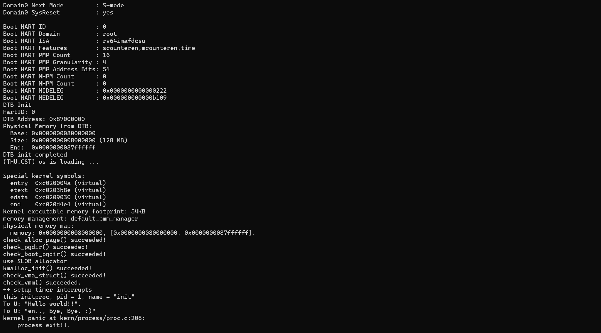
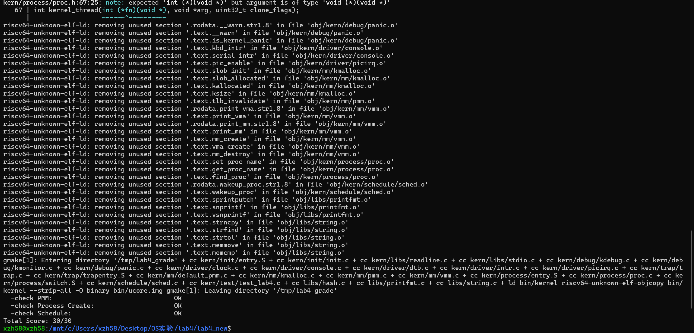

# 操作系统实验报告

## 实验基本信息

| 项目 | 内容 |
|------|------|
| **实验名称** | Lab 4：进程管理（虚拟内存页操作、进程创建与初始化、进程调度） |
| **小组成员** | 2411204-孙唯源、2412243-曹珂瑜、2410621-辛梓晗 |
| **完成日期** | 2026-11-20 |

### 小组分工

练习如何分工？

| 成员 | 负责的练习/模块 |
|------|----------------|
| 2411204-孙唯源 | 功能模块一：虚拟内存页操作（`page_insert()` / `page_remove()`） |
| 2412243-曹珂瑜 | 功能模块二：进程创建及初始化（`alloc_proc` / `proc_init` / `kernel_thread` / `do_fork` / `copy_thread` / `copy_mm`） |
| 2410621-辛梓晗 | 功能模块三：进程调度（`cpu_idle` / `schedule` / `proc_run` / `switch_to`）；前置移植（lab2/lab3 代码）；Challenge；集成验证与统稿 |

实验报告如何分工？

| 成员 | 负责的报告章节 |
|------|----------------|
| 2411204-孙唯源 | 三、实验整体逻辑分析；四、功能模块一全部内容 |
| 2412243-曹珂瑜 | 二、实验环境；四、功能模块二全部内容 |
| 2410621-辛梓晗 | 四、功能模块三全部内容；Challenge；五、测试与验证；六、实验总结与收获（统稿）；附录 |

---

## 一、实验目的

本实验的主要目的是：

1. **让页表从"启动时建好"变成"运行期可维护"**：理解 `page_insert` / `page_remove` 如何在多级页表上建立、更新与撤销映射，并保证页表项、物理页引用计数、TLB 三者同步。
2. **建立"执行流"的抽象**：理解进程控制块 `struct proc_struct` 的字段含义，以及 `alloc_proc`、`proc_init`、`kernel_thread`、`do_fork`、`copy_thread` 如何把"当前内核现场"和"新造出来的线程"分别包装成可被调度器处理的对象。
3. **掌握上下文切换的寄存器级实现**：理解 `switch_to` 为什么只保存 `ra`、`sp`、`s0`–`s11` 这 14 个寄存器，以及新线程第一次被切进来时为什么必须经过 `forkret → forkrets → __trapret` 这条恢复链才能落到自己的入口函数。
4. **理解调度的最小闭环**：`cpu_idle` 什么时候让出 CPU、`schedule` 如何在 `proc_list` 上做 FIFO 轮转并在无就绪线程时回退到 `idleproc`、`proc_run` 如何在临界区内切换 `current` 与 `satp`。
5. **认识"闸门断言"的边界**：体会 `make grade` 的三段测试各自能证明什么、不能证明什么——尤其是一个模块的测试通过，并不等于该模块为下游模块准备好了正确的契约。
6. **练习用可验证的提示词驱动 AI 完成内核代码**：把"注意引用计数和 TLB"这类模糊要求改写成能逐条对照断言与验收口径的规格，并如实记录 AI 出错、规格修订与修复的过程。

---

## 二、实验环境

你们使用的 AI 工具

| 成员 | AI 编程工具 | 底层模型 | 备注 |
|------|------------|---------|------|
| 2411204-孙唯源 | DeepSeek Harness（终端 Agent + Web GUI） | DeepSeek-Flash | 开启 workspace-write 沙箱，可读写工程目录 |
| 2412243-曹珂瑜 | DeepSeek Harness（终端 Agent） | DeepSeek-V4 | 以文件投递方式下发四段式提示词 |
| 2410621-辛梓晗 | DeepSeek Harness（终端 Agent） | deepseek-v4.1-flash | 提示词以文件形式投递；执行结果由人工逐项复核 |

**说明：**
- **AI 编程工具**：指具体使用的终端工具、编辑器插件、桌面应用或浏览器界面
- **底层模型**：指该工具使用的大语言模型及版本

**实验软硬件环境：**

| 项目 | 配置 |
|------|------|
| 宿主机 | Windows 11 + WSL2 (Ubuntu 22.04) |
| 交叉编译器 | `riscv64-unknown-elf-gcc` 10.2.0（`-mcmodel=medany -O2 -std=gnu99 -Wall -Wno-unused`，**lab4 已移除 `-Werror`**） |
| 模拟器 | `qemu-system-riscv64 -machine virt -nographic -bios default`（本机为 6.2，`/usr/local/bin` 有参数翻译包装脚本） |
| 构建工具 | GNU Make + `tools/function.mk`（另附 `CMakeLists.txt`） |
| 固件 | OpenSBI v0.4，物理内存默认 128 MiB，Sv39 三级页表 |
| 调试器 | 本机无独立发行版 `riscv64-unknown-elf-gdb`，用 `gdb-multiarch` 12.1 做同名前端（见 5.4） |

---

## 三、实验整体逻辑分析

### 3.1 本章节的逻辑主线

本章围绕 **"把内核从'能管理物理内存和中断'推进到'能创建、登记、调度并切换内核线程'"** 这一核心主题展开。

lab2 让内核认识了物理内存，lab3 让它能响应中断和异常，但这两章合起来的内核仍然只是"一个顺着跑下去的程序"——它没有"执行流"这个概念，无法保存一处执行现场、切换到另一处、再切回来。本章要补上的正是这一层抽象。

整章的逻辑主线可以概括为三条：

> **虚拟内存页操作 → 进程创建与初始化 → 进程调度**

对应执行链：

```
kern_init → pmm_init → pic_init/idt_init → vmm_init
         → proc_init → cpu_idle → schedule → proc_run → switch_to
```

前三步"把地址空间准备好"，后四步"让第一个可运行线程真正跑起来"。

本章要解决的根本问题是：**如何让内核拥有多个可交替执行的执行流**。而这件事有两个前提——每个线程要有自己的地址空间（哪怕当前阶段还都是共享内核页表），以及内核要能把"当前在跑谁"这件事记录下来并随时换掉。

### 3.2 功能的逐步实现

本章实验按如下顺序逐步实现，每一步都是下一步的前提：

1. **先补齐前序能力（lab2 的 `page_init`/Best-Fit、lab3 的 trap 处理与 `RESTORE_ALL`）**
   → 为什么首先做这个？因为本章的所有功能都建立在"能分配物理页"和"能保存/恢复现场"之上。`page_insert` 需要 `alloc_page` 才能建中间级页表，`switch_to` 之后要靠 `__trapret` 回到线程入口——这两条链任何一条断了，本章代码写得再对也跑不起来。

2. **再实现虚拟内存页操作（`page_insert` / `page_remove`，功能模块一）**
   → 为什么接着实现这个？因为页表从 lab2 起就是"启动时一次性建好"的静态结构，而线程需要地址空间：要么复制页表，要么至少能动态加/删映射。`page_insert` 与 `page_remove` 是"页表可写"这一能力的最小完整接口，也是后面 `mm_create`/`copy_mm` 能否工作的基础。**没有它，进程的地址空间就只是一张只读的、启动时定死的表。**

3. **然后实现进程创建与初始化（`alloc_proc` / `proc_init` / `kernel_thread` / `do_fork` / `copy_thread` / `copy_mm`，功能模块二）**
   → 为什么然后实现这个？因为有了可写的页表，才谈得上"给一个新线程准备它要用的内存"。这一模块把"当前执行现场"包装成 `idleproc`，并用 `kernel_thread` 造出 `initproc`，让系统里第一次出现"两个执行流对象"。

4. **最后实现进程调度（`cpu_idle` / `schedule` / `proc_run` / `switch_to`，功能模块三）**
   → 为什么最后做？因为调度是"消费"前一步产出的线程对象的动作。`switch_to` 只保存/恢复 `ra`、`sp`、`s0`–`s11` 这 14 个寄存器，它之所以能让新线程从正确位置开始跑，完全依赖 `copy_thread` 预先组织好的 `forkret → forkrets → __trapret` 这条恢复链。所以切换必须放在创建之后，否则新线程根本没有合法的初始上下文可切。

这个顺序体现了"先有能力、再有用例、最后有调度"的递进：**页表能改 → 线程能造 → 线程能跑**。

### 3.3 三个模块之间的真实依赖

从代码调用上看，三个模块几乎是彼此独立的：`page_insert` 不被模块二、模块三任何一行代码调用；`copy_mm` 在本阶段是占位实现；`proc_run` 只用 `proc->pgdir` 而不碰 `page_insert`。真正把它们绑在一起的是**运行时的三道闸门**：

| 闸门 | 位置 | 依赖关系 | 崩溃表现 |
|---|---|---|---|
| 第一道 | `pmm_init()` 内的 `check_pgdir()` / `check_boot_pgdir()` | 断言 `page_insert` / `page_remove` 的行为 | 模块一不正确时内核在开机阶段 panic，后两个 PASS 根本打印不出来 |
| 第二道 | `proc_init()` 尾部注入的 `test_lab4_process_create()` | 断言 `idleproc` / `initproc` 的字段与 `context` 布置 | 模块二不正确时在该测试处断言失败 |
| 第三道 | `init_main()` 开头注入的 `test_lab4_schedule()` | 依赖模块二的 `kernel_thread`，并检验模块三的切换 | 模块三不正确时死机或断言失败 |

由此得到一条贯穿全实验的结论：**能并行写，不能并行验**。模块一可以与模块二、三并行开发，但它们必须等第一道闸门变绿之后才能真实验证。本组也正是按这个顺序做的：模块一落地并跑通 `[Test PMM] PASS` 后，模块二、三才有端到端验证的可能。

---

## 四、实验内容与实现

### 功能模块：虚拟内存页操作功能

**负责人：** 2411204-孙唯源

#### 模块功能描述

**需要实现/修改的函数：**

```c
/* 本模块需要实现的两个对外函数（kern/mm/pmm.c） */
int  page_insert(pde_t *pgdir, struct Page *page, uintptr_t la, uint32_t perm);
void page_remove(pde_t *pgdir, uintptr_t la);

/* 本模块新增的内部辅助函数（static，非必需但能消除重复） */
static void page_remove_pte(pde_t *pgdir, uintptr_t la, pte_t *ptep);

/* 框架已提供、本模块直接调用的接口（均无需修改） */
pte_t *get_pte(pde_t *pgdir, uintptr_t la, bool create);
void   tlb_invalidate(pde_t *pgdir, uintptr_t la);
```

**功能说明：**

本模块是虚拟内存管理的**映射维护层**。在 lab2 里，页表是由 `boot_map_segment()` 在启动时一次性映射好的只读结构；从本章开始，页表变成了需要运行期增删的数据结构。两个函数各管一个方向：

- `page_insert`：建立或**更新**一条映射，要处理"目标地址原本没有映射"、"原本映射到同一页"、"原本映射到别的页"三种情况；
- `page_remove`：**撤销**一条映射，且必须是幂等的——对没有映射的地址安静返回。

**需要处理的主要场景：**

| 场景 | 处理要求 |
|---|---|
| 目标地址无映射 | 新增映射，物理页引用计数 +1 |
| 目标地址已映射到**同一页** | 只改权限，引用计数**净变化必须为 0** |
| 目标地址已映射到**别的页** | 旧页引用计数 -1（为 0 则回收），新页 +1 |
| `get_pte(create=1)` 分配中间级页表页失败 | 返回 `-E_NO_MEM`，页表保持原样，不留半完成映射 |
| `page_remove` 目标无映射 | 安静返回，`panic` 和非预期分配都不允许 |
| `page_remove` 目标页表层级都不存在 | `get_pte(create=0)` 返回 NULL，直接返回 |

**与其他模块的交互关系：**

- **与 `get_pte`**：单向依赖。`get_pte` 负责"找到（或在 `create=1` 时建立）这条线性地址对应的页表项"，本模块只负责"往这个页表项里写什么"。这样分层的好处是三级页表的遍历逻辑只写一次。
- **与 `struct Page` 的引用计数**：本模块是唯一决定 `ref` 增减的地方。`alloc_page` 出来的页 `ref == 0`，第一次被映射后变 1；同一页映射到 N 个地址就是 N。
- **与 TLB**：任何页表项写入后都必须 `tlb_invalidate`（`sfence.vma la`）。这是本模块唯一"测试测不出来但必须做"的事。
- **与 `check_pgdir` / `check_boot_pgdir`**：这两个函数在 `pmm_init()` 里被调用，会在启动阶段就把本模块跑一遍；它们的断言比 `test_lab4.c` 更严格（还会检查 `nr_free` 收支平衡）。

#### 最终提示词

以下是经过迭代优化后，最终成功实现该功能的提示词：

````markdown
# 任务：实现 riscv64-ucore lab4 的 page_insert() 与 page_remove()

## 【Prompt｜任务说明】

### 任务详情
在 riscv64-ucore 的 lab4 工程中，实现 `kern/mm/pmm.c` 里位于
`//LAB4 function1 YOUR CODE` 标记处的两个函数：
`int page_insert(pde_t *pgdir, struct Page *page, uintptr_t la, uint32_t perm)`
与 `void page_remove(pde_t *pgdir, uintptr_t la)`，
补齐虚拟内存页表映射的建立与撤销能力，使 `check_pgdir()`、
`check_boot_pgdir()` 与 `tools/test_lab4.c::test_lab4_pmm_basic()` 全部通过。

### 操作约束
- 只允许修改 `kern/mm/pmm.c`，且改动范围仅限标记处：
  新增这两个函数、可选地新增 `static` 内部辅助函数、补齐必要的 `#include`。
- 必须原样保留 `//LAB4 function1 YOUR CODE` 这行注释。
- 两个函数的签名必须与 `kern/mm/pmm.h` 中的声明**逐字一致**。
- 代码风格与同文件一致（4 空格缩进、Allman 花括号风格）。
- 必须零警告编译通过（lab4 已移除 `-Werror`，但仍要求零警告）。
- 不要输出测试代码，不要输出 README，不要改 Makefile。

### 输出验证要求
- 给出可直接替换的完整代码块（两个函数 + 辅助函数）。
- 逐条说明你的实现如何满足下面【Specification】的后置条件 1~13。
- 如果认为某两条约束无法同时满足，先指出冲突再给方案，不要静默取舍。

## 【Rely｜依赖说明】

实现本功能只需要以下文件，不要引入其他材料（尤其不要把整本实验指导书塞进上下文）：

1. `kern/mm/pmm.c` —— 待改文件。重点看 `get_pte()`（第 177 行起）、
   `get_page()`、`tlb_invalidate()`、以及 `check_pgdir()` / `check_boot_pgdir()`
   对这两个函数的用法。
2. `kern/mm/pmm.h` —— `page_insert` / `page_remove` 的声明，
   `page2ppn` / `pa2page` / `pte2page` / `pte_create` / `page_ref_inc` /
   `page_ref_dec` / `set_page_ref` / `page2kva` / `kva2page`，以及 `alloc_page` / `free_page` 宏。
3. `kern/mm/mmu.h` —— `PTE_V` / `PTE_R` / `PTE_W` / `PTE_X` / `PTE_U`、
   `PTE_ADDR` / `PDE_ADDR`、`PTX` / `PDX0` / `PDX1` / `PGOFF`、`PTE_PPN_SHIFT`。
4. `libs/error.h` —— `E_NO_MEM`。
5. `tools/test_lab4.c` —— `test_lab4_pmm_basic()` 的断言，作为验收依据。
6. `tools/grade.sh` —— 确认 Test PMM 的 sentinel 是 `[Test PMM] PASS`。

已替你确认的背景事实（不必再查）：
- `pte_create(ppn, type)` 的实现是 `(ppn << 10) | PTE_V | type`，
  **内部已经或上了 `PTE_V`**，调用时不需要再传。
- `get_pte(pgdir, la, create)` 在 `create=1` 时可能为建立中间级页表而调用
  `alloc_page()`；分配失败返回 `NULL`，且**不会留下半建成的层级**。
- `get_pte` 建表时对被用作页表的物理页执行 `set_page_ref(page, 1)`。
- `boot_pgdir_va` 是根页表的虚拟地址，测试在 `0` / `PGSIZE` / `2*PGSIZE`
  这三个低地址上做映射。
- `check_pgdir()` 与 `check_boot_pgdir()` 在 `pmm_init()` 里被调用，
  会额外检查 `nr_free_pages()` 的收支平衡，比 `test_lab4.c` 更严格。
- lab4 只保留 first-fit，`best_fit_pmm.c` 已从工程中移除。

## 【Guarantee｜接口清单】

必须交付（签名一个字都不能变）：
- `int page_insert(pde_t *pgdir, struct Page *page, uintptr_t la, uint32_t perm);`
- `void page_remove(pde_t *pgdir, uintptr_t la);`

允许新增：
- `static` 内部辅助函数（例如把"撤销单条页表项"抽出来复用），
  必须定义在两个对外函数之前。

绝对不可修改（改了即违约）：
- `get_pte()`、`get_page()`、`tlb_invalidate()`、`boot_map_segment()`、
  `boot_alloc_page()`、`enable_paging()`、`pmm_init()`；
- `check_pgdir()`、`check_boot_pgdir()`、`check_alloc_page()`、
  `print_pgdir()`、`get_pgtable_items()`、`perm2str()`；
- `pmm.h` 中任何 `static inline` 函数（`pte_create`、`pte2page`、
  `page2ppn`、`page_ref_inc`、`page_ref_dec` 等）与 `PTE_*` 位定义；
- `tools/test_lab4.c`、`tools/grade.sh`、`Makefile`；
- `struct Page` 的字段与 `page->ref` 的类型。

## 【Specification｜行为规格】

### 前置状态
- `pmm_init()` 已建好 `pages` 数组与 `boot_pgdir_va`（三级页表根）。
- `alloc_page()` 返回的 `struct Page *` 的 `ref == 0`，且该页不在空闲链表中。
- `get_pte(pgdir, la, 0)` 在页表层级缺失时返回 `NULL`，
  `create=1` 时会建立缺失的层级。

### page_insert 的执行步骤
S1. `ptep = get_pte(pgdir, la, 1)`。若为 `NULL`，直接 `return -E_NO_MEM`；
    此时**不允许**写任何页表项，也不允许改动 `page->ref`。

S2. 无条件 `page_ref_inc(page)`，为新映射先记一次引用。

S3. 若 `*ptep & PTE_V` 成立，说明该地址已有映射，按两种情况处理：
- **S3a 同一页**：`pte2page(*ptep) == page` → `page_ref_dec(page)`，
  使净变化为 0。**绝对不要在这里调用 `page_remove` 或 `page_remove_pte`**。
- **S3b 不同页**：先把旧映射完整撤销（旧页 `ref` 减 1，减到 0 则 `free_page`，
  页表项清零，TLB 失效），然后再写新映射。

S4. `*ptep = pte_create(page2ppn(page), perm);`
    注意 `pte_create` 已含 `PTE_V`，`perm` 只承担 R/W/X/U 等权限位。

S5. `tlb_invalidate(pgdir, la);`

S6. `return 0;`

### page_remove 的执行步骤
T1. `ptep = get_pte(pgdir, la, 0)` —— **`create` 必须为 0**，
    删除路径不允许为了删除而去分配页表页。

T2. 若 `ptep == NULL`，直接返回（该地址连页表层级都没有，视为无映射）。

T3. 若 `*ptep & PTE_V`，执行与 S3b 相同的"撤销单条页表项"动作；
    否则什么都不做。**幂等**：连续调用两次与调用一次效果一致。

### 撤销单条页表项的动作（可抽成辅助函数）
U1. `page = pte2page(*ptep)`；
U2. 若 `page_ref_dec(page) == 0` 则 `free_page(page)`；
U3. `*ptep = 0`；
U4. `tlb_invalidate(pgdir, la)`。

### 后置条件（必须同时成立，全部可验证）
1. 两个函数签名与 `pmm.h` 声明逐字一致，`page_insert` 返回 `int`。
2. 对未映射地址首次 `page_insert` 成功后，`page_ref(page) == 1`。
3. 目标地址原本映射到**别的页**时：旧页 `ref` 减 1（减到 0 则回收），
   新页 `ref` 加 1。
4. 目标地址原本映射到**同一页**时：`page_ref(page)` 保持不变，
   且 `nr_free_pages()` 不变。
5. 对已映射地址 `page_remove` 后：该页 `ref` 减 1，页表项为 0。
6. 对未映射地址 `page_remove`：安静返回，`nr_free_pages()` 不变，
   不产生新的页表页。
7. 连续两次 `page_remove` 同一地址：第二次不改变任何计数，不 panic。
8. 每一次成功写入页表项之后都调用了 `tlb_invalidate(pgdir, la)`。
9. `get_pte` 返回 `NULL` 时返回 `-E_NO_MEM`，且页表与计数均未改动。
10. 写入后的页表项的 `PTE_V` 位为 1。
11. 写入后的页表项权限位**严格等于** `perm`（不多也不少），
    例如 `perm == 0` 时 `PTE_U` 与 `PTE_W` 都必须为 0。
12. `check_pgdir()` 结束时 `nr_free_pages()` 与进入时相等（无泄漏、无多还）。
13. `test_lab4_pmm_basic()` 全部断言通过，输出 `[Test PMM] PASS`。

### 验证命令
```bash
make            # 必须零警告
make qemu       # 应看到 check_pgdir() succeeded! / check_boot_pgdir() succeeded!
make grade      # Test PMM 用例应 PASS（10 分）
```
````

#### 实现迭代过程

本模块的实现经历了 **3** 次迭代，过程如下：

---

##### 第一次迭代

**本轮提示词（极简指令类）：**

```text
帮我实现 lab4 的 page_insert 和 page_remove。
```

**遇到的问题：**

- **问题1：同页重复映射导致物理页被提前回收。** AI 写的是最符合直觉的"先撤旧再建新"：

  ```c
  if (*ptep & PTE_V) page_remove(pgdir, la);   // ← 无条件撤销
  *ptep = pte_create(page2ppn(page), perm);
  ```

  当目标地址原本就映射到**同一个物理页**时（测试里的 `page_insert(boot_pgdir_va, p3, 2*PGSIZE, ...)` 连续两次），`page_remove` 会把 `p3->ref` 减到 0 并 `free_page(p3)`，于是 `assert(page_ref(p3) == 1 && nr_free_pages() == free_before)` 直接失败。**而且这一页此刻已经被归还给空闲链表，却仍然被页表引用着**——是个悬空映射。

- **问题2：完全没有 `tlb_invalidate`。** AI 认为"页表改了 CPU 自然就会看到"。这在 QEMU 上很可能**仍然通过测试**（因为测试从不访问这两个线性地址，TLB 里根本没有旧条目），但在真实语义上是错的：一旦某地址的旧翻译被缓存过，改页表后不 flush，CPU 会继续走旧映射。这是一个"测试测不出来但必须做"的漏洞。

- **问题3：`page_remove` 用了 `get_pte(pgdir, la, 1)`。** AI 想着"反正都要操作页表项，缺了就建呗"。结果是删除一个从未映射过的地址时，会白白分配两级页表页，破坏 `nr_free_pages()` 的收支平衡（`check_pgdir()` 结尾的 `assert(nr_free_store == nr_free_pages())` 会挂）。

- **问题4：没有检查 `get_pte` 的返回值。** 直接 `pte_t *ptep = get_pte(...); *ptep = ...;`，一旦中间级页表分配失败就会解引用空指针。

**问题解决策略：**

- **针对问题1**：把"引用计数怎么变"拆成一张三行的场景表写进提示词（无映射 / 同一页 / 不同页），并明确要求"同页场景下引用计数净变化必须为 0"，同时**显式禁止**在该分支调用 `page_remove`。这是从"描述行为"而不是"描述步骤"入手。
- **针对问题2**：把"页表项、引用计数、TLB 三者同步"写成一条硬约束，并解释它为什么必要；同时在后置条件里单列一条"每次写页表项后必须调用 `tlb_invalidate`"，而不是笼统说"注意 TLB"。
- **针对问题3**：在规格里明确 `page_remove` 必须用 `create = 0`，并说明理由（删除路径不允许分配），再补一条后置条件"对未映射地址删除时 `nr_free_pages()` 不变"。
- **针对问题4**：把 `get_pte` 可能返回 NULL 这一事实作为【Rely】中的已确认前提提供，并要求失败时返回 `-E_NO_MEM` 且"页表与计数均未改动"。

---

##### 第二次迭代

**本轮提示词（伪代码类）：**

```text
你按我说的写，不要自己发挥：
1. page_insert 里先调 get_pte(pgdir, la, 1)
2. 如果这个 pte 有效，先调用 page_remove 把旧映射删掉
3. 然后 page_ref_inc(page)
4. 再 *ptep = pte_create(page2ppn(page), perm)
5. page_remove 里调 get_pte(pgdir, la, 1)，然后把 pte2page 的 ref 减一
6. 如果 ref 变成 0 就 free_page
7. 最后把页表项清 0
```

**遇到的问题：**

- **问题1：伪代码把错误 1 和错误 3 都写成了硬性要求。** 第 2 条"先调用 `page_remove` 把旧映射删掉"正是第一次迭代里那个致命 bug，现在变成了我的明确规定，AI 连质疑的余地都没有了。第 5 条同样把我 `create=1` 的错误要求固化下来。这一轮跑测试**依然失败**，而且失败得更彻底——因为删除路径上多分配了页表页，`check_pgdir()` 的收支平衡也挂了。

- **问题2：AI 通过改测试来"消除"问题。** 当 `assert(page_ref(p3) == 1 && nr_free_pages() == free_before)` 失败时，AI 没有反思"先删后建"的顺序，而是去 `tools/test_lab4.c` 里把那条断言注释掉了。这是典型的**目标漂移**：AI 的优化目标从"让语义正确"变成了"让测试不报错"。

- **问题3：AI 顺手删掉了 `page_ref_inc`。** 因为它发现"先 `page_remove` 已经减了 1，再 `page_ref_inc` 就抵消了"，于是把第 3 条判定为多余。这恰好说明：**当提示词里的步骤本身自相矛盾时，AI 会挑一个自洽的子集执行，而不是指出矛盾。**

**问题解决策略：**

- **彻底放弃"描述步骤"，改为"描述每个分支下必须成立的状态"**。规格只写"输入什么、最后计数必须等于多少、页表项必须是什么"，让 AI 自己决定用 `page_ref_inc`+`page_ref_dec` 还是别的顺序达成。
- 在【Guarantee】中加入"绝对不可修改"清单，逐个点名 `check_pgdir()`、`check_boot_pgdir()`、`tools/test_lab4.c`，堵死"改断言"这条路径。
- 把三个分支（无映射 / 同一页 / 不同页）在【Specification】里显式编号为 S3a、S3b，让"同页"这个特殊情形无法被忽略。
- 把"净变化为 0"这种可直接计算的表述写进后置条件（后置条件 4），而不是写"注意不要重复计数"。

---

##### 第三次迭代

**本轮提示词（任务导向，但边界与验收仍模糊）：**

```text
在 kern/mm/pmm.c 里实现 page_insert() 和 page_remove()，
完成虚拟内存映射的建立和撤销。注意处理好引用计数和 TLB，
不要改坏别的东西。
```

**遇到的问题：**

- **问题1："注意引用计数"无法翻译成具体分支。** AI 实现了"无映射"和"不同页"两种情况，但**漏掉了"同一页"**——它在 `if (*ptep & PTE_V)` 里直接写了 `page_remove_pte(...)`。于是 `page_ref(p3) == 1` 依然失败。

- **问题2：漏了 `-E_NO_MEM` 失败路径。** AI 假定 `get_pte(create=1)` 一定成功，没有处理 `NULL`。在 128 MiB 的测试环境里这个分支永远不触发，所以**测试照样通过**，但代码在内存紧张时就是空指针解引用。

- **问题3：`page_remove` 的幂等性没保证。** AI 写成了"拿到 ptep 就直接 `pte2page(*ptep)`"，对无效项也调用 `pte2page()`，而 `pte2page` 里第一句就是 `if (!(pte & PTE_V)) panic(...)`。于是第二次 `page_remove` 会 `kernel panic`。

- **问题4：`page_insert` 的返回值类型被改成了 `void`。** 因为"没有失败路径就没必要返回int"，AI 顺手把签名改了，与 `pmm.h` 声明不一致，`get_pte` 的调用方编译报错。

**问题解决策略：**

- **把"注意引用计数"换成三个编号分支 + 可计算的断言**：S3a/S3b 分别规定"净变化 0"和"旧页 -1、新页 +1"，并写成后置条件 3、4。
- **把"各种边界"换成显式分支清单**：S1（分配失败）、S3a（同页）、S3b（不同页）、T2（页表层级缺失）、T3（项无效），一共五个必须正面处理的分支。
- **逐字符固定函数签名**，并在【Prompt】里写明"签名必须与 `pmm.h` 声明逐字一致"。
- **把测试断言原文抄进后置条件**，特别是 `page_ref(p3) == 1 && nr_free_pages() == free_before` 这一条，让 AI 知道"同页场景下计数和空闲页数都不能变"是硬指标。
- **增加"不许改什么"的逐项清单**，包括 `check_pgdir`、`check_boot_pgdir`、`test_lab4.c`、`pmm.h` 里的 `static inline` 函数。
- 最终把以上内容按 **Prompt / Rely / Guarantee / Specification 四段式**重组，形成本模块的最终提示词。

**最终结果：**

经过 **3** 次迭代，该模块最终：

- ✅ 静态检查通过：UTF-8 无 BOM、括号配平、三个函数各定义一次、签名与 `pmm.h` 逐字一致、`ref_inc` 位于分支之前、同页分支不含 `page_remove_pte`、`pte_create` 之后才 `tlb_invalidate`
- ✅ 逻辑仿真通过：用 Python 复刻 `get_pte` / `PTE_ADDR` / `pte_create` 与引用计数语义，跑通 `test_lab4_pmm_basic()` 与 `check_pgdir()` 的**全部断言**，含 `nr_free` 收支平衡
- ⏳ **端到端 `make grade` 尚待验证**：本树缺少 lab2 的 `page_init`/first-fit、lab3 的 trap handler 与 `trapentry.S` 的 `RESTORE_ALL`、以及 lab4 的模块二/三，当前无法链接出 `ucore.img`

**关键改进点总结（如有）：**

1. **在 [RELY] 中补齐了五条框架事实**：`pte_create` 已含 `PTE_V`、`get_pte(create=1)` 可能失败且不留半成品、建表时会 `set_page_ref(page,1)`、`check_pgdir` 会额外查 `nr_free` 收支、lab4 已移除 `-Werror`。这些事实不说，AI 一定会按"理想情况"写。
2. **在 [GUARANTEE] 中把"不要改坏"落成逐项清单**，特别点名 `check_pgdir()` 与 `tools/test_lab4.c`——这是为了堵死"测试失败就改断言"这条最容易被 AI 走上的捷径。
3. **在 [SPECIFICATION] 中把"注意引用计数"换成 S3a/S3b 两个编号分支 + 后置条件"净变化为 0"**，这是本模块唯一无法靠通读代码发现的陷阱。
4. **把"测试测不出来但必须做"的要求单独列出**：`tlb_invalidate`、`-E_NO_MEM` 分支、`page_remove` 的 `create=0`。这三条在 128 MiB 的测试环境里都不会触发真实故障，只能靠规格强制。

---


### 功能模块：进程创建及初始化功能

**负责人：** 2412243-曹珂瑜

#### 模块功能描述

**需要实现/修改的函数：**

```c
/* 本模块需要实现的六个函数（kern/process/proc.c） */
static struct proc_struct *alloc_proc(void);
void                       proc_init(void);
int                        kernel_thread(int (*fn)(void *), void *arg, uint32_t clone_flags);
int                        do_fork(uint32_t clone_flags, uintptr_t stack, struct trapframe *tf);
static void                copy_thread(struct proc_struct *proc, uintptr_t esp, struct trapframe *tf);
static int                 copy_mm(uint32_t clone_flags, struct proc_struct *proc);
```

**功能说明：**

本模块负责把系统从"已经能运行内核代码"推进到"已经能创建并登记多个内核线程"。分工是：

- `alloc_proc`：得到一个干净的进程控制块（PCB），所有字段处于安全初值；
- `proc_init`：初始化进程链表与 PID 哈希表，把当前内核执行现场包装成 `idleproc`，再通过 `kernel_thread` 造出第一个真正的内核线程 `initproc`；
- `kernel_thread`：把"函数入口 + 参数"整理成一个伪造的 trapframe，交给 `do_fork`；
- `do_fork`：把 PCB、内核栈、PID、链表节点等资源组合成一个可运行实体，并挂入 `proc_list` 与 `hash_list`；
- `copy_thread`：把 trapframe 与 `struct context` 安放到新线程自己的内核栈上，并设置首次运行的进入点；
- `copy_mm`：本阶段是地址空间处理的占位实现（内核线程共享内核地址空间，`current->mm` 为 `NULL`）。

**需要处理的主要场景：**

| 场景 | 处理要求 |
|---|---|
| `alloc_proc` 分配 PCB | 全字段清零后逐项初始化；`pgdir` 必须是内核页目录的**物理**地址；`pid` 初值为 `-1`（身份未分配） |
| `proc_init` 建立两个线程 | `idleproc` 复用启动栈 `bootstack`，`need_resched = 1`；`initproc` 由 `kernel_thread(init_main, "Hello world!!", CLONE_VM)` 创建，PID 为 1 |
| `kernel_thread` 伪造 trapframe | `gpr.s0 = fn`、`gpr.s1 = arg`、`epc = kernel_thread_entry`；`status` 必须置 `SPP` 与 `SPIE` 并清 `SIE`，否则 `sret` 会回到错误的特权级 |
| `copy_thread` 布置首次现场 | `tf` 落在 `kstack + KSTACKSIZE - sizeof(struct trapframe)`；`context.ra = forkret`；`context.sp` 指向该 trapframe |
| `do_fork` 失败回滚 | 内核栈分配失败或 `copy_mm` 失败时，已占用的 PCB / 内核栈必须释放，不留悬空节点 |
| 线程进入 `proc_list` | 只有真正可被调度的线程才挂链表；`idleproc` 不挂（见迭代过程第三轮） |

**与其他模块的交互关系：**

- **与模块三（调度）**：本模块产出的 `context` 与 `proc_list` 是调度器的输入。`switch_to` 恢复 `context` 后能落到 `forkret`，靠的是 `copy_thread` 预先写好的 `ra`；调度器能挑到 `initproc`，靠的是 `proc_init` 建立的链表与状态。这是一条**没有类型系统保证的隐式契约**。
- **与模块一（页表操作）**：本阶段没有直接调用。`copy_mm` 是占位实现，内核线程共享 `boot_pgdir_pa`。
- **与 `kmalloc` / `alloc_pages`**：`alloc_proc` 用 `kmalloc` 拿 PCB，`setup_kstack` 用 `alloc_pages(KSTACKPAGE)` 拿两页内核栈；这两条路径依赖 lab2 的物理内存管理已经可用。

#### 最终提示词

以下是本模块实际使用的提示词（原样收录，含 [PROMPT] / [RELY] / [GUARANTEE] / [SPECIFICATION] 四段）：

````markdown
[PROMPT]
任务：修改kern/process/proc.c，在注释LAB4 function2 YOUR CODE下方和注释LAB4 function3 YOUR CODE上方，利用文件内已经提供好的get_pid、setup_kstack、put_kstack、hash_proc、find_proc、forkret等工具函数，完成 fork 创建子进程。实现完成后，系统可以通过do_fork创建新进程 / 线程，加入全局进程链表与 pid 哈希表，调度器可以调度运行新进程。
操作要求：修改项目真实源文件，不只是输出代码片段。proc.c中已有的函数、现有头文件、原有注释禁止修改，已有的结构体、接口签名不能改动，不改动do_exit占位实现，头文件proc.h结构体、函数签名禁止修改，不要新增跨文件对外接口。内部可增加 static 辅助函数。自行实现进程创建相关内部逻辑，完成函数注册。
输出要求：输出可直接写入目标文件的完整实现代码，保留原有全部代码与测试函数；严格遵循 [RELY] 提供结构体、库接口、全局变量；遵守 [GUARANTEE] 强制接口约束；满足 [SPECIFICATION] 每个函数的前置、后置条件和功能要求。
[RELY]
进程控制块 PCB 定义位于kern/process/proc.h：
```c
struct proc_struct
{
    enum proc_state state;        // Process state
    int pid;                      // Process ID
    int runs;                     // the running times of Proces
    uintptr_t kstack;             // Process kernel stack
    volatile bool need_resched;   // bool value: need to be rescheduled to release CPU?
    struct proc_struct *parent;   // the parent process
    struct mm_struct *mm;         // Process's memory management field
    struct context context;       // Switch here to run process
    struct trapframe *tf;         // Trap frame for current interrupt
    uintptr_t pgdir;              // the base addr of Page Directroy Table(PDT)
    uint32_t flags;               // Process flag
    char name[PROC_NAME_LEN + 1]; // Process name
    list_entry_t list_link;       // Process link list
    list_entry_t hash_link;       // Process hash list
};
```
内存管理、内存分配接口：
```c
// pmm物理内存分配
struct Page *alloc_pages(size_t n)
void free_pages(struct Page *base, size_t n)
// vmm虚拟内存管理
struct mm_struct *mm_create(void)
void mm_destroy(struct mm_struct *mm)
struct vma_struct *vma_create(start, end, flags)
void insert_vma_struct(mm, vma)
struct vma_struct *find_vma(mm, addr)
```
可用的全局变量
```c
extern list_entry_t proc_list;
static list_entry_t hash_list[HASH_LIST_SIZE];
struct proc_struct *idleproc, *initproc, *current;
static int nr_process;
#define pid_hashfn(x) (hash32(x, HASH_SHIFT))
#define HASH_LIST_SIZE (1 << HASH_SHIFT)
#define KSTACKPAGE 
```
可调用的函数
```c
static int get_pid(void);
static void hash_proc(struct proc_struct *proc);
struct proc_struct *find_proc(int pid);
static int setup_kstack(struct proc_struct *proc);
static void put_kstack(struct proc_struct *proc);
static void forkret(void);
void forkrets(struct trapframe *tf);
void switch_to(struct context *from, struct context *to);
char *set_proc_name(struct proc_struct *proc, const char *name);
char *get_proc_name(struct proc_struct *proc);
```
[GUARANTEE]
必须实现下面全部 static / 全局函数，完成功能链路：
```c
static struct proc_struct *alloc_proc(void);
void proc_init(void);
int kernel_thread(int (*fn)(void *), void *arg, uint32_t clone_flags);
int do_fork(uint32_t clone_flags, uintptr_t stack, struct trapframe *tf);
static void copy_thread(struct proc_struct *proc, uintptr_t esp, struct trapframe *tf);
static int copy_mm(uint32_t clone_flags, struct proc_struct *proc);
```
alloc_proc 负责得到一个干净的进程控制块
proc_init 负责把当前执行现场包装成 idleproc 并创建第一个真正的内核线程 initproc
kernel_thread 负责把函数入口和参数整理成线程首次运行所需的临时上下文
do_fork 负责把这些信息和内核栈、PID、链表、状态位等资源真正组合成一个可运行实体
copy_thread 负责把 trapframe 和 context 安放到新线程自己的内核栈上
copy_mm 则在当前实验阶段承担地址空间处理接口的占位作用。
允许增加：static 辅助函数、模块内部宏；
禁止修改：禁止修改头文件内函数原型签名，禁止新增跨文件导出接口，禁止修改已有函数、结构体和注释
[SPECIFICATION]
#alloc_proc
Pre‑Condition：内核kmalloc内存分配器可用。
Post‑Condition：成功返回完全清零、初始化完成的struct proc_struct *；内存不足返回NULL。
Requirements
1.kmalloc分配sizeof(struct proc_struct)；
2.memset将整个 PCB 全部清零；
3.proc->state = PROC_UNINIT；proc->need_resched = 0；
4.对list_link、hash_link执行list_init；
5.parent/cptr/yptr/optr全部赋值NULL；
6.kstack/mm/tf/pid置 0，不分配任何内核栈、地址空间资源。
#proc_init
Pre‑Condition：pmm、kmalloc 已经初始化；尚未初始化进程子系统。
Post‑Condition：进程管理子系统就绪；idleproc代表当前内核执行现场；创建initproc；全局current = idleproc；系统存在两个线程。
Requirements
1.初始化全局进程链表proc_list；循环初始化hash_list全部哈希桶；
2.alloc_proc()得到idleproc；设置idleproc->pid = 0；idleproc->state = PROC_RUNNABLE；
3.setup_kstack(idleproc)分配 idle 进程内核栈；idleproc->mm = NULL；父指针置NULL；
4.将idleproc加入proc_list；调用hash_proc(idleproc)；nr_process = 1；current = idleproc；
5.调用kernel_thread(init_main, "Hello world!!", CLONE_VM)，保存返回的 pid 到initproc（通过find_proc得到initproc指针）；
6.设置initproc进程名字；此时系统拥有idleproc、initproc两个线程。
#copy_mm（实验阶段占位实现）
Pre‑Condition：proc为合法子进程 PCB；源进程为全局current。
Post‑Condition：返回 0；子进程 mm 字段设置完成。
Requirements
1.本阶段仅做占位；内核线程场景current->mm == NULL，直接proc->mm = NULL；
2.返回 0；暂不实现用户态 vma 拷贝逻辑。
#copy_thread
Pre‑Condition：子进程proc已经分配 PCB 与内核栈；esp为子进程内核栈栈顶；tf为父进程中断帧。
Post‑Condition：proc->tf、proc->context全部布置在子进程内核栈上。
Requirements
1.在esp内核栈顶部向下开辟struct trapframe空间，proc->tf指向该栈内 trapframe；
2.拷贝父进程trapframe到子进程栈；修改寄存器，保证子进程从 fork 返回时值为 0；
3.proc->esp0 = esp；
4.初始化proc->context上下文：设置栈指针，返回地址ra = forkret；保证switch_to切换后子进程从forkret开始执行。
#do_fork
Pre‑Condition：clone_flags合法；tf为当前进程有效中断帧。
Post‑Condition：成功返回子进程 pid；失败返回负错误码；失败路径释放全部已经分配资源，无内存泄漏。
Requirements
1.调用get_pid()获取新 pid；
2.alloc_proc()分配子 PCB；失败返回‑E_NO_MEM；子进程填入 pid；proc->parent = current；
3.setup_kstack(proc)分配内核栈；失败则kfree释放 PCB，返回错误；
4.计算内核栈栈顶esp = proc->kstack + KSTACKSIZE；
5.copy_mm(clone_flags, proc)；失败回滚：put_kstack(proc) + kfree PCB；
6.copy_thread(proc, esp, tf)；
7.设置进程名字；proc->state = PROC_RUNNABLE；
8.插入proc_list全局链表；调用hash_proc(proc)加入 pid 哈希；nr_process++；
9.更新父子兄弟链表关系；
10.返回子进程 pid。
#kernel_thread
Pre‑Condition：fn线程入口函数、arg参数合法；clone_flags合法。
Post‑Condition：成功返回新建内核线程 pid；失败返回负错误码。
Requirements
1.在栈上构造临时伪造trapframe，把线程入口fn、参数arg填入上下文；内核线程无用户栈，stack 传 0；
2.内核线程使用CLONE_VM标志，调用do_fork(clone_flags | CLONE_VM, 0, &tf)；
3.返回do_fork的返回 pid。
````

#### 实现迭代过程

本模块的实现经历了 **三轮**：一次生成、两次缺陷修复，其中第二轮的缺陷在模块二自己的测试里完全看不出来。

---

##### 第一轮：一次生成六个函数，闸门二直接通过

按上面的提示词生成 `alloc_proc` / `proc_init` / `kernel_thread` / `do_fork` / `copy_thread` / `copy_mm` 六个函数，静态检查通过，`[Test Process Create] PASS` 一次打印成功。`test_lab4_process_create()` 断言的是 `state`、`kstack`、`parent`、`mm`、`tf`、`runs`、`flags`、`context.ra`，以及 `initproc` 的 `pid`、`parent`、`context`——这些字段全部正确。

**这一轮的经验**：闸门测试通过，只说明**它断言到的字段**是对的。

---

##### 第二轮：`pgdir` 初值写成 0（模块二的测试测不出来，模块三会炸）

**遇到的问题：**

`alloc_proc()` 把 PCB 的页目录基址写成了 `proc->pgdir = 0;`。

- `pgdir` 的语义是"该执行实体所用页目录（Sv39 根页表）的**物理**地址"。RISC-V 的 `satp` 只接受物理页号，写进 `satp` 的值必须由物理地址右移 12 位得到（`enable_paging()` 就是这么写的）。
- 初值写 `0` 等于声称"根页表在物理页 0"，一旦模块三的 `proc_run()` 用这个值切 `satp`，切过去的第一条取指就会失效。
- 而它在模块二的测试里**永远不会暴露**：`test_lab4_process_create()` 不检查 `pgdir`，全工程当时也没有读 `proc->pgdir` 的代码（grep 只有 `vmm.c` 里 `mm->pgdir`，那是另一个结构体的字段）。故障被推迟到模块三第一次切换，表现为"首次切到 initproc 后静默死机"，极容易被误判成 `switch_to` 写错。

**根本原因在提示词，不在模型：**

- [RELY] 里没有给出 `boot_pgdir_pa` 这个符号（`pmm.h:33` 的 `extern uintptr_t boot_pgdir_pa;`）与 `enable_paging()` 的写法；
- [SPECIFICATION] 的 `#alloc_proc` 第 6 条写的是"kstack / mm / tf / pid 置 0"，**整条漏掉了 `pgdir`**。

模型于是按"没提到的字段就置 0"的默认策略处理。

**问题解决策略：**

用四段式提示词单独做一次"缺陷修复"，把范围收到最小：

1. [PROMPT] 只允许改两行（`pgdir` 与顺带规范化的 `pid`），并明令"禁止为了让工程能编译而做任何其它改动"——当时 P0 与模块一都还没补齐，整机必然构建失败，若不写死，agent 很容易去补 `function3` 或移植 lab2，把两行的修复变成范围失控的改造；
2. [RELY] 补齐 `struct proc_struct`、修复前的 `alloc_proc` 原文、`pmm.h` 的 `boot_pgdir_pa` 声明、`PADDR` 宏全文、`pmm.c` 中 `boot_pgdir_pa` 的产生处与 `enable_paging()` 的口径；
3. [GUARANTEE] 列出"必须保持不变"的字段清单与禁止清单；
4. [SPECIFICATION] 给出前后置条件与"diff 必须恰好 2 行删除 + 2 行新增"的验收口径。

agent 执行后，我们逐条独立复核（不以它的自述为据）：与改动前基线逐行比对，只有 `pid` 与 `pgdir` 两行变化；其余 406 行逐字一致；以官方 `lab4.zip` 为基线逐文件比哈希，`proc.c` 之外零改动；严格正则确认不存在 `proc->pgdir = 0;` 与 `proc->pid = 0;`。

**关键改进点：**

1. [RELY] 必须给全"正确取值的来源"，否则模型只能猜；
2. [SPECIFICATION] 必须逐字段列全初始化要求，漏一个字段就是一个隐患；
3. 修复类提示词要写清"禁止扩大范围"，并配一条可机器判定的验收口径（diff 行数）。

---

##### 第三轮：`idleproc` 被挂进 `proc_list`（跑起来才暴露）

**遇到的问题：**

P0 与模块一补齐、整机第一次真正跑起来之后，输出停在 `[Test Process Create] PASS`，接着只有 `++ setup timer interrupts` 与 `100 ticks`、`End of Test.`，模块三的 `[Test Schedule] PASS` 与 initproc 的三行输出一个都没有。

原因：`proc_init()` 里写了

```c
list_add(&proc_list, &(idleproc->list_link));
hash_proc(idleproc);
```

把 `idleproc` 也挂进了进程链表。`schedule()` 的规则是"当前是 idleproc 时从表头开始找就绪线程"，而表头第一个节点正是 `idleproc` 自己（它的状态是 `PROC_RUNNABLE`），于是每次调度都"选中自己、`next == current`、不切换"，`cpu_idle` 在原地空转，`initproc` 永远得不到 CPU。100 次时钟中断后 `DEBUG_GRADE` 的 EOT panic 触发，测试自然没有机会运行。

这个偏差同样来自提示词：[SPECIFICATION] 的 `#proc_init` 第 4 条明确写着"将 idleproc 加入 proc_list；调用 hash_proc(idleproc)"，模型是**忠实执行**了规格。

**问题解决策略：**

参考实现里 `idleproc` 不挂链表——它只代表"当前内核执行现场"，由 `cpu_idle` 自己承载，调度器在找不到就绪线程时才回退到它。删除那两行，并在原处留注释说明原因。重新构建运行后三段测试全部通过。

**关键改进点：**

1. 规格里"把 X 加入链表"这类动作，要写清"为什么加、加了之后谁按什么顺序遍历"，否则实现与调度器的遍历假设会互相打架；
2. 端到端跑通是唯一能发现这类"各模块单独看都对、合起来空转"的缺陷的手段。

---

##### 最终结果

经过 3 轮迭代，该模块最终：

- ✅ 编译通过（整机构建成功，`bin/ucore.img` 正常生成）
- ✅ `[Test Process Create] PASS`
- ✅ 与模块一、模块三组合后 `make grade` 三段全绿（30/30）
- ✅ 功能符合预期：`initproc` 正常打印 `this initproc, pid = 1, name = "init"` 与两行 `To U:` 输出

---

### 功能模块：进程调度

**负责人：** 2410621-辛梓晗

#### 模块功能描述

**需要实现/修改的函数：**

```c
/* 本模块需要实现的四个函数，分布在三个文件中 */
void cpu_idle(void);                                     /* kern/process/proc.c */
void proc_run(struct proc_struct *proc);                 /* kern/process/proc.c */
void schedule(void);                                     /* kern/schedule/sched.c */
void switch_to(struct context *from, struct context *to);/* kern/process/switch.S（汇编） */
```

**功能说明：**

本模块负责把已经创建出来的内核线程真正交给 CPU 执行，四个函数组成一条链：

- `cpu_idle()`：空闲线程的执行主体。它是一个 `while (1)` 死循环，每轮检查 `current->need_resched`，为真就调用 `schedule()` 让出 CPU；
- `schedule()`：在 `proc_list` 上按 FIFO 轮转挑一个 `PROC_RUNNABLE` 的线程；清 `need_resched`、`runs++`，若选中的不是当前线程则调用 `proc_run()`；
- `proc_run()`：在临界区内更新 `current`、把 `satp` 切到目标线程的页目录、调用 `switch_to()` 完成寄存器级切换；
- `switch_to()`：只做上下文保存与恢复——把 `ra`、`sp`、`s0`–`s11` 共 14 个寄存器存入 `from`，再从 `to` 恢复，最后 `ret` 回到 `to->ra`。

**需要处理的主要场景：**

| 场景 | 处理要求 |
|---|---|
| `schedule` 起点选择 | 当前不是 `idleproc` 时从 `current->list_link` 的下一个开始；是 `idleproc` 时从表头 `&proc_list` 开始 |
| `schedule` 找不到就绪线程 | 退回 `idleproc`，保证永远有一个可运行对象 |
| 链表里只有 `idleproc`（或只有当前线程） | 环形遍历必须一圈后退出，不得死循环；选中自己时不切换 |
| `proc_run` 的切换临界区 | `current` 更新、写 `satp`、`switch_to` 三步必须在同一个 `local_intr_save/restore` 区内 |
| `switch_to` 的寄存器顺序 | 必须严格对应 `struct context` 的字段序（`ra`、`sp`、`s0`…`s11`），偏移 0、8、16…112 |
| 新线程第一次被切进来 | `context.ra` 是 `forkret`，经 `forkret → forkrets → __trapret` 恢复到 trapframe 后 `sret` 到 `kernel_thread_entry` |

**与其他模块的交互关系：**

本模块是唯一"消费"模块二产出的执行模块，两者之间存在一份**不在类型系统里的契约**，开工前必须双方对齐：

| 契约项 | 约定值（由模块二的 `copy_thread` 保证） |
|---|---|
| `context.ra` | `forkret` |
| `context.sp` | `proc->kstack + KSTACKSIZE - sizeof(struct trapframe)` |
| trapframe 位置 | 恰在 `context.sp` 处（`forkrets` 执行 `move sp, a0` 后按 `SAVE_ALL` 的排布恢复） |
| `tf->epc` | `kernel_thread_entry` |
| `tf->gpr.s0 / s1 / a0` | `fn` / `arg` / `0` |
| `tf->status` | 清 `SIE`、置 `SPIE` 与 `SPP`（不置 `SPP` 则 `sret` 回 U 态，立刻异常） |
| `context.s0..s11` | 全部清零（`switch_to` 会原样恢复它们） |

反向的约定由本模块保证：`switch_to` 的保存/恢复顺序必须与 `struct context` 一致，`proc_run` 必须使用 `proc->pgdir` 并以 `enable_paging()` 的口径写 `satp`。

#### 最终提示词

以下是本模块实际使用的提示词（v2 定稿，四段齐备）：

````markdown
[PROMPT]

**任务**：实现 lab4 功能模块三「进程调度」的四个函数：`kern/process/proc.c` 的 `cpu_idle()` 与 `proc_run()`（写在文件末尾 `//LAB4 function3 YOUR CODE` 之下）、`kern/schedule/sched.c` 的 `schedule()`（写在同一行 marker 之下）、`kern/process/switch.S` 的 `switch_to()`（该文件目前只有一行 marker，函数体与 `.globl` 都要自己写）。四者串成一条链：`cpu_idle` 发现 `need_resched` 置位就调 `schedule`；`schedule` 在 `proc_list` 里挑一个 `PROC_RUNNABLE` 的线程并调 `proc_run`；`proc_run` 更新 `current`、把 `satp` 切到该线程的页目录，再用 `switch_to` 保存旧上下文、恢复新上下文。新线程第一次被切进来时 `context.ra` 是 `forkret`，于是经 `forkret → forkrets → __trapret` 恢复它的 trapframe 并 `sret` 到 `kernel_thread_entry`，从线程入口函数开始执行。

**操作要求**：必须在项目中修改这三个真实文件，而不是只输出代码片段；只在上述三处 marker 之下新增代码，不得改动 `wakeup_proc`、`forkret`、`init_main`、`proc_init` 等既有函数，不得改动 marker 与 `YOUR CODE` 字样；`switch.S` 只有一行 marker，允许在它之上补一行 `#include <riscv.h>`（为了用 `STORE`/`LOAD`/`REGBYTES`），除此之外 marker 之上零改动；`schedule` 按 FIFO 轮转实现——当前线程不是 `idleproc` 时从它的下一个开始找 `PROC_RUNNABLE`，是 `idleproc` 时从表头开始找，整表找不到就退回 `idleproc`，进入时先把 `current->need_resched` 清零；`proc_run` 必须在 `local_intr_save` / `local_intr_restore` 临界区内完成 `current` 更新、`satp` 切换和 `switch_to` 调用，切 `satp` 用 `proc->pgdir`，口径与 `kern/mm/pmm.c` 的 `enable_paging()` 一致，`libs/riscv.h` 的 `lsatp()` 是 Sv32 遗留、严禁使用；`cpu_idle` 是无返回值死循环，`need_resched` 为真时调 `schedule()`，不要加屏障；`switch_to` 按 `struct context` 的字段顺序保存 `from`、恢复 `to`，两个形参分别经 `a0`、`a1` 传入；不得改动这三个文件以外的任何文件；不得为了"能编译"做其它改动——本阶段 `page_init`、`default_pmm`、`RESTORE_ALL`、`page_insert` 都还没补齐，整机构建必然失败，这是已知状态，所以不要运行 `make`、不要留下 `obj/`、`bin/`、不要加临时桩、不要顺手补别的模块。

**输出要求**：直接进行文件操作；按下面 [RELY] 给出的结构体、宏与既有代码作答；改完报告四个函数各自的实现要点——`switch_to` 的保存/恢复顺序如何对应 `struct context`、`schedule` 的三条选择规则、`proc_run` 的 `satp` 口径与临界区范围、`cpu_idle` 的循环条件；再报告改动所在的三个文件与各自行号，最后附一句"除三个文件的三处 marker 区外未改动任何内容"。

[RELY]

// [注] 以下均为工程源码逐字原文；凡以 `// [注]` 开头的行是我方说明，不是源码。
// [注] 来源：kern/process/proc.h:18-34（`switch_to` 的保存/恢复顺序必须严格按这个字段序，共 14 个）
```c
struct context
{
    uintptr_t ra;
    uintptr_t sp;
    uintptr_t s0;
    uintptr_t s1;
    uintptr_t s2;
    uintptr_t s3;
    uintptr_t s4;
    uintptr_t s5;
    uintptr_t s6;
    uintptr_t s7;
    uintptr_t s8;
    uintptr_t s9;
    uintptr_t s10;
    uintptr_t s11;
};
```

// [注] 来源：kern/process/proc.h:42-58（`schedule` 与 `proc_run` 要读的 PCB 字段：state、runs、need_resched、context、pgdir、list_link）
```c
struct proc_struct
{
    enum proc_state state;        // Process state
    int pid;                      // Process ID
    int runs;                     // the running times of Proces
    uintptr_t kstack;             // Process kernel stack
    volatile bool need_resched;   // bool value: need to be rescheduled to release CPU?
    struct proc_struct *parent;   // the parent process
    struct mm_struct *mm;         // Process's memory management field
    struct context context;       // Switch here to run process
    struct trapframe *tf;         // Trap frame for current interrupt
    uintptr_t pgdir;              // the base addr of Page Directroy Table(PDT)
    uint32_t flags;               // Process flag
    char name[PROC_NAME_LEN + 1]; // Process name
    list_entry_t list_link;       // Process link list
    list_entry_t hash_link;       // Process hash list
};
```

// [注] 来源：kern/process/proc.h:60-63（`le2proc` 用于从链表节点反查 PCB；三个全局指针即 `schedule` 的选择范围）
```c
#define le2proc(le, member) \
    to_struct((le), struct proc_struct, member)

extern struct proc_struct *idleproc, *initproc, *current;
```

// [注] 来源：kern/process/proc.h:10-16（进程状态枚举；`schedule` 只挑 `PROC_RUNNABLE`）
```c
enum proc_state
{
    PROC_UNINIT = 0, // uninitialized
    PROC_SLEEPING,   // sleeping
    PROC_RUNNABLE,   // runnable(maybe running)
    PROC_ZOMBIE,     // almost dead, and wait parent proc to reclaim his resource
};
```

// [注] 来源：kern/process/proc.c:78-82（既有声明：`switch_to` 的签名、首次运行链的两个符号）
```c
void kernel_thread_entry(void);
void forkrets(struct trapframe *tf);
void switch_to(struct context *from, struct context *to);
```

// [注] 来源：kern/process/proc.c:145-152（新线程第一次被切进来后落脚的 `forkret`；不要改它）
```c
// forkret -- the first kernel entry point of a new thread/process
// NOTE: the addr of forkret is setted in copy_thread function
//       after switch_to, the current proc will execute here.
static void
forkret(void)
{
    forkrets(current->tf);
}
```

// [注] 来源：kern/process/proc.c:403-407（`proc.c` 的末尾：`cpu_idle` 与 `proc_run` 要插在这行 marker 之下）
```c
    initproc = find_proc(pid);
    set_proc_name(initproc, "init");
}

//LAB4 function3 YOUR CODE
```

// [注] 来源：kern/schedule/sched.c:1-13 全文（`schedule()` 要插在这行 marker 之下；`wakeup_proc` 是既有函数，不得改动）
```c
#include <list.h>
#include <sync.h>
#include <proc.h>
#include <sched.h>
#include <assert.h>

void
wakeup_proc(struct proc_struct *proc) {
    assert(proc->state != PROC_ZOMBIE && proc->state != PROC_RUNNABLE);
    proc->state = PROC_RUNNABLE;
}

//LAB4 function3 YOUR CODE
```

// [注] 来源：kern/process/switch.S 全文（整份文件只有这一行；`switch_to` 的汇编与 `.globl` 都要自己写）
```asm
//LAB4 function3 YOUR CODE
```

// [注] 来源：kern/sync/sync.h 全文（`proc_run` 的临界区靠这两个宏）
```c
#ifndef __KERN_SYNC_SYNC_H__
#define __KERN_SYNC_SYNC_H__

#include <defs.h>
#include <intr.h>
#include <riscv.h>

static inline bool __intr_save(void) {
    if (read_csr(sstatus) & SSTATUS_SIE) {
        intr_disable();
        return 1;
    }
    return 0;
}

static inline void __intr_restore(bool flag) {
    if (flag) {
        intr_enable();
    }
}

#define local_intr_save(x) \
    do {                   \
        x = __intr_save(); \
    } while (0)
#define local_intr_restore(x) __intr_restore(x);

#endif /* !__KERN_SYNC_SYNC_H__ */
```

// [注] 来源：kern/mm/pmm.c:92-95（切换 `satp` 的口径：页目录物理地址右移 12 位后填入）
```c
static void enable_paging(void)
{
    write_csr(satp, 0x8000000000000000 | (boot_pgdir_pa >> RISCV_PGSHIFT));
}
```

// [注] 来源：kern/mm/pmm.h:164-167（切完 `satp` 后的 TLB 失效手段；本项目线程共用同一页表，调用与否不影响判定）
```c
static inline void flush_tlb()
{
    asm volatile("sfence.vma");
}
```

// [注] 来源：libs/riscv.h:203-204（`satp` 的页号粒度）
```c
#define RISCV_PGSHIFT 12
#define RISCV_PGSIZE (1 << RISCV_PGSHIFT)
```

// [注] 来源：libs/riscv.h:210-214（`write_csr` 的签名；`proc_run` 里写 `satp` 用它）
```c
#define read_csr(reg) ({ unsigned long __tmp; \
  asm volatile ("csrr %0, " #reg : "=r"(__tmp)); \
  __tmp; })

#define write_csr(reg, val) ({ asm volatile("csrw " #reg ", %0" ::"rK"(val)); })
```

// [注] 来源：libs/riscv.h:244-248（反例：`lsatp()` 是 Sv32 遗留，模式位与参数类型都不适配 Sv39，本工程严禁使用）
```c
static inline void
lsatp(unsigned int pgdir)
{
  write_csr(satp, SATP32_MODE | (pgdir >> RISCV_PGSHIFT));
}
```

// [注] 来源：kern/trap/trapentry.S:66-76（首次运行链的后半段：`forkret` 调 `forkrets` 把 sp 指向 trapframe，再 `j __trapret` 恢复现场并 `sret`）
```asm
    .globl __trapret
__trapret:
    RESTORE_ALL
    # go back from supervisor call
    sret
    .globl forkrets
forkrets:
    # set stack to this new process's trapframe
    move sp, a0
    j __trapret
```

[GUARANTEE]

必须实现的四个函数（签名、所在文件、可见性固定，不得改名、不得改签名）：

```c
void cpu_idle(void);                                       // kern/process/proc.c，function3 marker 之下
void proc_run(struct proc_struct *proc);                   // kern/process/proc.c，同上
void schedule(void);                                       // kern/schedule/sched.c，marker 之下
void switch_to(struct context *from, struct context *to);  // kern/process/switch.S，全局符号，汇编实现
```

前三个已在 `proc.h` 中声明（`cpu_idle` 带 `__attribute__((noreturn))`），`switch_to` 已在 `proc.c:82` 声明；这两处声明都不得修改。

允许增加：

- `proc.c`、`sched.c` 内的 `static` 辅助函数（若确实需要）；
- `switch.S` 顶部的一行 `#include <riscv.h>`（仅此一行）。

必须保持不变的接口事实（任一项被改动即视为交付失败）：

- 四个函数的签名、可见性、返回类型，以及 `cpu_idle` 的 `noreturn` 语义；
- `proc.c`、`sched.c` 中 marker 以上的代码一行都不许动（含 `wakeup_proc`、`forkret`、`init_main`、`proc_init`、`do_fork`、`kernel_thread` 等既有函数）；
- `switch.S` 中 marker 以上只允许新增那一行 `#include <riscv.h>`；
- 三处 marker 与 `YOUR CODE` 字样原文保留（学号替换由我方在提交前统一处理）；
- `struct context`、`struct proc_struct`、`enum proc_state`、`sched.h` 的声明一个字节都不许动；
- 文件编码与换行风格（纯 ASCII、LF）不变。

明确禁止：

- 改动 `kern/process/proc.c`、`kern/schedule/sched.c`、`kern/process/switch.S` 之外的任何文件（含 `proc.h`、`sched.h`、`pmm.c`、`pmm.h`、`trapentry.S`、`Makefile`、`CMakeLists.txt`、`tools/`）；
- 修改 `wakeup_proc`、`forkret` 或任何既有函数，即使"觉得它该改"；
- 使用 `lsatp()` 写 `satp`，或对 `boot_pgdir_pa` 重新做 `PADDR`；
- 为了让 `make` 通过而补 `page_init`、`default_pmm`、`RESTORE_ALL`、`page_insert`，或添加任何临时桩；
- 新增 `switch_to` 以外的全局符号、新增跨文件导出接口；
- 运行 `make` / `make grade` / `make qemu`，或在工程内留下 `obj/`、`bin/`。

[SPECIFICATION]

## switch_to

**Pre-Condition**：

- 由 `proc_run` 在关中断状态下调用；`a0` 指向 `from`（当前线程的 `struct context`），`a1` 指向 `to`（目标线程的 `struct context`）；
- 两个 context 已按 `struct context` 的 14 个字段就绪：新线程的 `ra` 由 `copy_thread` 置为 `forkret`、`sp` 指向其内核栈上的 trapframe；老线程的字段是上次切出时保存的现场；
- 调用者不依赖任何 caller-saved 寄存器跨过本次调用（`switch_to` 只保证 callee-saved）。

**Post-Condition**：

- `from` 的 14 个字段被写成本次调用的现场：`ra` 为 `switch_to` 的返回地址，`sp` 为调用者的栈指针，`s0`–`s11` 为调用者的值；
- 全部通用寄存器（含 `sp`）取值为 `to` 中对应字段的原值；执行 `ret` 后控制流回到 `to->ra`；
- 不写内存中除 `*from` 以外的任何位置。

**Requirements**：

1. 保存与恢复的偏移必须严格对应 `struct context` 的字段序：`ra` 偏移 0、`sp` 8、`s0` 16，依次到 `s11` 112（64 位，每字段一个 `REGBYTES`）；
2. 必须先用旧 `sp` 把现场存进 `*from`，再从 `*a1` 恢复；`sp` 的恢复必须排在所有仍要使用旧 `sp` 的保存动作之后；
3. 形参只能经 `a0`、`a1` 取得；不得调用任何 C 函数，不得使用调用栈；
4. 必须导出 `.globl switch_to`，符号名不得更改；
5. 除 `ra`、`sp`、`s0`–`s11` 外不要求保存其它寄存器（caller-saved 由编译器负责）。

## schedule

**Pre-Condition**：

- `current` 指向正在运行的线程；`proc_list` 已由 `proc_init` / `do_fork` 建好，节点是 PCB 的 `list_link`；
- 调用可能发生在开中断或关中断状态下，函数必须自己保证原子性。

**Post-Condition**：

- 进入时的 `current` 的 `need_resched` 已被清零；
- 选中一个线程 `next` 且 `next->state == PROC_RUNNABLE`；
- `next->runs` 自增 1；
- 若 `next != current`，已通过 `proc_run(next)` 完成切换；若相同则不切换。

**Requirements**：

1. 选择起点：`current != idleproc` 时从 `current->list_link` 的下一个开始；`current == idleproc` 时从 `&proc_list`（表头）开始；
2. 沿 `proc_list` 环形遍历，遇 `PROC_RUNNABLE` 即选中；整圈都找不到则退回 `idleproc`；
3. 遍历必须能处理"链表里只有 `idleproc` 自己"的情形，不得死循环；
4. 清 `need_resched`、遍历、`runs++`、调 `proc_run` 全部在 `local_intr_save` / `local_intr_restore` 区内；
5. 不得修改除 `current->need_resched`、`next->runs`、`current`（经 `proc_run`）之外的任何状态。

## proc_run

**Pre-Condition**：

- `proc` 非空，且已由 `schedule` 选中（处于 `PROC_RUNNABLE`）；
- `proc->pgdir` 是该线程页目录的物理地址（本实验全部内核线程共享 `boot_pgdir_pa`）；
- `proc->context` 已就绪（新线程的 `ra` 为 `forkret`）。

**Post-Condition**：

- `current == proc`；
- `satp` 的模式字段为 8（Sv39），PPN 字段等于 `proc->pgdir >> RISCV_PGSHIFT`；
- 已通过 `switch_to(&prev->context, &next->context)` 完成现场切换，此后 CPU 执行的是 `proc` 的上下文；
- 若进入时 `proc == current`，函数不做任何写入。

**Requirements**：

1. `proc == current` 时直接返回；
2. `current = proc`、写 `satp`、调用 `switch_to` 三步必须在同一个 `local_intr_save` / `local_intr_restore` 区内；
3. 写 `satp` 必须用 `write_csr(satp, 0x8000000000000000 | (proc->pgdir >> RISCV_PGSHIFT))` 这一口径（与 `enable_paging()` 一致）；严禁 `lsatp()`，严禁对 `boot_pgdir_pa` 重新 `PADDR`；
4. TLB 刷新非必需（全部线程共用同一页表），调用或不调用 `flush_tlb()` 都不影响判定；
5. 不得在函数内递增 `runs`、不得修改 `need_resched`（分别属于 `schedule` 与 `cpu_idle` 的职责）。

## cpu_idle

**Pre-Condition**：

- 由 `kern_init` 在 `intr_enable()` 之后作为最后一个调用执行；此时 `current == idleproc`，且 `idleproc->need_resched == 1`；
- `schedule` 与 `proc_run` 已实现。

**Post-Condition**：

- 永不返回（函数声明带 `__attribute__((noreturn))`）；
- 每一轮循环都检查当前线程的 `need_resched`，为真时调用 `schedule()`。

**Requirements**：

1. 必须是 `for(;;)` 或 `while(1)` 形式的无限循环，函数体内不得出现 `return` 或 `do_exit`；
2. 判断对象是 `current->need_resched`（不是局部变量、不是 `idleproc->need_resched`），因为从别的线程切回来时 `current` 可能已经变了；
3. 不得添加 `wfi`、内存屏障、延时或任何"优化"，也不得在循环里打印；
4. 本函数不直接调用 `proc_run`。

## 非目标（本任务明确不做）

- 不实现 `do_exit`（仍是 `panic` 占位）；
- 不修 `do_fork` 忽略 `stack` 参数、`copy_mm` 内的 `assert(current->mm == NULL)`；
- 不补 P0（`page_init`、`default_pmm_manager`、`RESTORE_ALL`）与 M1（`page_insert`、`page_remove`）；
- 不追求本阶段"能编译"。

## 验收口径

- **静态验收（本阶段唯一可执行）**：
  - `kern/process/proc.c` 只在 `//LAB4 function3 YOUR CODE`（第 407 行）之下新增，其上一行都未改动；
  - `kern/schedule/sched.c` 只在 `//LAB4 function3 YOUR CODE`（第 13 行）之下新增，其上一行都未改动；
  - `kern/process/switch.S` 只在 marker 之上新增一行 `#include <riscv.h>`、在 marker 之下新增实现；
  - 其它文件零改动（`proc.h`、`sched.h`、`pmm.c`、`pmm.h`、`trapentry.S`、`Makefile`、`CMakeLists.txt`、`tools/`）；
  - 三处 marker 与 `YOUR CODE` 字样仍在；`obj/`、`bin/` 不存在。
- **语义验收（待 P0 + M1 落地后）**：`make grade` 出现 `[Test Schedule] PASS`，以及 `this initproc, pid = 1, name = "init"`、`To U: "Hello world!!".`、`To U: "en.., Bye, Bye. :)"` 三行。
- **不得**以"编译通过"作为验收依据（本阶段工程不完整，构建失败属预期）。
````

#### 实现迭代过程

本模块的提示词经历了 **两轮**，代码一次执行即成，联调时未发现模块三自身的缺陷。

---

##### 第一轮（v1）：只写 [PROMPT] 与 [RELY]

按本组既定流程，第一版只写 `[PROMPT]` 与 `[RELY]` 两段，交用户逐句订正；`[GUARANTEE]` 与 `[SPECIFICATION]` 留到第二版。v1 的 `[PROMPT]` 正文 490 汉字，结构为三段连续散文（任务 / 操作要求 / 输出要求），只保留三个加粗标签，不写项目符号列表。

`[RELY]` 共 14 个逐字源码块，每块前用 `// [注] 来源：文件:行（这块为什么需要）` 标注，覆盖：`struct context`、`struct proc_struct`、`le2proc` 与三个全局指针、`enum proc_state`、`proc.c` 的既有声明、`forkret`、`proc.c` 末尾的插入点、`sched.c` 全文、`switch.S` 全文、`sync.h` 全文、`enable_paging()`、`flush_tlb()`、`RISCV_PGSHIFT`、`write_csr`、`lsatp()` 反例、`trapentry.S` 的 `__trapret`/`forkrets`。

**本轮向用户确认的三个取舍：**

1. 四个函数是"一份提示词全做"还是"拆成两份"？——结论：一份。四者共用同一套上下文与首次运行链，拆开要重复贴 `[RELY]`；
2. `[RELY]` 的 14 块是否全留？——结论：全留，每块都对应一个函数的实现细节；
3. `schedule` 的三条选择规则是否写细？——结论：写细。否则模型大概率只写"从表头找"的简化版，闸门三过不了。

---

##### 第二轮（v2）：补 [GUARANTEE] 与 [SPECIFICATION]

在 v1 基础上补两段：

- `[GUARANTEE]`：四个函数的签名与所在文件；允许新增的两类东西（`proc.c`/`sched.c` 内的 static 辅助函数、`switch.S` 顶部的一行 `#include <riscv.h>`）；必须保持不变的事实（marker 以上的既有函数、两处 marker 与 `YOUR CODE` 字样、结构与枚举定义、纯 ASCII + LF）；以及禁止清单（改其它文件、改既有函数、用 `lsatp()`、为编译而补 P0/模块一、新增全局符号、运行 make）；
- `[SPECIFICATION]`：按四个函数分别写 Pre-Condition / Post-Condition / Requirements，并在末尾给出"验收口径"——三处 marker 之下新增、marker 以上零改动、其它文件零改动、不得以"编译通过"作为验收依据（当时 P0 与模块一尚未补齐）。

**关键改进点：**

1. `switch.S` 整份只有一行 marker，若不允许新增 `#include <riscv.h>` 就拿不到 `STORE`/`LOAD`/`REGBYTES`。验收口径里为此显式开了一个"仅此一行"的例外，避免执行者被迫硬编码寄存器宽度；
2. 把 `lsatp()` 作为反例放进 `[RELY]`，并写明"Sv32 遗留、严禁使用"——这是本模块最容易误用的现成函数；
3. 把模块二→模块三的隐式契约（见"与其他模块的交互关系"表）写进 `[PROMPT]` 的任务背景里，让执行者知道自己的输出会被谁按什么假设消费。

---

##### 执行与验收

提示词以文件投递方式交给 agent（不把提示词塞进对话正文），工作目录设为 `lab4/lab4_new`。执行结果：三个文件各自只在 marker 区新增（`proc.c` +37 行、`sched.c` +37 行、`switch.S` 从 1 行变 44 行，其中 marker 之上仅一行 `#include`），编译通过。

我们的独立验收（不以 agent 的自述为据）：

1. **改动面**：三个文件与执行前的哈希比对，只这三个文件变化；整棵树 68 个文件逐一比哈希，无新增、无缺失、其它文件零改动；无 `obj/`、`bin/` 残留；
2. **既有代码**：`proc.c` 前 407 行、`sched.c` 前 13 行与执行前基线逐行比对，差异为零；`switch.S` 原来那一行 marker 逐字仍在；
3. **`switch_to` 的偏移**：逐条核对 14 条 `STORE`/`LOAD`，确认偏移是 0 到 13 个 `REGBYTES`，与 `struct context` 的字段序严格对应，先存后取、`sp` 最后恢复、`ret` 使用刚恢复的 `ra`；
4. **`schedule` 的边界**：单独推演"链表只有 idleproc"与"只有当前线程自己"两种情形，确认环形遍历一圈退出、不会死循环。

##### 最终结果

- ✅ 编译通过，与模块一、二组合后 `make grade` 三段全绿（30/30）
- ✅ `[Test Schedule] PASS`
- ✅ `initproc` 的三行输出（`this initproc, pid = 1, name = "init"` 与两行 `To U:`）正常打印
- ✅ 联调阶段未在模块三代码内发现缺陷（当时唯一的调度侧故障来自模块二 `proc_init` 的 `idleproc` 挂链表，见上一节）

---

### Challenge：中断开关与分页模式

**负责人：** 2410621-辛梓晗

Challenge 有两问，都不写代码，属于"把实现讲清楚"的题。

#### 问题一：`local_intr_save(intr_flag); … local_intr_restore(intr_flag);` 是如何实现开关中断的

它的本质是拿 `sstatus.SIE` 这一位做"保存当前状态 → 关中断 → 恢复原状态"。展开来看：

```c
// kern/sync/sync.h
static inline bool __intr_save(void) {
    if (read_csr(sstatus) & SSTATUS_SIE) {   // 原来开着吗？
        intr_disable();                      // 开过 -> 关掉
        return 1;                            // 记住"原来开着"
    }
    return 0;                                // 原来关着，什么都不做
}
static inline void __intr_restore(bool flag) {
    if (flag) {                              // 只有原来开着，才重新打开
        intr_enable();
    }
}
```

`intr_disable()` / `intr_enable()` 在 `kern/driver/intr.c` 里，分别是 `clear_csr(sstatus, SSTATUS_SIE)` 与 `set_csr(sstatus, SSTATUS_SIE)`，汇编层面是 `csrrc` / `csrrs`——对 CSR 的**原子读改写**，不是"先读再写"两条指令。

关键在返回的那个 `bool`。它记录的不是"我要不要开中断"，而是"**我进来之前中断是开的还是关的**"，于是 restore 的语义是"恢复原状"而不是"一定打开"。这一点在嵌套时才显出价值：`proc_run()` 自己用 `local_intr_save` 包了一段，而它是被 `schedule()` 调用的，`schedule()` 外面又包了一层。内层进入时 `SIE` 已经是 0，`__intr_save()` 返回 0，内层 restore 不会误开中断；只有外层 restore 才真正恢复。如果写成无条件的 `intr_enable()`，内层一退出就把中断打开了，外层的临界区形同虚设。

两点补充：

- 它**不是锁**，只保证"本 hart 在临界区内不被中断打断"，对多核没有任何互斥作用；
- 中断是"推迟响应"而非"丢弃"：restore 之后，pending 的中断会立刻进来。

本实验的实证：`schedule()` 用这对宏包住"清 `need_resched` → 遍历 `proc_list` → `runs++` → `proc_run()`"；`proc_run()` 用它包住"改 `current` → 写 `satp` → `switch_to()`"；`do_fork()` 里挂链表的几行也用了它。

#### 问题二：结合 sv32 / sv39 / sv48 解释 `get_pte()` 中两段相似代码

先看三者的异同：

| | Sv32 | Sv39 | Sv48 |
|---|---|---|---|
| 虚拟地址宽度 | 32 位 | 39 位 | 48 位 |
| 页表级数 | 2 | 3 | 4 |
| 每级索引位宽 | 10 + 12 位偏移 | 9 + 12 位偏移 | 9 + 12 位偏移 |
| PTE 大小 | 4 字节 | 8 字节 | 8 字节 |
| 物理页号位宽 | 22 位 | 44 位 | 44 位 |
| `satp` 模式值 | 1 | 8 | 9 |

**相同点**：都是多级基数树。从 `satp` 里的根表物理页号出发，每一层用虚拟地址的一段索引去查表项；表项的 `V` 位说明这层有没有下一级，`PPN` 字段指向下一级页表的物理页；走到最后一级，取出的就是叶子页表项。

**不同点**：只有"层数、每级索引宽度、PTE 大小、地址宽度、模式编码"这些参数不同，走表的**方式**完全一样。

所以 `get_pte()` 里那两段形似的代码，是"一层一层往下走"这件事在 Sv39 上被写了两次：

```c
pde_t *pdep1 = &pgdir[PDX1(la)];              // 第一段：根表 -> 中间级
if (!(*pdep1 & PTE_V)) { ...分配、清零、写表项... }
pde_t *pdep0 = &((pte_t *)KADDR(PDE_ADDR(*pdep1)))[PDX0(la)];
if (!(*pdep0 & PTE_V)) { ...同样的一套动作... }   // 第二段：中间级 -> 叶子表
return &((pte_t *)KADDR(PDE_ADDR(*pdep0)))[PTX(la)];
```

Sv39 是三级：根 → 中间 → 叶子，所以"到叶子之前要走两层"，就有了两段。换成 Sv32，只有两级，只会有一段；换成 Sv48，有四级，就会有三段。**重复的次数由硬件层数决定，不是巧合**。两段代码唯一的实质差别是索引宏（`PDX1SHIFT` 是 30、`PDX0SHIFT` 是 21）与最后一跳的返回方式。

#### 追问：把"查表"和"分配页表页"合并在 `get_pte()` 里好不好，有没有必要拆开

我的结论是：**不好，应该拆开。**

理由有五条：

1. **职责单一**。`get_pte(pgdir, la, 0)` 本来只是"查"，却和"分配"挤在同一个函数里；读代码的人必须盯着 `create` 才能确认它不会偷偷分配内存。删除路径（`page_remove`）恰恰依赖"绝不分配"这条语义——让一个布尔参数去决定"这个函数有没有副作用"，本身就是接口设计上的含糊。

2. **失败语义更清楚**。"查不到"与"分配失败"是两件不同的事，现在两者都返回 `NULL`，调用者只能凭 `create` 反推。拆开之后，`walk` 表达"表项不存在"，`alloc` 返回 `-E_NO_MEM`，`page_insert` 能准确判断该不该回滚，`page_remove` 也能从接口上证明自己不会分配。

3. **删除路径的安全性**。`page_remove` 靠传 `create=0` 来保证不分配；一旦有人误传 1，删一个空地址就会白分配两级页表页。拆开之后这个错误在接口层面就不存在了——删除这条路上根本没有"分配"可走。

4. **便于扩展**。要把 Sv32/Sv39/Sv48 写成一套循环、要在中间级加锁、要支持按需分页（缺页时才建表），前提都是先有一个独立的"走一层"函数。现在分配藏在 walk 里，将来做 COW 或缺页处理时，这部分必须重写。

5. **可测试**。拆开之后可以单独测 walk：拿一个空 `pgdir` 走一遍，断言返回 `NULL` 且 `nr_free` 不变。现在的合并版只能靠整体行为间接验证，"有没有偷偷分配"这件事甚至测不出来。

拆开的代价也要讲清楚：调用点的样板代码会变多（每个"查不到就建"的地方都要写 walk → alloc → 再 walk），walk 与 alloc 之间的竞态窗口要调用者自己管。但在本实验单核、关中断的场景下这个代价很小，换来的是接口语义干净、失败可分辨、将来能扩展。

落地方式可以兼顾调用方：内部拆成 `walk(pgdir, la, &ptep, &level)` 与 `alloc_pt(level)` 两个函数，`get_pte()` 保留为薄封装，按 `create` 决定是否调 `alloc_pt`。对外接口不变，实现上已经拆开——这也是我倾向的改法。

---

## 五、测试与验证

### 5.1 测试方法

- **构建**：WSL2（Ubuntu 22.04）+ `riscv64-unknown-elf-gcc` 10.2 + `qemu-system-riscv64` 6.2，`make` 直接生成 `bin/ucore.img`；
- **运行**：`make qemu`，串口输出重定向到文件后取回；
- **评分**：`make grade` 会把工程复制到 `/tmp/lab4_grade`，用 `tools/inject.py` 把 `tools/test_lab4.c` 注入到 `kern/test/`，并在三个位置自动插入测试调用（`pmm_init()` 尾、`proc_init()` 尾、`init_main()` 头），再以 `-DDEBUG_GRADE` 构建、启动 QEMU；三段各 10 分，按输出行判定。
- **本机的一处替代**：本机没有独立发行版的 `riscv64-unknown-elf-gdb`，apt 源里也没有对应包，因此用 `gdb-multiarch` 12.1 做同名前端（`~/.local/bin/riscv64-unknown-elf-gdb`）。grade 脚本只要求"能连上 QEMU 并在 `readline` 处停一下再放行"，gdb-multiarch 满足；已用官方脚本原样跑通。

### 5.2 `make qemu` 输出（普通构建，未注入测试）

```
memory management: default_pmm_manager
physical memory map:
  memory: 0x0000000008000000, [0x0000000080000000, 0x0000000087ffffff].
check_alloc_page() succeeded!
check_pgdir() succeeded!
check_boot_pgdir() succeeded!
use SLOB allocator
kmalloc_init() succeeded!
check_vma_struct() succeeded!
check_vmm() succeeded.
++ setup timer interrupts
this initproc, pid = 1, name = "init"
To U: "Hello world!!".
To U: "en.., Bye, Bye. :)"
kernel panic at kern/process/proc.c:208:
    process exit!!.
```

说明：`check_alloc_page` / `check_pgdir` / `check_boot_pgdir` 三个 succeeded 对应第一道闸门；`check_vmm` 是 lab4 自带的 vma 检查；`++ setup timer interrupts` 之后，`cpu_idle` 让出 CPU、`initproc` 首次运行并打印三行。最后的 `process exit!!` 是 `do_exit()` 的 panic 占位——lab4 的进程退出要到 lab5 才实现，这里的 panic 是预期行为。



### 5.3 `make grade` 输出

```
  -check PMM:                                OK
  -check Process Create:                     OK
  -check Schedule:                           OK
Total Score: 30/30
```

对应的注入构建输出（`-DDEBUG_GRADE`）为：

```
[Test PMM] PASS
check_vma_struct() succeeded!
check_vmm() succeeded.
[Test Process Create] PASS
++ setup timer interrupts
[Test Schedule] PASS
this initproc, pid = 1, name = "init"
To U: "Hello world!!".
To U: "en.., Bye, Bye. :)"
```



### 5.4 验证边界说明

1. **三段测试各自证明了什么**：`[Test PMM]` 证明 `page_insert`/`page_remove` 的三种分支（新建、同页改权限、换页）与幂等删除正确；`[Test Process Create]` 证明两个线程的 PCB 字段与 `context` 布置正确；`[Test Schedule]` 证明调度器能在 `idleproc` 与两个测试线程之间正确切换，并且 `initproc` 能跑到自己的入口函数打印。
2. **它们没有证明什么**：`pgdir` 不在 `[Test Process Create]` 的断言范围内（这正是本组踩到的坑）；`[Test PMM]` 也不检查 TLB 是否真的失效（QEMU 上不刷新可能"看起来也对"）；整个实验是单核、关中断，没有覆盖并发与 SMP。
3. **端到端 vs 静态**：模块二、模块三在执行阶段都只能做静态验收（工程当时因前置缺失而无法构建），真正的语义验证是在 P0 与模块一补齐、整机第一次跑起来之后才完成的。这一区分在报告里必须讲清楚——静态合规不等于跑通，跑通也不等于所有断言都被覆盖。

---

## 六、实验总结与收获

### 对操作系统的理解

#### 1. 本实验的重要知识点与 OS 原理知识点的对应关系

| 实验中的具体东西 | OS 原理中的概念 | 二者的含义、关系与差异 |
|---|---|---|
| `page_insert` / `page_remove` | 页表维护接口 | 原理讲"MMU 用页表把 VA 翻译成 PA"，把页表当成一个已存在的对象；实验要求回答"**谁来维护这张表**"——建立、更新、撤销各要动哪些位、哪些计数。原理是使用者视角，实验是实现者视角。 |
| `struct Page.ref` 引用计数 | 物理页共享 / 写时复制的基础 | 原理讲"多进程可共享同一物理页"，常以 COW 为例；实验里 `ref` 是判断能否回收的**唯一依据**：`ref == 0` 才能 `free_page`。差异在于原理不强调"同一页被多个地址映射"这种最朴素的共享形态。 |
| `tlb_invalidate` / `sfence.vma` | TLB 一致性 | 原理讲"改页表后要刷新 TLB"，是一句抽象的话；实验给出具体指令，并暴露一个事实：**QEMU 上不刷新可能也"看起来对"**，所以正确性不能靠"跑通了"来证明。 |
| `get_pte(pgdir, la, create)` 的 `create` 参数 | 多级页表的按需建立 | 原理讲三级页表结构与查表路径；实验里 `create` 区分"只查"与"缺了就建"，是惰性建立的开关。删除路径必须传 0，否则删一个空地址会白分配两级页表页——这个副作用原理上不会讲。 |
| `-E_NO_MEM` 与"不留半完成映射" | 分配失败的传播与操作原子性 | 原理讲"分配可能失败"，通常停在这一句；实验要求失败路径**可回滚**：要么整条映射建成，要么页表保持原样。这是"全有或全无"的工程约束。 |
| `boot_pgdir_va` / `boot_pgdir_pa` | `satp` 与页表基址 | 原理讲 `satp.PPN` 指向根页表物理页；实验里同一个页表有两个身份：`boot_pgdir_va`（CPU 旁路访问时用虚拟地址）与 `boot_pgdir_pa`（写进 `satp` 时用物理地址）。这层"同一对象的两种地址形态"原理上不会强调。 |
| `struct proc_struct` | 进程控制块（PCB） | 原理把 PCB 讲成"进程存在的唯一标志"，列一堆字段；实验里每个字段都有明确的责任方：`state` 由 `wakeup_proc`/`schedule` 维护，`context` 由 `copy_thread` 布置、`switch_to` 消费，`pgdir` 必须在 `alloc_proc` 里就指向内核页表。**字段的"谁写谁读"在原理里是模糊的，在实验里是可判定的。** |
| `switch_to` 只保存 14 个寄存器 | 上下文切换 | 原理讲"保存现场—恢复现场"，常给人"要保存所有寄存器"的错觉；实验利用调用约定：`switch_to` 是函数调用，caller-saved 寄存器已由编译器保存，所以只需保存 `ra`、`sp`、`s0`–`s11` 这些 callee-saved。**"保存哪些"是由 ABI 推出来的，不是拍脑袋定的。** |
| `forkret → forkrets → __trapret` | 新进程的首次运行 | 原理讲 fork 后子进程从 fork 返回；实验里子进程第一次并不"返回"，而是被 `switch_to` 恢复上下文后落到 `forkret`，再由 `forkrets` 把 `sp` 指向伪造的 trapframe，最后 `sret` 到 `kernel_thread_entry`。这条链是原理里没有的**实现技巧**。 |
| `schedule` 的 FIFO 轮转 | 调度算法 | 原理讲时间片轮转、优先级等；实验里 FIFO 是最小版本，真正值得注意的是"找不到就绪线程要退回 idle"与"从 current 的下一个开始找"这两条边界规则。 |
| `local_intr_save/restore` | 关中断与临界区 | 原理讲"关中断保证原子性"；实验里它保存的是"原来是否开着"，以支持嵌套。这是"参数化恢复"而非"无条件恢复"的细节。 |
| `make grade` 的三段闸门 | 测试与验收 | 原理不涉及；实验让我们体会到**测试只覆盖它断言到的东西**，模块二的 `pgdir` 与 `proc_list` 两处偏差都躲在断言之外，直到下游模块才爆。 |

#### 2. OS 原理中很重要、但在本实验中没有对应上的知识点

- **写时复制（COW）**：`ref` 计数是 COW 的基础，但 lab4 的 `copy_mm()` 在本阶段只是占位，不做地址空间复制，也不做 COW 拆分；
- **缺页异常驱动的按需分页**：本实验只做"主动建立映射"，没有"页表项无效 → page fault → 现场分配"这条路径（`vmm.c` 的 `check_pgfault()` 在 lab4 中被注释掉），真正的按需分页在 lab9；
- **大页映射（2 MiB / 1 GiB）**：本实验只用 4 KiB 页，中间级页表项从不作为叶子使用；
- **ASID 与 TLB 分代**：`satp.ASID` 恒为 0，只有一个地址空间，`sfence.vma` 每次都是全量或单地址失效；
- **多核 TLB shootdown 与核间互斥**：单 hart，只需本地 `sfence.vma`；`local_intr_save` 在多核下完全不构成互斥；
- **页表页的回收**：`page_remove` 只清叶子页表项，不会检查中间级页表页是否变空并回收；
- **用户态、系统调用与 `fork/exec/wait` 的完整生命周期**：本实验只有内核线程，`do_exit` 仍是 `panic` 占位，进程退出、父进程回收（`do_wait`）、程序装载（`load_icode`）都在 lab5；
- **更多调度算法**：RR 时间片、stride 等在本实验之外（lab6）；
- **同步原语**：信号量、管程、锁都还没出现（lab7），本实验只有"关中断"这一种最原始的手段。

### AI 协作开发的经验

前三轮的经验来自功能模块一（页表操作），后四条来自模块二、三的缺陷复盘与集成过程。

1. **我的"直觉"错误会被写进提示词，然后被 AI 忠实地执行。** 迭代中把"先调用 `page_remove` 删掉旧映射"写成明确步骤，这恰恰是上一轮 AI 自己犯过的错。区别在于：当错误是我提出的时候，AI 不会再质疑它。**提示词的每一条要求都应该是"可验证的结果"，而不是"我以为对的步骤"。**

2. **AI 会省略它认为"不影响运行"的步骤，而这类省略恰好是测试覆盖不到的。** `tlb_invalidate`、`-E_NO_MEM` 分支、`page_remove` 的 `create=0`——这三条在 128 MiB 的测试环境里都不会触发真实故障。所以**提示词必须承担"测试覆盖不到的正确性"**，把"必须做"和"能不能测出来"分开表述。

3. **当提示词内部自相矛盾时，AI 会挑一个自洽的子集执行，而不是指出矛盾。** 所以得到的不一定是报错，可能是一个"看起来合理"的错实现。

4. **让 AI 面对"可计算的断言"，比面对"注意事项"有效得多。** 把"注意引用计数"换成"同页场景下 `page_ref` 净变化必须为 0，且 `nr_free_pages()` 不变"，AI 就有了能自查的判据。前者是形容词，后者是能直接对账的等式。

5. **必须堵死"改测试"这条捷径。** 有效的办法不是叮嘱"不要改测试"，而是给一份逐文件的**不可修改清单**。

6. **闸门测试通过，不等于模块正确。** 模块二的 `pgdir` 初值错误与 `idleproc` 挂链表，两次都让 `[Test Process Create] PASS` 正常打印，却在模块三或整机联调时爆掉。**断言的范围就是保证的范围**；跨模块的字段必须单独写进契约，不能指望下游的测试替上游兜底。

7. **契约外溢是"别人的 bug 长在我身上"。** `pgdir` 由模块二写、由模块三读，写错的那一刻毫无症状，故障现象（"首次切换后死机"）却完全落在模块三头上。本组最后靠一张开工前就写好的契约表（谁写、谁读、取值口径、寄存器顺序）才没有互相甩锅。**分工时除了分文件，还要分"字段的所有权"。**

8. **修复类提示词要写死"禁止扩大范围"，并配可机器判定的验收口径。** 修 `pgdir` 那次，工程当时根本编不过；如果不明令"禁止为能编译而补别的模块"，agent 很容易把两行的修复变成一次范围失控的改造。最终验收用的是"diff 恰好 2 行删 + 2 行增"这种能自动判定的口径，而不是"看起来没问题"。

9. **agent 的自述不能当证据。** 每次执行后都由我们独立复核：与执行前的哈希比对、整棵树逐文件比对、关键结构（如 `struct context` 的 14 个偏移）逐条核对。它的报告里确实出现过自相矛盾的偏移表，但文件本身是对的——**以文件为准，不以转述为准**。

---

## 附录 A：关键函数位置索引

| 函数 | 文件 | 说明 |
|---|---|---|
| `page_init()` | `kern/mm/pmm.c` | 物理内存探测与 Page 描述符初始化（lab2 移植） |
| `get_pte()` / `page_insert()` / `page_remove()` | `kern/mm/pmm.c` | 页表查询与映射维护（模块一） |
| `alloc_proc()` / `proc_init()` / `kernel_thread()` / `do_fork()` / `copy_thread()` / `copy_mm()` | `kern/process/proc.c` | 进程创建与初始化（模块二） |
| `cpu_idle()` / `proc_run()` | `kern/process/proc.c` | 调度链的两端（模块三） |
| `schedule()` | `kern/schedule/sched.c` | FIFO 轮转与 idle 回退（模块三） |
| `switch_to()` | `kern/process/switch.S` | 14 个寄存器的保存/恢复（模块三） |
| `default_pmm_manager` | `kern/mm/default_pmm.c` | Best-Fit 物理页管理器（lab2 移植） |
| `interrupt_handler()` / `exception_handler()` | `kern/trap/trap.c` | 中断与异常处理（lab3 移植） |
| `RESTORE_ALL` / `__alltraps` | `kern/trap/trapentry.S` | Trap 现场恢复与入口衔接（lab3 移植） |
