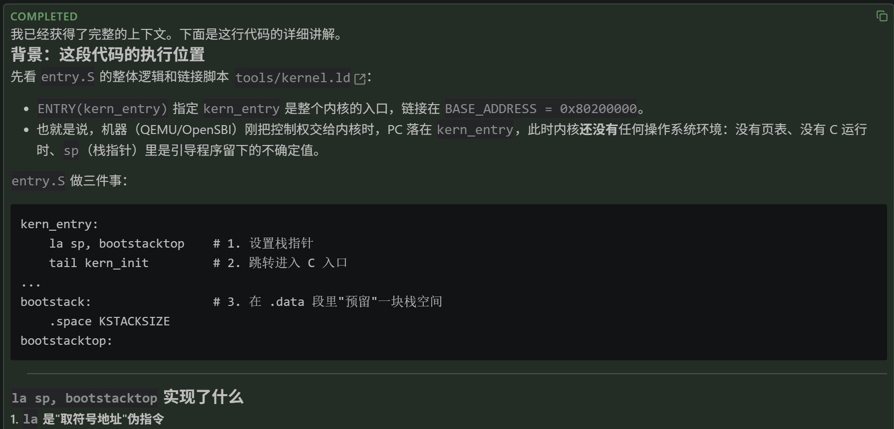
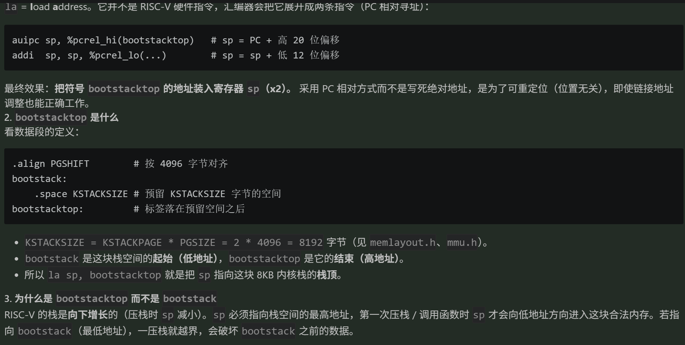
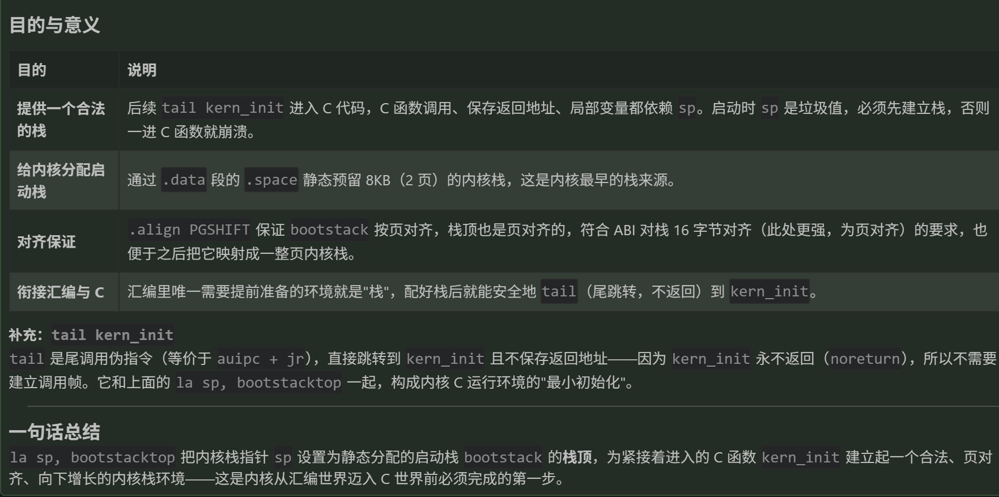
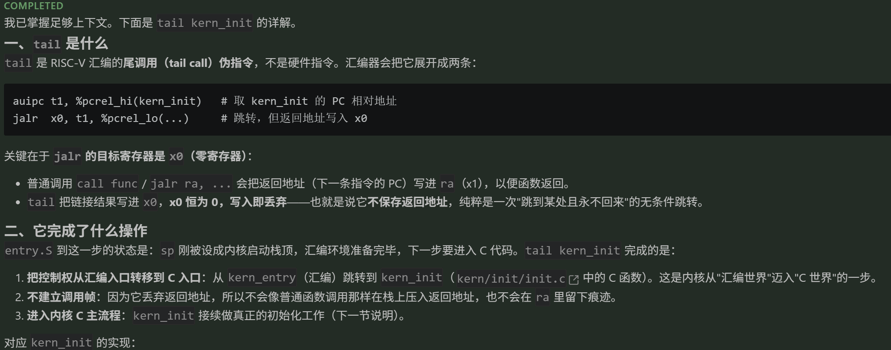
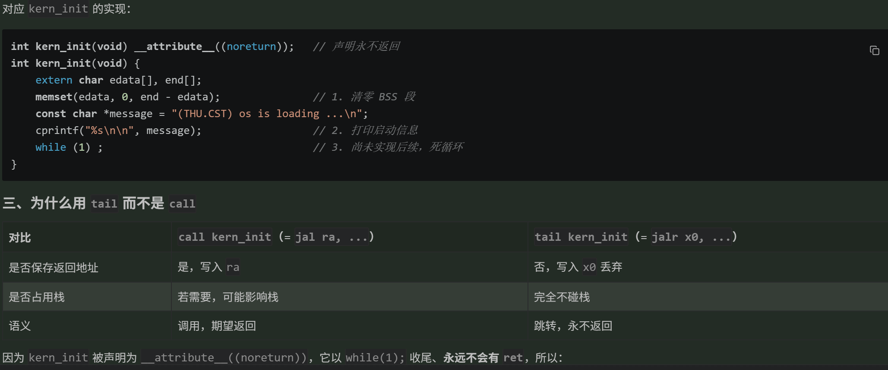
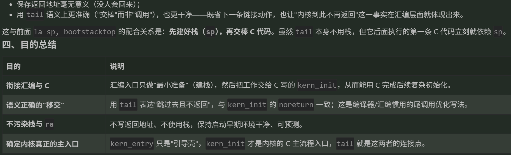
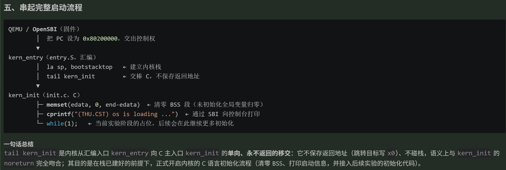
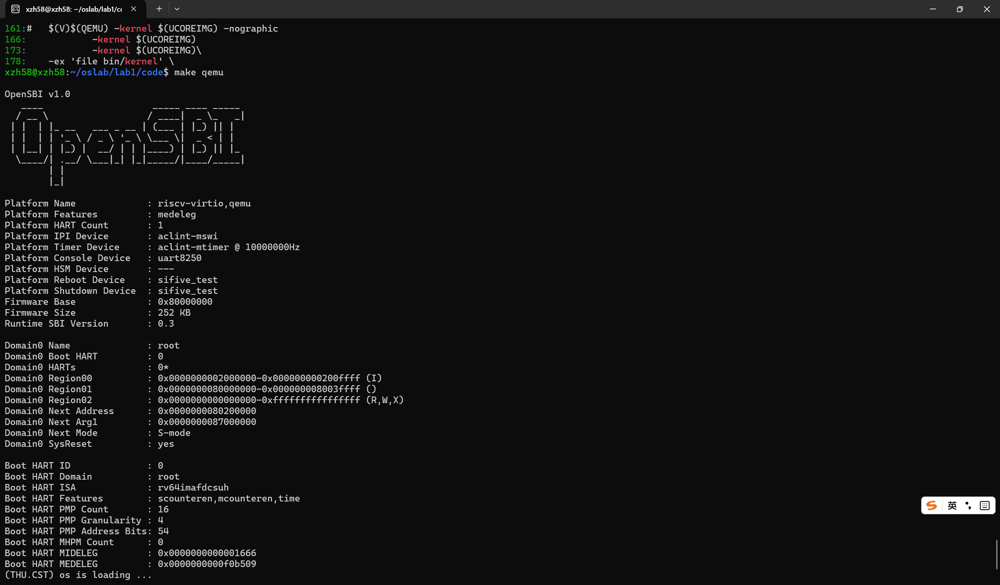
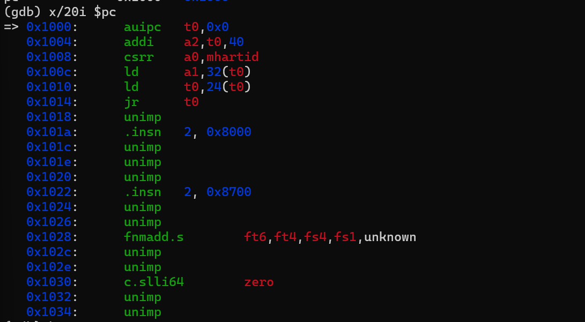
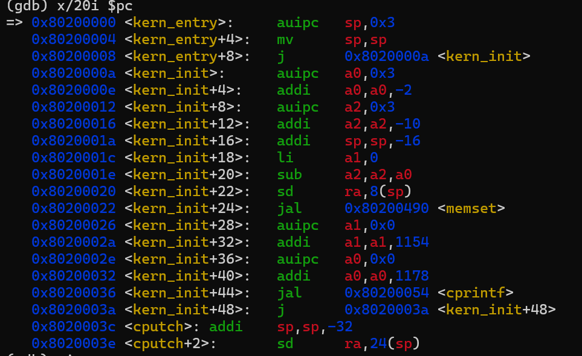

# 操作系统实验报告

## 实验基本信息

| 项目 | 内容 |
|------|------|
| **实验名称** | Lab1: 比麻雀更小的麻雀（最小可执行内核） |
| **小组成员** | 2410621-辛梓晗、2412243-曹珂瑜、2411204-孙唯源 |
| **完成日期** | <!-- 待填 --> |

### 小组分工

| 成员 | 负责的练习/模块 |
|------|----------------|
| 2410621-辛梓晗 | 整合套模板、汇总 prompt、搭建 git 结构、报告终版完成 |
| 2412243-曹珂瑜 | 练习1 与报告初稿撰写 |
| 2411204-孙唯源 | 练习2 环境与调试 |

---

## 一、实验目的

1. 使用链接脚本描述内存布局；
2. 进行交叉编译生成可执行文件，进而生成内核镜像；
3. 使用 OpenSBI 作为 bootloader 加载内核镜像，并使用 QEMU 进行模拟；
4. 使用 OpenSBI 提供的服务，在屏幕上格式化打印字符串，用于以后调试。

---

## 二、实验环境

| 成员 | AI 编程工具 | 底层模型 | 备注 |
|------|------------|---------|------|
| 2410621-辛梓晗 | <!-- 待填 --> | <!-- 待填 --> | |
| 2412243-曹珂瑜 | VS Code 插件 | DeepSeek-V4-flash | |
| 2411204-孙唯源 | <!-- 待填 --> | <!-- 待填 --> | |

运行环境（实测）：WSL Ubuntu 22.04.5 LTS、QEMU 7.0.0、riscv64-unknown-elf 工具链（gcc 15.1.0，`rv64gc`/`lp64d`，编译选项 `-mcmodel=medany`）、GDB 16.3.90。

---

## 三、实验整体逻辑分析

### 3.1 本章节的逻辑主线

本章节主要有两个任务。其一是阅读 lab1 文件夹里 `kern/init/entry.S` 文件的内容代码，然后结合操作系统内核启动流程，说明 `la sp, bootstacktop` 和 `tail kern_init` 这两段代码在启动过程中发挥了什么作用，以及这两段代码的目的是什么。

其二是使用 GDB 跟踪 QEMU 模拟的 RISC-V 从加电开始，直到执行内核第一条指令（也就是跳转到 `0x80200000`）的整个过程。通过调试，探究 RISC-V 硬件加电后最初执行的几条指令位于什么地址，以及它们主要完成了哪些功能。

### 3.2 功能的逐步实现

本章按内核启动的执行流逐步实现，顺序与原因如下：

1. **先确定内存布局与入口（`tools/kernel.ld`）**——只有先约定内核被加载到 `0x80200000`、入口符号为 `kern_entry`，编译、链接与加载才能对齐，这是后续一切的基础；
2. **再写汇编入口建立内核栈（`kern/init/entry.S`）**——C 语言函数运行必须有栈，汇编入口在跳到 C 之前必须先设置好栈指针 `sp`，所以它是进入 C 世界前的最后一道准备；
3. **然后进入 C 初始化（`kern/init/init.c` 的 `kern_init`）**——有了栈，才能调用 C 函数完成清零 BSS、打印启动信息等初始化工作，形成"内核已启动"的证据；
4. **再用 SBI 服务输出（`libs/sbi.c` / `kern/driver/console.c`）**——内核运行在 S 模式，无法直接操作串口，需要通过 `ecall` 调用 OpenSBI 提供的控制台服务，这也是之后所有实验的调试手段；
5. **最后用 QEMU + GDB 验证整条链**——从复位地址 `0x1000` 跟踪到 `0x80200000`，确认前面每一步都符合预期。

---

## 四、实验内容与实现

### 练习一：理解内核启动中的程序入口操作

**负责人：** 2412243-曹珂瑜

借助 AI，成功了解到了 `la sp, bootstacktop` 和 `tail kern_init` 这两段代码在启动过程中的作用以及目的。

在 `la sp, bootstacktop` 这段代码中，`la` 为 `load address` 伪指令，用于将符号地址加载到寄存器中；`sp` 是栈指针寄存器；`bootstacktop` 表示内核启动栈的顶端地址。最终，这段代码的作用是将 `bootstacktop` 的地址加载到 `sp` 寄存器里，其目的是为了在内核启动时为内核代码分配并建立栈空间。

而在 `tail kern_init` 这段代码中，`tail` 是一个伪指令，用于生成尾调用，将 PC 设置为 `kern_init` 函数的地址，并跳转过去但不保留返回地址；`kern_init` 是内核的 C 主入口函数，用于进一步初始化内核。这段代码的作用是实现内核从汇编入口 `kern_entry` 向 C 主入口 `kern_init` 进行一次单向的移交，其目的是在栈已建好的前提下，正式开启内核的 C 语言初始化流程，即清零 BSS、打印启动信息，并接入后续实验的初始化代码。

**所用提示词：**

- "讲解在 `kern/init/entry.S` 中，`la sp, bootstacktop` 这行代码实现了什么功能，以及它的目的是什么"
- "接下来解释一下 `tail kern_init` 在操作系统内核启动流程中又完成了什么操作，这段代码的目的是什么"

**AI 给出的回答（截图）：**

关于 `la sp, bootstacktop` 的回答：







关于 `tail kern_init` 的回答：







完整的启动流程串联：



---

### 练习二：使用 GDB 验证启动流程

**负责人：** 2411204-孙唯源

**题目**：用 GDB 跟踪 QEMU 模拟的 RISC-V 从加电开始，直到执行内核第一条指令（跳转到 `0x80200000`）的过程；说明 RISC-V 硬件加电后最初执行的几条指令位于什么地址、主要完成哪些功能。

**调试步骤**：

1. 终端 A 执行 `make debug`（QEMU 带 `-s -S`，启动即冻结，在 1234 端口等待 GDB）；
2. 终端 B 执行 `make gdb` 连接，连接后停在复位点；
3. 依次执行 `info registers`、`x/20i $pc`、`b *0x80200000`、`c`、`si`、`x/10x $sp`。

**观察现象**：

（1）刚连上时 PC 停在上电复位地址 `0x1000`，各寄存器初值为 0：

```
pc  0x1000
```

（2）复位处最初 6 条指令（`x/20i $pc`）：

```
0x1000:  auipc t0,0x0        # t0 = 0x1000（取得当前地址）
0x1004:  addi  a2,t0,40      # a2 = 0x1028（指向 fdt，作为固件参数）
0x1008:  csrr  a0,mhartid    # a0 = hart id (0)
0x100c:  ld    a1,32(t0)     # a1 = 0x80000000（下一阶段地址参数）
0x1010:  ld    t0,24(t0)     # t0 = 0x80000000（要跳转到的地址）
0x1014:  jr    t0            # 跳转到 0x80000000
```

（3）在 `0x80200000` 下断点并 `continue`，命中内核入口：

```
Breakpoint 1, kern_entry () at kern/init/entry.S:7
7   la sp, bootstacktop
pc  0x80200000  <kern_entry>
```

（4）内核入口反汇编（`x/20i $pc`）——**印证了练习一的分析**：

```
0x80200000 <kern_entry>:     auipc sp,0x3      # sp = 0x80200000 + 0x3000 = 0x80203000 = bootstacktop
0x80200004 <kern_entry+4>:   mv    sp,sp
0x80200008 <kern_entry+8>:   j     0x8020000a <kern_init>   # tail kern_init（编译为不写 ra 的 j）
0x8020000a <kern_init>:      ...
   0x80200022 <kern_init+24>: jal  0x80200490 <memset>
   0x80200036 <kern_init+44>: jal  0x80200054 <cprintf>
   0x8020003a <kern_init+48>: j    0x8020003a <kern_init+48>  # while(1)
```

（5）`si` 单步一条后 `sp = 0x80203000`，与 `bootstacktop` 符号地址一致。

**结论**：

- RISC-V 硬件加电后最初执行的几条指令位于**地址 `0x1000`**（QEMU 的复位向量 / MROM）。
- 它们的功能是：以 `0x1000` 为基址，读取 hart id 到 `a0`，准备固件参数（`a1`/`a2`，含设备树 fdt 地址），把下一阶段地址 `0x80000000` 装入 `t0`，最后 `jr t0` 跳转到 `0x80000000`（OpenSBI）。之后由 OpenSBI 完成硬件初始化，再跳转到 `0x80200000` 执行内核 `kern_entry`。
- 从内核入口反汇编可见：`la sp, bootstacktop` 编译为 `auipc sp,0x3`（+ `mv sp,sp`），确实把 `sp` 设为 `0x80203000`；`tail kern_init` 编译为**不写 `ra`** 的 `j` 指令，与练习一的结论完全一致。

---

## 五、测试与验证

**测试截图：**

1. `make qemu` 运行成功，内核打印启动信息：

   

2. GDB 停在复位地址 `0x1000`（练习二）：

   

3. GDB 命中内核入口 `0x80200000`（练习二）：

   

> 说明 1：本实验代码包缺少 `tools/grade.sh`，`make grade` 无法运行，故测试证据以 `make qemu` 输出 + GDB 调试记录为准。
>
> 说明 2（环境适配）：本机 QEMU 7.0 + OpenSBI 1.0 下，Makefile 原有的 `-device loader,file=...,addr=0x80200000` 方式不会让 OpenSBI 跳转到内核（启动横幅显示 `Domain0 Next Address : 0x0`），已改为 `-kernel bin/ucore.img`，此后 `make qemu` / `make debug` 均正常。

---

## 六、实验总结与收获

### 对操作系统的理解

**（1）本实验的重要知识点及其与 OS 原理的对应关系**

| 本实验知识点 | 含义 | 对应 OS 原理 | 关系与差异 |
|-------------|------|-------------|-----------|
| 链接脚本 + 加载地址 `0x80200000` | 用 `kernel.ld` 固定内核在物理内存中的位置与入口 | 程序的地址空间与装入 | 原理常讲虚拟地址空间与重定位；本实验是内核裸机、无分页的物理定位，为后续引入页表做铺垫 |
| 交叉编译 | 在 x86 上生成 RISC-V 机器码 | 编译与目标代码生成 | 原理不强调"宿主机/目标机异构"，本实验必须区分 |
| 启动栈设置 `la sp` | 进入 C 之前建立内核栈 | 进程/线程的栈、函数调用约定 | 原理讲"每个进程有用户栈/内核栈"；这里是内核最初的引导栈，尚无进程概念 |
| `tail kern_init` 尾调用 | 不保存返回地址的单向跳转 | 函数调用约定（call/ret） | 原理默认有返回；此处利用 `noreturn` 语义省略 `ra` |
| SBI `ecall` 输出 | 通过固件服务访问设备 | 系统调用 / 特权级切换 | 形式都是 `ecall` + 寄存器传参，但这里是 S→M 陷入固件，不是用户→内核 |
| GDB 远程调试 | 连接 QEMU 观察启动过程 | 调试与可观测性 | 原理少见，属工程实践 |

**（2）OS 原理中重要、但本实验未覆盖的知识点**

- **进程与线程管理**：本实验只有"内核启动"，尚无进程/PCB/调度等概念；
- **虚拟内存与分页**：本实验内核直接运行在物理地址，尚未启用页表；
- **中断与异常处理**：`entry.S` 只顺序执行，没有 `trap` 入口与中断向量；
- **系统调用的完整机制**：虽出现 `ecall`，但那是 S→M 的 SBI 调用，还未实现用户态→内核态的系统调用；
- **同步互斥、文件系统、设备驱动**：均属后续实验内容。

### AI 协作开发的经验

1. **给足可信上下文最重要**：把 `mmu.h`/`memlayout.h` 的真实宏、`kernel.ld` 的真实语句放进提示词的 `[RELY]` 部分，AI 才能给出具体到字节的答案；凭记忆写"差不多"的宏会导致 AI 答错。
2. **要求 AI「结合启动流程」而非孤立解释**：否则容易漏掉"栈必须在跳 C 之前设好"这类关键因果。
3. **环境类问题先让 AI 看现象**：把启动横幅里 `Domain0 Next Address : 0x0` 这类证据交给 AI，比直接问"为什么跑不起来"有效得多。
4. **验证优先**：AI 的解释要用 GDB 反汇编（`x/20i $pc`）核对——例如 `la sp` 编译成 `auipc sp,0x3`、`tail` 编译成不写 `ra` 的 `j`，都能实测印证。

---

<!-- 提交前待办（删除本段）：
- 填写"完成日期"、辛梓晗/孙唯源的 AI 工具与模型；
- 确认 report/images/ 下图片齐全；
- 生成 report/prompt.md。 -->
