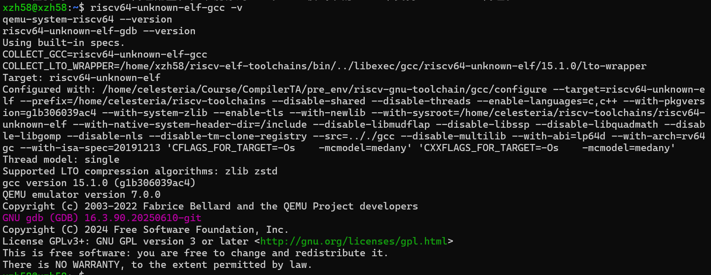
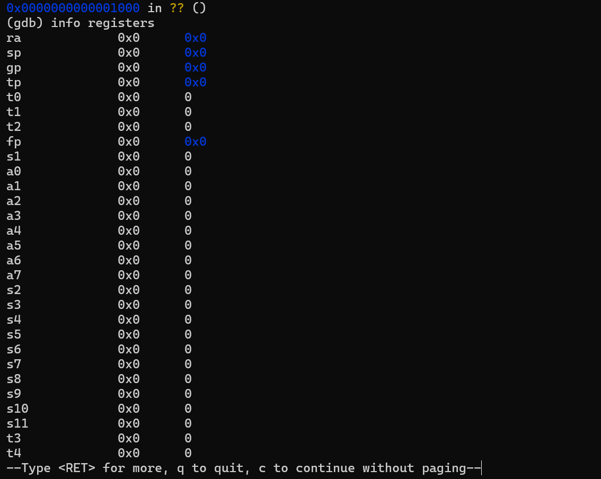

# 操作系统实验报告

## 实验基本信息

| 项目 | 内容 |
|------|------|
| **实验名称** | Lab1: 比麻雀更小的麻雀（最小可执行内核） |
| **小组成员** | 2410621-辛梓晗、2412243-曹珂瑜、2411204-孙唯源 |
| **完成日期** | <!-- 待填 --> |

### 小组分工

| 成员 | 负责的练习/模块 |
|------|----------------|
| 2410621-辛梓晗 | 整合套模板、汇总 prompt、搭建 git 结构、报告终版完成 |
| 2412243-曹珂瑜 | 练习1 与报告初稿撰写 |
| 2411204-孙唯源 | 练习2 环境与调试 |

---

## 一、实验目的

1. 使用链接脚本描述内存布局；
2. 进行交叉编译生成可执行文件，进而生成内核镜像；
3. 使用 OpenSBI 作为 bootloader 加载内核镜像，并使用 QEMU 进行模拟；
4. 使用 OpenSBI 提供的服务，在屏幕上格式化打印字符串，用于以后调试。

---

## 二、实验环境

| 成员 | AI 编程工具 | 底层模型 | 备注 |
|------|------------|---------|------|
| 2410621-辛梓晗 | OpenCode | deepseek-v4.1-flash | |
| 2412243-曹珂瑜 | VS Code 插件 | DeepSeek-V4-flash | |
| 2411204-孙唯源 | DeepSeek Harness | deepseek-v4-flash | |

运行环境（实测）：WSL Ubuntu 22.04.5 LTS、QEMU 7.0.0、riscv64-unknown-elf 工具链（gcc 15.1.0，`rv64gc`/`lp64d`，编译选项 `-mcmodel=medany`）、GDB 16.3.90。版本截图如下：



---

## 三、实验整体逻辑分析

### 3.1 本章节的逻辑主线

本章节主要有两个任务。其一是阅读 lab1 文件夹里 `kern/init/entry.S` 文件的内容代码，然后结合操作系统内核启动流程，说明 `la sp, bootstacktop` 和 `tail kern_init` 这两段代码在启动过程中发挥了什么作用，以及这两段代码的目的是什么。

其二是使用 GDB 跟踪 QEMU 模拟的 RISC-V 从加电开始，直到执行内核第一条指令（也就是跳转到 `0x80200000`）的整个过程。通过调试，探究 RISC-V 硬件加电后最初执行的几条指令位于什么地址，以及它们主要完成了哪些功能。

### 3.2 功能的逐步实现

1. 首先搭建 RISC-V 实验环境，包括交叉编译工具链、QEMU 和 GDB。环境是后续编译、运行和调试内核的基础。
2. 接着编译并运行 Lab1 内核，使用 `make` 和 `make qemu` 检查构建结果。只有内核能够正常启动，才能进一步跟踪其启动过程。
3. 然后使用 GDB 从复位地址 `0x1000` 开始观察指令，并在 `0x80200000` 设置断点，以分析固件启动到内核入口的控制流。
4. 最后整理实际反汇编、寄存器与栈内存观察结果，保存规定截图并完成实验报告和 prompt 记录，形成可核验的实验记录。

---

## 四、实验内容与实现

### 练习一：理解内核启动中的程序入口操作

**负责人：** 2412243-曹珂瑜、2410621-辛梓晗

借助 AI，成功了解到了 `la sp, bootstacktop` 和 `tail kern_init` 这两段代码在启动过程中的作用以及目的。`entry.S` 全文核心只有两条指令（外加数据段的栈空间声明）：

```asm
kern_entry:
    la sp, bootstacktop   # 1. 设置内核栈顶
    tail kern_init        # 2. 尾调用 C 入口
# 数据段
bootstack: .space KSTACKSIZE
bootstacktop:
```

链接脚本 `tools/kernel.ld` 通过 `ENTRY(kern_entry)` 和 `BASE_ADDRESS = 0x80200000` 把内核定位到 `0x80200000`，并把 `.text.kern_entry` 排在最前。因此 QEMU/OpenSBI 交出控制权时 PC 落在 `kern_entry`，此刻内核没有任何运行环境（无页表、无 C 运行时，`sp` 是引导程序留下的不确定值）。

**（1）`la sp, bootstacktop`**

`la` = *load address* 伪指令（**不是硬件指令**），汇编器展开为 `auipc sp, %pcrel_hi(bootstacktop)` + `addi sp, sp, %pcrel_lo(...)`，采用 PC 相对寻址，把符号 `bootstacktop` 的地址装入栈指针 `sp`。`bootstacktop` 是内核启动栈的**栈顶**：`.data` 段中 `.align PGSHIFT`（4KB 对齐）后用 `.space KSTACKSIZE` 预留栈空间，紧随其后的 `bootstacktop` 即这块空间的最高地址，而 `KSTACKSIZE = KSTACKPAGE * PGSIZE = 2 * 4096 = 8192` 字节（见 `memlayout.h`、`mmu.h`）。

之所以指向 `bootstacktop`（高地址）而非 `bootstack`（低地址）：RISC-V 栈**向下增长**，`sp` 必须指向栈顶最高地址，第一次压栈时 `sp` 才向低地址进入这块合法内存；若指向 `bootstack`，一压栈就越界、破坏其前面的数据。

**作用**：把 `sp` 指向 8KB 内核启动栈的栈顶。**目的**：为即将执行的 C 代码建立合法的栈环境——C 函数的局部变量、返回地址、保存寄存器都依赖 `sp`，不先建栈，进入 C 函数就会崩溃。

**（2）`tail kern_init`**

`tail` 是 RISC-V 的**尾调用伪指令**（不是硬件指令），展开为 `auipc t1, %pcrel_hi(kern_init)` + `jalr x0, t1, %pcrel_lo(...)`。关键在于 `jalr` 的目标寄存器是 **`x0`（零寄存器）**：普通调用 `call`（= `jal ra,...`）把返回地址写入 `ra`（x1）以便函数返回；而 `tail` 把链接结果写入 `x0`，`x0` 恒为 0、写入即丢弃——即**不保存返回地址**，纯粹是"跳到某处且永不回来"的无条件跳转。

**作用**：把控制权从汇编入口 `kern_entry` **单向移交**给 C 入口 `kern_init`，且不建立调用帧、不污染 `ra`。**目的**：因为 `kern_init` 被声明为 `noreturn`（以 `while(1);` 收尾、永不返回），保存返回地址没有意义；用 `tail` 语义更准确（"交棒"而非"调用"），也与 `noreturn` 完全吻合。它与 `la sp, bootstacktop` 的配合是：**先建好栈，再交棒 C 代码**。

**（3）实测印证（GDB）**

QEMU + GDB 调试时，内核入口 `0x80200000` 处的反汇编进一步印证了上述结论：

```
0x80200000 <kern_entry>:     auipc sp,0x3      # 即 la sp, bootstacktop → sp = 0x80203000
0x80200004 <kern_entry+4>:   mv    sp,sp
0x80200008 <kern_entry+8>:   j     0x8020000a <kern_init>   # 即 tail kern_init（未写 ra）
```

`si` 单步后 `sp = 0x80203000`，正与 `bootstacktop` 的符号地址一致；`tail kern_init` 编译为一条**不写 `ra`** 的 `j`。

**完整启动流程串联**：

```
QEMU/OpenSBI（固件）──把 PC 设为 0x80200000，交出控制权──▶
kern_entry（entry.S）── la sp, bootstacktop 建立 8KB 内核栈 ──▶
                      ── tail kern_init      交棒 C，不保存返回地址 ──▶
kern_init（init.c）   ── memset 清零 BSS ── cprintf 打印 ── while(1)
```

**所用提示词：**

- "讲解在 `kern/init/entry.S` 中，`la sp, bootstacktop` 这行代码实现了什么功能，以及它的目的是什么"
- "接下来解释一下 `tail kern_init` 在操作系统内核启动流程中又完成了什么操作，这段代码的目的是什么"

**AI 给出的回答（截图）：**

关于 `la sp, bootstacktop` 的回答：


关于 `tail kern_init` 的回答：


完整的启动流程串联：


---

### 练习二：使用 GDB 验证启动流程

**负责人：** 2411204-孙唯源、2410621-辛梓晗

**练习目标**：通过 GDB 跟踪 QEMU 模拟的 RISC-V 启动过程，观察复位地址附近的固件指令，并跟踪执行流程到内核入口 `0x80200000`。重点理解启动固件、OpenSBI 与实验内核之间的控制流交接。

**（一）调试步骤**

1. 在一个 WSL 终端进入实验目录 `~/oslab/lab1`，执行 `make debug`，启动等待调试器连接的 QEMU；
2. 在另一个 WSL 终端进入同一目录，执行 `make gdb`，连接 GDB；
3. 在 GDB 中执行 `info registers`，检查程序计数器 PC；再执行 `x/20i $pc`，查看初始地址附近的 20 条指令；
4. 执行 `b *0x80200000` 设置内核入口断点，再执行 `c` 继续运行；
5. 断点命中后执行 `info registers` 和 `x/20i $pc`，观察内核入口地址与汇编指令；随后执行 `si` 单步，并用 `x/10x $sp` 查看栈指针附近的内存。

**（二）观察与分析**

根据实验任务指引，GDB 初始位置预期为 `0x1000`。该位置属于 QEMU 启动时的固件执行路径，并非实验内核的入口。使用 `x/20i $pc` 可以查看固件最初执行的指令；分析时应结合实际输出，确认指令如何获取或保留 hart ID、准备传递给下一阶段的参数，以及如何转交到 `0x80000000` 附近的 OpenSBI。之后继续跟踪，观察控制流是否到达 `0x80200000` 的内核入口。进入内核后，再通过反汇编和单步执行观察入口代码对栈指针 `sp` 的设置。

**（三）实际观察输出**

（1）复位点 `0x1000` 处的最初 6 条指令（`x/20i $pc`）：

```
0x1000:  auipc t0,0x0        # t0 = 0x1000（取得当前地址）
0x1004:  addi  a2,t0,40      # a2 = 0x1028（指向 fdt，作为固件参数）
0x1008:  csrr  a0,mhartid    # a0 = hart id (0)
0x100c:  ld    a1,32(t0)     # a1 = 0x80000000（下一阶段地址参数）
0x1010:  ld    t0,24(t0)     # t0 = 0x80000000（要跳转到的地址）
0x1014:  jr    t0            # 跳转到 0x80000000
```

复位时 `info registers` 显示 PC=`0x1000`、其余寄存器初值均为 0（见 `images/gdb_registers.png`）。

（2）在 `0x80200000` 下断点并 `continue`，命中内核入口：

```
Breakpoint 1, kern_entry () at kern/init/entry.S:7
7   la sp, bootstacktop
pc  0x80200000  <kern_entry>
```

（3）内核入口反汇编（`x/20i $pc`）——与练习一的结论相互印证：

```
0x80200000 <kern_entry>:     auipc sp,0x3      # sp = 0x80203000 = bootstacktop
0x80200004 <kern_entry+4>:   mv    sp,sp
0x80200008 <kern_entry+8>:   j     0x8020000a <kern_init>   # tail kern_init（不写 ra）
0x8020000a <kern_init>:      ...
0x80200022 <kern_init+24>:   jal   0x80200490 <memset>
0x80200036 <kern_init+44>:   jal   0x80200054 <cprintf>
0x8020003a <kern_init+48>:   j     0x8020003a <kern_init+48>  # while(1)
```

`si` 单步后 `sp = 0x80203000`，与 `bootstacktop` 符号地址一致。

**（四）练习问题的回答**

RISC-V 在 QEMU 中启动时，首先从**复位地址 `0x1000`** 附近开始执行固件指令。这些指令负责完成启动阶段的初步准备：处理 hart ID、准备启动参数，并将控制权交给后续启动程序（`0x80000000` 的 OpenSBI）。启动过程并不是直接从 `0x1000` 跳入实验内核，而是先经过固件及 OpenSBI 的启动流程，再由 OpenSBI 转交给 `0x80200000` 的实验内核。实验中在 `0x80200000` 设置断点，确认内核入口处的 PC，并结合真实反汇编解释具体指令的作用。

**（五）截图与 AI 对话证据**

GDB 停在复位地址 `0x1000`（固件最初指令）：


复位点寄存器状态（PC=0x1000，初值均为 0）：



GDB 命中内核入口 `0x80200000`：


与 AI 的对话记录（孙唯源）：


---

## 五、测试与验证

**测试截图：**

1. `make qemu` 运行成功，内核打印启动信息：

   

2. GDB 停在复位地址 `0x1000`（练习二）：

   

3. GDB 命中内核入口 `0x80200000`（练习二）：

   

4. GDB 复位点的寄存器状态（练习二，PC=`0x1000`，各寄存器初值均为 0）：

   

> 说明 1：本实验代码包缺少 `tools/grade.sh`，`make grade` 无法运行，故测试证据以 `make qemu` 输出 + GDB 调试记录为准。
>
> 说明 2（环境适配）：本机 QEMU 7.0 + OpenSBI 1.0 下，Makefile 原有的 `-device loader,file=...,addr=0x80200000` 方式不会让 OpenSBI 跳转到内核（启动横幅显示 `Domain0 Next Address : 0x0`），已改为 `-kernel bin/ucore.img`，此后 `make qemu` / `make debug` 均正常。

---

## 六、实验总结与收获

### 对操作系统的理解

**（1）本实验的重要知识点及其与 OS 原理的对应关系**

| 本实验知识点 | 含义 | 对应 OS 原理 | 关系与差异 |
|-------------|------|-------------|-----------|
| 链接脚本 + 加载地址 `0x80200000` | 用 `kernel.ld` 固定内核在物理内存中的位置与入口 | 程序的地址空间与装入 | 原理常讲虚拟地址空间与重定位；本实验是内核裸机、无分页的物理定位，为后续引入页表做铺垫 |
| 交叉编译 | 在 x86 上生成 RISC-V 机器码 | 编译与目标代码生成 | 原理不强调"宿主机/目标机异构"，本实验必须区分 |
| 启动栈设置 `la sp` | 进入 C 之前建立内核栈 | 进程/线程的栈、函数调用约定 | 原理讲"每个进程有用户栈/内核栈"；这里是内核最初的引导栈，尚无进程概念 |
| `tail kern_init` 尾调用 | 不保存返回地址的单向跳转 | 函数调用约定（call/ret） | 原理默认有返回；此处利用 `noreturn` 语义省略 `ra` |
| SBI `ecall` 输出 | 通过固件服务访问设备 | 系统调用 / 特权级切换 | 形式都是 `ecall` + 寄存器传参，但这里是 S→M 陷入固件，不是用户→内核 |
| GDB 远程调试 | 连接 QEMU 观察启动过程 | 调试与可观测性 | 原理少见，属工程实践 |

**（2）OS 原理中重要、但本实验未覆盖的知识点**

- **进程与线程管理**：本实验只有"内核启动"，尚无进程/PCB/调度等概念；
- **虚拟内存与分页**：本实验内核直接运行在物理地址，尚未启用页表；
- **中断与异常处理**：`entry.S` 只顺序执行，没有 `trap` 入口与中断向量；
- **系统调用的完整机制**：虽出现 `ecall`，但那是 S→M 的 SBI 调用，还未实现用户态→内核态的系统调用；
- **同步互斥、文件系统、设备驱动**：均属后续实验内容。

### AI 协作开发的经验

1. **给足可信上下文最重要**：把 `mmu.h`/`memlayout.h` 的真实宏、`kernel.ld` 的真实语句放进提示词，AI 才能给出具体到字节的答案；凭记忆写"差不多"的宏会导致 AI 答错。
2. **要求 AI「结合启动流程」而非孤立解释**：否则容易漏掉"栈必须在跳 C 之前设好"这类关键因果。
3. **环境类问题先让 AI 看现象**：把启动横幅里 `Domain0 Next Address : 0x0` 这类证据交给 AI，比直接问"为什么跑不起来"有效得多。
4. **验证优先**：AI 的解释要用 GDB 反汇编（`x/20i $pc`）核对——例如 `la sp` 编译成 `auipc sp,0x3`、`tail` 编译成不写 `ra` 的 `j`，都能实测印证。

---

<!-- 提交前待办（删除本段）：填写"完成日期"。 -->
