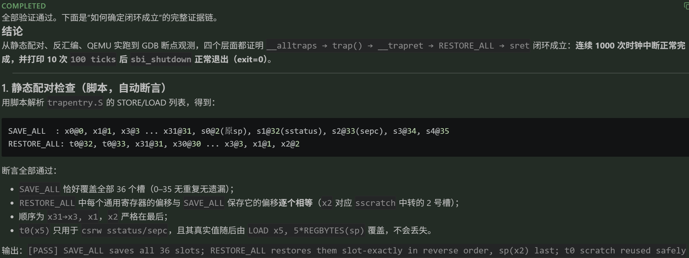
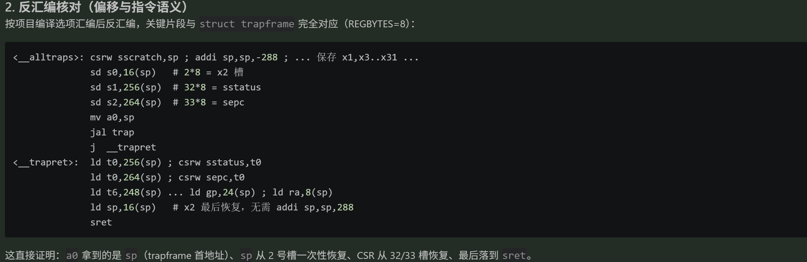
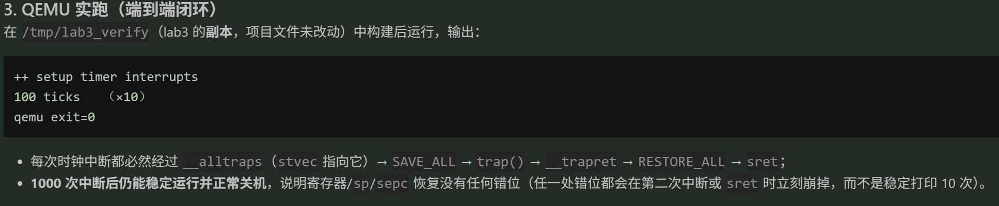
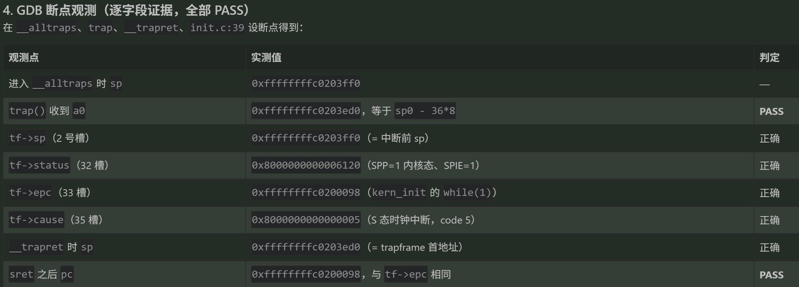
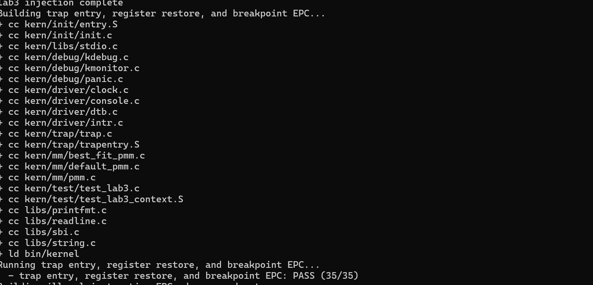
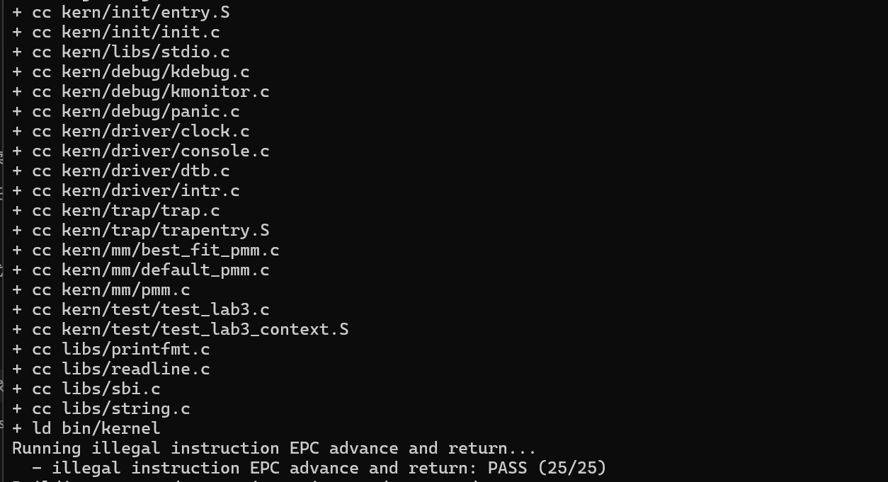
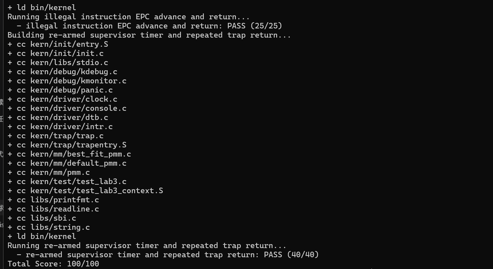

# 操作系统实验报告

## 实验基本信息

| 项目 | 内容 |
|------|------|
| **实验名称** | Lab 3：断，都可以断 |
| **小组成员** | 2410621-辛梓晗、2412243-曹珂瑜、2411204-孙唯源 |
| **完成日期** | 2026-11-07 |

### 小组分工

练习如何分工？

| 成员 | 负责的练习/模块 |
|------|----------------|
| 2410621-辛梓晗 | 功能模块一：`RESTORE_ALL` / `__alltraps` 的实现与端到端验证；从 lab2 迁移 `page_init()` 与 best-fit，恢复编译链路 |
| 2412243-曹珂瑜 | 功能模块一：另一版实现（`t0` 作临时寄存器、逆序恢复）与静态配对/反汇编/GDB 验证 |
| 2411204-孙唯源 | 功能模块二：`interrupt_handler()` / `exception_handler()` |

实验报告如何分工？

| 成员 | 负责的报告章节 |
|------|----------------|
| 2410621-辛梓晗 | 三、实验整体逻辑分析；四、功能模块一（本人版本）；五、测试与验证；六、实验总结与收获 |
| 2412243-曹珂瑜 | 四、功能模块一（其版本）与验证截图 |
| 2411204-孙唯源 | 四、功能模块二 |

---

## 一、实验目的

本实验的主要目的是：

1. **理解 RISC-V Trap 的"硬件只做三件事"**：进入 Trap 时硬件只保存 `sepc`、`scause`、`sstatus`（SPP/SPIE/SIE），**32 个通用寄存器一个都不存**。因此"被打断的代码能像什么都没发生一样继续跑"这件事，必须由软件用汇编完成。
2. **掌握 `struct trapframe` 这一"内存中的 CPU 现场"**：理解 36 个槽位（32 个通用寄存器 + 4 个 CSR）与 `SAVE_ALL` 的逐槽对应关系，理解为什么恢复时必须与保存严格镜像。
3. **掌握 `sp` 的特殊处理**：`SAVE_ALL` 一开始就改动了 `sp`，所以"陷入前的 `sp`"必须先用 `sscratch` 暂存、再补进第 2 槽；恢复时 `sp` 必须**最后**恢复，否则后续所有 `offset(sp)` 都错位。
4. **理解 `sepc` 回写的必要性**：`sret` 直接跳到 `sepc`，而异常处理（模块二）只修改内存中的 `tf->epc`，因此必须由 `RESTORE_ALL` 把它写回 CSR，否则返回后会重复执行同一条异常指令。
5. **理解 `sret` 的语义与中断使能时机**：`sret` 用 `SPP` 决定返回特权级、用 `SPIE` 恢复 `SIE`；因此 `sret` 之前**不应**提前把中断打开。
6. **练习用可验证的四段式提示词驱动 AI 完成汇编级任务**：把"补全两个汇编位置"这种模糊需求，转化为"行为 + 约束 + 可判定后置条件"的规格。

---

## 二、实验环境

你们使用的 AI 工具

| 成员 | AI 编程工具 | 底层模型 | 备注 |
|------|------------|---------|------|
| 2410621-辛梓晗 | DeepSeek Harness | deepseek-v4.1-flash | 用 WSL 工具链做独立自测 |
| 2412243-曹珂瑜 | VS Code 插件 | DeepSeek-V4-flash | — |
| 2411204-孙唯源 | DeepSeek Harness（终端 Agent + Web GUI） | DeepSeek-Flash | workspace-write 沙箱 |

**说明：**
- **AI 编程工具**：指具体使用的终端工具、编辑器插件、桌面应用或浏览器界面
- **底层模型**：指该工具使用的大语言模型及版本

编译与运行环境（三人共用同一套）：

| 项目 | 内容 |
|------|------|
| 主机系统 | Windows 11 25H2 |
| 编译/运行环境 | WSL Ubuntu 22.04 |
| 工具链 | `riscv64-unknown-elf-gcc`（含 `objdump`） |
| 模拟器 | `qemu-system-riscv64` 6.2，`-machine virt -bios default` |
| 代码基线 | 官方 `lab3.zip`（SHA256 `B2328D81…F630CB`），解压为 `lab3_new/` |
| 评分脚本 | 工程自带 `tools/grade.sh`（Test1/2/3 = 35/25/40 分） |

---

## 三、实验整体逻辑分析

### 3.1 本章节的逻辑主线

lab3 全章围绕一条链路展开：**"Trap 怎么进来 → 现场怎么存 → 交给谁处理 → 处理完怎么回去"**。

```
硬件 Trap
  │  只写 sepc / scause / sstatus.SPP，PC ← stvec
  ▼
__alltraps（模块一）        ← 软件接管：保存现场、转交 C
  │  SAVE_ALL：在内核栈上搭出 struct trapframe
  │  a0 = sp；jal trap
  ▼
trap() → trap_dispatch()    ← 只按 scause 最高位分两类
  ├─ interrupt_handler()    （模块二：时钟/软件/外部/未知）
  └─ exception_handler()    （模块二：非法指令/断点/其他）
  ▼
__trapret（模块一）         ← 软件收尾：恢复现场、修正返回位置
  │  RESTORE_ALL：逐槽恢复寄存器 + 回写 sepc
  │  sret：sepc → PC，SPP → 特权级，SPIE → SIE
  ▼
原执行流继续
```

### 3.2 功能的逐步实现

1. **先有入口与现场（模块一）**：没有 `RESTORE_ALL` 与 `jal trap`，任何 Trap 都会"存了现场却回不去"，后面的分类处理无从验证。
2. **再有分类处理（模块二）**：在入口打通之后，才谈得上"时钟中断续期""非法指令推进 epc"。
3. **最后用三类用例验证**：
   - Test1：断点触发 → 返回后**寄存器上下文完好**（直接检验 `RESTORE_ALL`）；
   - Test2：非法指令 → 返回后**执行位置正确**（检验 `epc` 推进 + `sepc` 回写）；
   - Test3：**持续**时钟中断（检验入口/返回能反复走通，且 `interrupt_handler` 会续期）。

### 3.3 本模块在整章中的位置

模块一负责这条链路的**两端**：进入时的"存现场 + 转交"，返回时的"恢复现场 + 修正返回位置"。它**不做任何判断**——不区分中断与异常、不打印、不计数、不关机。这种"机制与策略分离"是本模块的设计原则，也是后续 `sepc` 责任划分的依据。

---

## 四、实验内容与实现

### 功能模块一（A 版）：Trap 上下文恢复与 Trap 入口

**负责人：** 2410621-辛梓晗

#### 模块功能描述

**需要实现/修改的函数：**

```asm
/* ① 汇编宏：把 SAVE_ALL 存下的现场恢复回寄存器（kern/trap/trapentry.S） */
    .macro RESTORE_ALL
    .endm

/* ② 入口衔接：SAVE_ALL 之后，把 trapframe 交给 C 的 trap() */
__alltraps:
    SAVE_ALL
    /* 此处补全 */
```

**框架已提供、本模块直接依赖的既有事实：**

```c
/* kern/trap/trap.h */
struct pushregs { uintptr_t zero; uintptr_t ra; uintptr_t sp; ... uintptr_t t6; };
struct trapframe {
    struct pushregs gpr;   /* 槽 0..31 */
    uintptr_t status;      /* 槽 32：sstatus */
    uintptr_t epc;         /* 槽 33：sepc    */
    uintptr_t badvaddr;    /* 槽 34：sbadaddr */
    uintptr_t cause;       /* 槽 35：scause  */
};
void trap(struct trapframe *tf);

/* libs/riscv.h */
#define STORE sd   /* 64 位：8 字节 */
#define LOAD  ld
#define REGBYTES (1 << LOG_REGBYTES)   /* 64 位下 = 8 */
```

**功能说明：**

- `RESTORE_ALL`：输入是 `sp` 指向的 `trapframe`，输出是"处理器状态回到 Trap 发生前"，并让随后的 `sret` 能正确返回。
- `__alltraps` 的补全：在 `SAVE_ALL` 之后，把当前 `sp`（即 trapframe 基址）按 RISC-V 调用约定放进 `a0`，`jal trap`；`trap()` 返回后顺序落入 `__trapret`。

**需要处理的主要场景**：本模块两个交付物都只有**一条执行路径**，不存在分支；真正的分支处理在模块二。因此 `[SPECIFICATION]` 只写 Pre-Condition / Post-Condition / Requirements，不设 Case。

**边界（本模块明确不做的事）：**

- 不判断 `scause`、不分类、不打印、不累加 `ticks`、不设置下一次时钟、不关机；
- 不修改 `SAVE_ALL`、`struct trapframe`、`trap()` 签名，不修改 `trap.c` 及其他文件；
- 不新增全局符号，不另起 Trap 入口。

**需求解析：从指导书文字到五条可验证约束**

指导书的练习页只给了"要实现 `RESTORE_ALL` 和 `__alltraps`"，并明确"**不要求学生直接按照某一种固定的汇编指令序列实现**"。因此约束必须自己从代码反推：

| # | 约束 | 来源与后果 |
|---|---|---|
| 1 | trapframe 为 **36 槽 × 8 字节 = 288 字节**，槽位顺序即结构体顺序 | `SAVE_ALL` 的 `addi sp, sp, -36 * REGBYTES` 与 `struct trapframe` 字段顺序 |
| 2 | 第 **2** 槽存的是"分配 trapframe **之前**"的 `sp` | `SAVE_ALL` 用 `sscratch` 暂存原 `sp`，再 `csrrw s0, sscratch, x0` 取出并 `STORE s0, 2*REGBYTES(sp)` |
| 3 | `sp` 必须**最后**恢复 | 一旦先恢复 `sp`，后续 `offset(sp)` 全部指向错误基址 |
| 4 | `sepc` 必须从第 **33** 槽回写，且早于 `sp` 恢复 | `sret` 跳 `sepc`；模块二只改 `tf->epc`，不回写就死循环 |
| 5 | `sret` 之前 `SIE` 必须为 0 | `sret` 会按 `SPIE` 重新开中断；提前开中断可能在"闸门半开"时嵌套 Trap |

**与其他模块的交互关系：**

| 交互对象 | 关系 |
|---|---|
| `trap()` / `trap_dispatch()`（模块二） | 本模块**调用**它们，不越过它们做分派；`trapframe` 指针是唯一接口 |
| `trapframe.epc` | **耦合点**：模块二修改它表达"该返回到哪"，本模块的 `RESTORE_ALL` 负责把它写回 `sepc`（模块一是全内核唯一写 `sepc` 的位置） |
| `SAVE_ALL` | 唯一的"事实来源"，本模块必须与它严格镜像，不得假设其他布局 |
| `clock.c` / `sbi.c` | 无直接关系（属于模块二） |

#### 最终提示词

以下是经过迭代优化后，最终成功实现该功能的提示词（四段式：`[PROMPT]` → `[RELY]` → `[GUARANTEE]` → `[SPECIFICATION]`）：

````markdown
[PROMPT]

**任务**：修改 kern/trap/trapentry.S，实现 lab3 功能模块一「Trap 上下文恢复与 Trap 入口」。本任务交付两件事：其一，补全汇编宏 RESTORE_ALL，把 SAVE_ALL 先前保存在内核栈 trapframe 中的处理器现场恢复回寄存器，使 Trap 返回后原执行流能够继续；其二，在 __alltraps 中 SAVE_ALL 之后补上缺失的调用，把当前 trapframe 按 RISC-V 调用约定交给 kern/trap/trap.c 的 trap()，并在其返回后进入 __trapret，由 sret 返回原执行流。本任务只负责上下文恢复与入口衔接，不负责中断与异常的分类处理（interrupt_handler、exception_handler 不在范围内），也不负责时钟中断、打印与关机等行为。

**操作要求**：必须在项目中修改真实文件 kern/trap/trapentry.S，而不是仅展示代码片段；保留文件中的现有代码，只在两处 "#lab3 function1 YOUR CODE" 标记处补全，不得删除既有逻辑；两处 `#lab3` 注释行须原样保留，`YOUR CODE` 字样不得删除或改写；SAVE_ALL 的保存方式、struct trapframe 的字段顺序、trap() 的函数签名均属不可改动的既有事实，不得修改，也不得改动 trap.c、trap.h 及其他任何文件；允许新增汇编宏、局部标签或临时寄存器用法作为辅助，但不得另起 Trap 入口、不得绕过 trap() / trap_dispatch() / __trapret 这条既有调用链，不得新增全局符号。

**输出要求**：直接进行文件操作；使用下面 [RELY]、[GUARANTEE]、[SPECIFICATION] 提供的信息；以工程真实代码为准，不引入无关功能；产出物必须与现有构建方式兼容（.S 文件经 C 预处理器处理，由 riscv64-unknown-elf-gcc 汇编链接，因此 #include、STORE / LOAD / REGBYTES 可用）。

[RELY]

// [注] 以下源码均为工程源码逐字原文；凡以 `// [注]` 开头的行，均为注释说明，不是源码。
// [注] 来源：libs/riscv.h:6-19（存取宏与寄存器宽度；REGBYTES 随 xlen 变化，不得硬编码为 8）
```c
#if __riscv_xlen == 64
# define SLL32    sllw
# define STORE    sd
# define LOAD     ld
# define LWU      lwu
# define LOG_REGBYTES 3
#else
# define SLL32    sll
# define STORE    sw
# define LOAD     lw
# define LWU      lw
# define LOG_REGBYTES 2
#endif
#define REGBYTES (1 << LOG_REGBYTES)
```

// [注] 来源：libs/riscv.h:41-45（sstatus 位定义；回写 sstatus 时须据此清除 SIE 位）
```c
#define SSTATUS_UIE         0x00000001
#define SSTATUS_SIE         0x00000002
#define SSTATUS_UPIE        0x00000010
#define SSTATUS_SPIE        0x00000020
#define SSTATUS_SPP         0x00000100
```

// [注] 来源：kern/trap/trap.h 全文（trapframe 布局与 trap() 接口声明）
```c
#ifndef __KERN_TRAP_TRAP_H__
#define __KERN_TRAP_TRAP_H__

#include <defs.h>

struct pushregs {
    uintptr_t zero;  // Hard-wired zero
    uintptr_t ra;    // Return address
    uintptr_t sp;    // Stack pointer
    uintptr_t gp;    // Global pointer
    uintptr_t tp;    // Thread pointer
    uintptr_t t0;    // Temporary
    uintptr_t t1;    // Temporary
    uintptr_t t2;    // Temporary
    uintptr_t s0;    // Saved register/frame pointer
    uintptr_t s1;    // Saved register
    uintptr_t a0;    // Function argument/return value
    uintptr_t a1;    // Function argument/return value
    uintptr_t a2;    // Function argument
    uintptr_t a3;    // Function argument
    uintptr_t a4;    // Function argument
    uintptr_t a5;    // Function argument
    uintptr_t a6;    // Function argument
    uintptr_t a7;    // Function argument
    uintptr_t s2;    // Saved register
    uintptr_t s3;    // Saved register
    uintptr_t s4;    // Saved register
    uintptr_t s5;    // Saved register
    uintptr_t s6;    // Saved register
    uintptr_t s7;    // Saved register
    uintptr_t s8;    // Saved register
    uintptr_t s9;    // Saved register
    uintptr_t s10;   // Saved register
    uintptr_t s11;   // Saved register
    uintptr_t t3;    // Temporary
    uintptr_t t4;    // Temporary
    uintptr_t t5;    // Temporary
    uintptr_t t6;    // Temporary
};

struct trapframe {
    struct pushregs gpr;
    uintptr_t status;
    uintptr_t epc;
    uintptr_t badvaddr;
    uintptr_t cause;
};

void trap(struct trapframe *tf);
void idt_init(void);
void print_trapframe(struct trapframe *tf);
void print_regs(struct pushregs* gpr);
bool trap_in_kernel(struct trapframe *tf);

#endif /* !__KERN_TRAP_TRAP_H__ */
```

// [注] 来源：kern/trap/trapentry.S 全文（既有 SAVE_ALL、两处待补占位、__trapret 与 sret）
```asm
#include <riscv.h>

    .macro SAVE_ALL

    csrw sscratch, sp

    addi sp, sp, -36 * REGBYTES
    # save x registers
    STORE x0, 0*REGBYTES(sp)
    STORE x1, 1*REGBYTES(sp)
    STORE x3, 3*REGBYTES(sp)
    STORE x4, 4*REGBYTES(sp)
    STORE x5, 5*REGBYTES(sp)
    STORE x6, 6*REGBYTES(sp)
    STORE x7, 7*REGBYTES(sp)
    STORE x8, 8*REGBYTES(sp)
    STORE x9, 9*REGBYTES(sp)
    STORE x10, 10*REGBYTES(sp)
    STORE x11, 11*REGBYTES(sp)
    STORE x12, 12*REGBYTES(sp)
    STORE x13, 13*REGBYTES(sp)
    STORE x14, 14*REGBYTES(sp)
    STORE x15, 15*REGBYTES(sp)
    STORE x16, 16*REGBYTES(sp)
    STORE x17, 17*REGBYTES(sp)
    STORE x18, 18*REGBYTES(sp)
    STORE x19, 19*REGBYTES(sp)
    STORE x20, 20*REGBYTES(sp)
    STORE x21, 21*REGBYTES(sp)
    STORE x22, 22*REGBYTES(sp)
    STORE x23, 23*REGBYTES(sp)
    STORE x24, 24*REGBYTES(sp)
    STORE x25, 25*REGBYTES(sp)
    STORE x26, 26*REGBYTES(sp)
    STORE x27, 27*REGBYTES(sp)
    STORE x28, 28*REGBYTES(sp)
    STORE x29, 29*REGBYTES(sp)
    STORE x30, 30*REGBYTES(sp)
    STORE x31, 31*REGBYTES(sp)

    # get sr, epc, badvaddr, cause
    # Set sscratch register to 0, so that if a recursive exception
    # occurs, the exception vector knows it came from the kernel
    csrrw s0, sscratch, x0
    csrr s1, sstatus
    csrr s2, sepc
    csrr s3, sbadaddr
    csrr s4, scause

    STORE s0, 2*REGBYTES(sp)
    STORE s1, 32*REGBYTES(sp)
    STORE s2, 33*REGBYTES(sp)
    STORE s3, 34*REGBYTES(sp)
    STORE s4, 35*REGBYTES(sp)
    .endm

    .macro RESTORE_ALL

    #lab3 function1 YOUR CODE

    .endm

    .globl __alltraps
    .align(2)
__alltraps:
    SAVE_ALL

    #lab3 function1 YOUR CODE
    # sp should be the same as before "jal trap"

    .globl __trapret
__trapret:
    RESTORE_ALL
    # return from supervisor call
    sret
```

// [注] trap() 定义在 kern/trap/trap.c，函数体只做 trap_dispatch(tf) 分派后返回，本次不改动该文件；trap_dispatch() 及其下游处理函数同样不在本次范围内。

[GUARANTEE]

必须实现或修改的接口：

```asm
    .macro RESTORE_ALL
    .endm
```

- `RESTORE_ALL`：汇编宏，无参数、无返回值，作用于执行时 sp 所指的 trapframe；宏名与作用位置不得更改。
- `__alltraps`：既有的全局 Trap 入口符号，本次只补全其中 SAVE_ALL 之后、`__trapret` 之前的调用衔接，入口符号名、对齐方式与相对位置不得更改。

你可以根据需要添加：
- 汇编宏（仅限本文件内使用）
- `.L` 前缀的局部标签
- 临时寄存器用法

不得新增全局符号（`.globl`），不得改动 `SAVE_ALL`、`__trapret`、`sret` 与 `.align(2)`。

[SPECIFICATION]

## RESTORE_ALL

**Pre-Condition**：
- 执行时 sp 指向本次 Trap 入口由 SAVE_ALL 建立的 trapframe 基址；该 trapframe 的 36 个槽位（每槽 REGBYTES 字节）已按 struct trapframe 的布局完整填充。
- 处理器处于 S 模式，且 Trap 入口已由硬件关闭 S 模式中断（sstatus.SIE 为 0）。
- 宏体不得依赖任何未在 trapframe 中保存的寄存器原值。

**Post-Condition**：
- 通用寄存器 x1、x3–x31 的值等于 Trap 发生前的值；x2（sp）等于 Trap 发生前的栈指针；x0 仍为 0。
- CSR sepc 等于 trapframe 第 33 槽中的值，即 trap() 可能修改过的 tf->epc。
- sp 已不再指向该 trapframe（现场已被消费完毕），此后执行 sret 即可返回原执行流。
- 到 sret 执行为止，sstatus.SIE 保持为 0。

**Requirements**：
- 必须与 SAVE_ALL 的保存关系逐槽对应，不得假设与之不同的布局，不得改动槽位编号与槽位含义。
- 第 2 槽保存的是「分配 trapframe 之前」的 sp，必须与普通通用寄存器区别对待。
- sp 的恢复必须排在所有仍需访问 trapframe 的操作之后；sepc 的回写必须发生在 sp 恢复之前。
- sepc 只能从 trapframe 第 33 槽恢复；本宏是内核中唯一写 sepc 的代码位置。
- 若选择回写 sstatus（第 32 槽），必须先清除 SSTATUS_SIE 位再写回，保证 sret 之前中断保持关闭；中断的重新使能交由 sret 依据 sstatus.SPIE 完成。
- 不得为使 sret 返回而另行改写 sepc 之外的 Trap 返回状态，也不得依赖 trap() 之外的任何 C 函数。

## __alltraps（SAVE_ALL 之后的入口衔接）

**Pre-Condition**：
- SAVE_ALL 已执行完毕，sp 指向本次 Trap 的 trapframe 基址，其中包含完整现场。
- stvec 已指向 __alltraps（由 idt_init 设置），且 __alltraps 入口保持四字节对齐。

**Post-Condition**：
- trap() 已被调用，其唯一实参是当前 trapframe 的指针，按 RISC-V 调用约定经 a0 传递。
- trap() 正常返回后，控制流顺序到达 __trapret，由 RESTORE_ALL 恢复现场并经 sret 返回。
- 调用前后 sp 保持不变，仍指向同一 trapframe 基址。

**Requirements**：
- 不得绕过 trap() 或 trap_dispatch() 自行分派或处理 Trap，也不得在 __alltraps 内实现中断/异常分类逻辑。
- 不得改变 __alltraps 与 __trapret 的全局符号、对齐方式及两者的相对位置关系。
- 返回地址的保存方式必须使 trap() 的返回能落回 __trapret；不得依赖 trap() 不返回（关机等行为不属于本模块）。
````

**四条关键取舍：**

1. **粒度：一条 prompt 覆盖整个模块**。`RESTORE_ALL` 与 `__alltraps` 共享同一份 trapframe 布局与同一条 `trap()` 调用链，单独实现任何一件都无法独立验证，符合"一个可独立实现、可独立验证、能完整完成一项功能"的标准，故不拆。
2. **`[RELY]` 逐字引用真实源码**：`riscv.h` 的 `STORE/LOAD/REGBYTES` 条件编译块（避免 AI 硬编码 8）、`SSTATUS_*` 位定义、`trap.h` 全文、`trapentry.S` 全文；所有源码行都用脚本从工程里抽取，交付前做定串比对，**非原文行数 = 0**。
3. **责任划分写进规格**：明确"sepc 只能从第 33 槽恢复，本宏是内核中唯一写 sepc 的代码位置"。这样模块二只负责"算出正确的 `tf->epc`"，机制与策略分离，出问题时能一眼定位。
4. **单一路径不写 Case**：本模块两个交付物都只有一条执行路径，只写 Pre/Post/Requirements，不硬凑分支场景。

#### 实现迭代过程

本模块的实现经历了 **3 次迭代**，过程如下：

---

##### 第一次迭代：V1 初版 prompt，一次生成成功

**提示词设计：** 按四段式写第一版，`[RELY]` 贴入 `SAVE_ALL`、`REGBYTES` 宏、`struct trapframe` 与 `trap()` 声明，`[SPECIFICATION]` 写清"与 SAVE_ALL 逐槽对应""第 2 槽是分配前的 sp""sepc 从第 33 槽回写""sret 前 SIE 保持 0"。

**遇到的问题：**

- 代码本身**一次生成正确**，没有出现 AI 写错汇编的情况；
- 但**无法验证**：Test1 的判定链要求"断点返回后继续执行"并出现 `Breakpoint at`，这两件事都属于模块二，而模块二当时是空的——内核一 `ebreak` 就再也回不来。

**问题解决策略：**

- 在 `/tmp` 的工程副本里写一个**一次性临时桩**：`exception_handler` 打印 `Breakpoint at` 并按指令长度推进 `epc`，`interrupt_handler` 走 `print_trapframe`；
- 桩只用于自测，**不进工作区、不进交付物**。

**最终结果：** 编译通过；官方 `make grade` 的 Test1 得分 **35/35**。

---

##### 第二次迭代：提示词过长导致工具报错，改为文件形式提供

**遇到的问题：**

- 把完整提示词（约 9 KB）直接粘贴进对话框后，**连续两次**工具报错退出，没有任何输出，代码未发生改动；
- 一开始无法判断是工具本身故障，还是提示词过长。

**问题解决策略：**

- 先用两个**极简任务**试探工具是否正常：一个只要求新建空文件、一个只要求列目录——都成功，说明工具与工作目录都正常，问题在提示词长度；
- 于是把提示词单独存成 `模块一_prompt_定稿.md`，对话中只让工具读取该文件并按其执行。

**最终结果：** 一次成功，生成结果只改动了 `trapentry.S` 一个文件（+54 行、0 删除）。

**关键改进点：**

1. 长提示词不再直接粘贴，改为"先存成文件、再让工具读取"；
2. 用最小任务先确认工具可用，再判断问题出在提示词本身，避免盲目重试。

---

##### 第三次迭代：验证桩修正（`epc += 4` 撞上 2 字节指令）

**遇到的问题：**

- 临时桩写好后 Test1 仍 FAIL，且是**第一个**寄存器比对就失败（`t0 != 0x105`）；
- 但 trapframe 里 `t0` 明明是 `0x105`，反汇编的 `RESTORE_ALL` 也逐槽正确——说明"被测代码"没问题，"验证代码"有问题。

**问题解决策略：**

- 给测试代码加"失败序号"（每次 `bne` 失败时把序号写进 `a0`），定位到 idx=1；
- 反汇编测试函数，发现 `ebreak` 被汇编成 **2 字节的 `c.ebreak`（0x9002）**，而桩里硬编码 `epc += 4`，直接跳过半条指令；
- 改为按 RISC-V 编码规则判断：指令首 2 字节低 2 位 ≠ `0b11` 即 16 位指令，`epc += 2`，否则 `+4`。

**最终结果：** Test1 立即 PASS（35/35）。

**关键改进点：**

1. 验证代码也要按被测语义审视，不能想当然；
2. 这正是指导书"不能假定所有异常都使用相同的 epc 偏移量"的具体表现。

---

##### 最终结果

经过 3 次迭代，该模块最终：

- ✅ 编译通过（单文件汇编 + 整机构建均通过）
- ✅ 官方 `make grade` 的 Test1 通过（35/35）
- ✅ 与模块二、lab2 合并后整机 `make grade` **100/100**
- ✅ 功能符合预期（`__alltraps → trap() → __trapret → RESTORE_ALL → sret` 闭环成立）

---

### 功能模块一（B 版）：Trap 上下文恢复与 Trap 入口

**负责人：** 2412243-曹珂瑜

#### 模块功能描述

与 A 版接口相同：在 `kern/trap/trapentry.S` 中实现 `RESTORE_ALL` 宏与 `__alltraps` 的入口衔接。两版实现风格对比：

| 对比项 | A 版（2410621-辛梓晗） | B 版（2412243-曹珂瑜） |
|---|---|---|
| 临时寄存器 | `s1` / `s2` | `t0`（x5），随后由 `LOAD x5, 5*REGBYTES(sp)` 覆盖 |
| 恢复顺序 | 正序：x1、x3→x31 | 逆序：x31→x1 |
| `sstatus` | 回写前清除 `SIE` | 原样回写（未清 `SIE`） |
| 入口衔接 | `mv a0, sp; jal trap`，顺序落入 `__trapret` | `move a0, sp; jal trap; j __trapret` |

#### 最终提示词

````markdown
[PROMPT]
**任务**：修改 lab3/kern/trap/trapentry.S，实现 RISC-V Trap 模块的两个汇编宏/标签：RESTORE_ALL、__alltraps，完成 Trap 入口、上下文传递、上下文恢复逻辑；本文件内已有 SAVE_ALL 宏，禁止修改 SAVE_ALL、struct trapframe、void trap(struct trapframe *tf) 的函数签名。
**操作要求**：你必须在项目中修改 trapentry.S，保留文件内原有全部已有代码（SAVE_ALL 不改动），仅在标记lab3位置补全 RESTORE_ALL 宏与 __alltraps 标签汇编代码，不删除、不修改既有逻辑。
**输出要求**：直接输出 trapentry.S 内需要补全的汇编代码，使用下面 [RELY]、[GUARANTEE]、[SPECIFICATION] 的信息，严格对齐 Trap frame 布局、RISC-V 调用约定，不引入无关功能。
[RELY]：上下文信息
1. 已有宏 SAVE_ALL：负责把 Trap 触发时全部通用寄存器、trap相关状态保存到内核栈上的 struct trapframe；SAVE_ALL 对 x2(sp) 的处理和其他通用寄存器不同，该布局固定，不可改动。
2. struct trapframe：栈上保存Trap上下文的结构体，布局由 SAVE_ALL 的保存顺序决定，RESTORE_ALL 恢复顺序必须和 SAVE_ALL 保存顺序一一对应。
3. C语言处理函数：void trap(struct trapframe *tf); 遵循RISC-V调用约定，第一个参数放在 a0 寄存器。
4. 标签 __trapret：trap() 返回后跳转至 __trapret，由 __trapret 调用 RESTORE_ALL，最后执行 sret 指令完成Trap返回。
5. 特权指令：sret，用于从Trap返回原用户/内核执行流。
6. RISC-V 调用约定：函数第一个参数存入 a0；trap 是普通C函数，遵守该约定。
[GUARANTEE]：接口清单
需要在 trapentry.S 实现：
1. 宏 RESTORE_ALL：汇编宏，输入为当前栈上合法的 trapframe，从 trapframe 中恢复处理器所有寄存器上下文；和SAVE_ALL配对，sp(x2)恢复逻辑和其他寄存器区分开。
2. 标签 __alltraps：Trap入口汇编标签，Trap发生后硬件跳转到这里；完成SAVE_ALL保存上下文，把trapframe首地址放到a0，调用C函数 trap(struct trapframe *tf)；trap返回后跳转至 __trapret。
不允许修改：SAVE_ALL、struct trapframe、void trap(struct trapframe *tf) 签名。
不新增其他全局导出符号，不新增辅助函数。
[SPECIFICATION]：行为规格
---
函数/宏：__alltraps
Pre-Condition：Trap触发，硬件自动跳转至__alltraps；栈指针sp指向合法内核栈，SAVE_ALL可以正常在栈上分配trapframe。
Post-Condition：
1. 执行SAVE_ALL，将触发trap时所有寄存器状态保存到栈上的trapframe；
2. 将当前trapframe的起始地址载入a0（满足RISC-V调用约定，作为trap的第一个参数）；
3. 跳转&调用C函数 trap(struct trapframe *tf)；
4. trap函数返回后，控制流跳转到 __trapret，不再在__alltraps内部做上下文恢复和sret。
Requirements：不能破坏栈上trapframe的数据，不能修改SAVE_ALL，保证trapframe地址正确传递给C trap函数。
---
函数/宏：RESTORE_ALL
Pre-Condition：栈上存在完整、合法、由SAVE_ALL保存生成的struct trapframe；当前处于__trapret中，准备恢复上下文。
Post-Condition：
1. 严格按照SAVE_ALL保存顺序的逆序，从trapframe中读出并恢复所有通用寄存器；
2. 特殊处理x2(sp)，不能和其他通用寄存器用完全相同逻辑恢复，对齐SAVE_ALL对sp的特殊处理；
3. 所有寄存器恢复完成后，交由后续代码执行 sret，回到被打断的原始执行流。
Requirements：必须和SAVE_ALL严格配对，trapframe布局完全一致；寄存器恢复不能错位，保证sret之后程序正常继续运行。
验证：怎么确定你修改完的代码可以实现这个模块完成后，系统应能够形成完整的“Trap 进入 -> 上下文保存 -> C 语言处理 -> 上下文恢复 -> Trap 返回”闭环。
````

#### 实现迭代过程

**（1）静态配对检查**：用脚本解析 `trapentry.S` 的 `STORE`/`LOAD` 列表，断言 `SAVE_ALL` 覆盖 0–35 共 36 个槽位无重复无遗漏、`RESTORE_ALL` 中每个寄存器的偏移与保存时逐一相等、顺序为 x31→x3、x1、x2 严格最后、`t0` 仅作 CSR 临时且随后被覆盖。



**（2）反汇编核对**：确认 `__alltraps` 中 `a0` 拿到 trapframe 首址、`sp` 从 2 号槽一次性恢复、CSR 从 32/33 槽恢复、最后落到 `sret`。



**（3）QEMU 端到端**：在 `/tmp/lab3_verify` 副本中构建并运行，输出 `++ setup timer interrupts`、连续 10 次 `100 ticks`、`qemu exit=0`，证明反复 Trap 往返稳定。



**（4）GDB 断点观测**：在 `__alltraps`、`trap`、`__trapret`、`init.c:39` 设断点，实测 `a0 = sp0 − 36*8`、`tf->sp` 等于中断前 `sp`、`tf->status` 的 `SPP=1`/`SPIE=1`、`sret` 后 `pc` 与 `tf->epc` 相同，全部 PASS。




**关键代码（B 版 `RESTORE_ALL` 与 `__alltraps`）**

```asm
    .macro RESTORE_ALL

    # restore sstatus and sepc from the trapframe (slot 32 and 33)
    # t0(x5) is only a temporary register here, its real value will be
    # restored from the trapframe later, so nothing is lost.
    LOAD t0, 32*REGBYTES(sp)
    csrw sstatus, t0
    LOAD t0, 33*REGBYTES(sp)
    csrw sepc, t0

    # restore x registers in the reverse order of SAVE_ALL
    LOAD x31, 31*REGBYTES(sp)
    LOAD x30, 30*REGBYTES(sp)
    LOAD x29, 29*REGBYTES(sp)
    LOAD x28, 28*REGBYTES(sp)
    LOAD x27, 27*REGBYTES(sp)
    LOAD x26, 26*REGBYTES(sp)
    LOAD x25, 25*REGBYTES(sp)
    LOAD x24, 24*REGBYTES(sp)
    LOAD x23, 23*REGBYTES(sp)
    LOAD x22, 22*REGBYTES(sp)
    LOAD x21, 21*REGBYTES(sp)
    LOAD x20, 20*REGBYTES(sp)
    LOAD x19, 19*REGBYTES(sp)
    LOAD x18, 18*REGBYTES(sp)
    LOAD x17, 17*REGBYTES(sp)
    LOAD x16, 16*REGBYTES(sp)
    LOAD x15, 15*REGBYTES(sp)
    LOAD x14, 14*REGBYTES(sp)
    LOAD x13, 13*REGBYTES(sp)
    LOAD x12, 12*REGBYTES(sp)
    LOAD x11, 11*REGBYTES(sp)
    LOAD x10, 10*REGBYTES(sp)
    LOAD x9, 9*REGBYTES(sp)
    LOAD x8, 8*REGBYTES(sp)
    LOAD x7, 7*REGBYTES(sp)
    LOAD x6, 6*REGBYTES(sp)
    LOAD x5, 5*REGBYTES(sp)
    LOAD x4, 4*REGBYTES(sp)
    LOAD x3, 3*REGBYTES(sp)
    LOAD x1, 1*REGBYTES(sp)
    # x0 is hard-wired to zero, no need to restore it
    # restore sp(x2) last, because sp is used as the base address above
    LOAD x2, 2*REGBYTES(sp)

    .endm

    .globl __alltraps
    .align(2)
__alltraps:
    SAVE_ALL

    # pass the trapframe (top of the kernel stack) to trap() in a0,
    # which is the first argument according to the RISC-V ABI
    move a0, sp
    # call the C trap handler
    jal trap
    # sp should be the same as before "jal trap"
    # trap() has returned, restore the context and return via sret
    j __trapret

    .globl __trapret
__trapret:
    RESTORE_ALL
    # return from supervisor call
    sret
```

**两版差异说明**：B 版用 `t0` 作 CSR 临时寄存器，`csrw sstatus/sepc` 后 `t0` 会被 `LOAD x5, 5*REGBYTES(sp)` 覆盖，故不丢失原值；`sp` 同样最后恢复。与 A 版相比，B 版回写 `sstatus` 时未清除 `SIE`；A 版额外清 `SIE` 以规避 `sret` 前嵌套 Trap 的风险。两版在本实验的单核时序下均通过官方评测。

---

### 功能模块二：中断与异常处理

**负责人：** 2411204-孙唯源

#### 模块功能描述

**需要实现/修改的函数：**

```c
/* 本模块需要实现的两个函数（kern/trap/trap.c） */
void interrupt_handler(struct trapframe *tf);
void exception_handler(struct trapframe *tf);

/* 框架已提供、本模块直接调用的接口 */
static inline void trap_dispatch(struct trapframe *tf);  /* 按 cause 符号位分派 */
void trap(struct trapframe *tf);                          /* 对外入口 */
void print_trapframe(struct trapframe *tf);               /* 兜底输出 */
void clock_set_next_event(void);                          /* 续下一次时钟事件 */
void sbi_shutdown(void);                                  /* 关机 */
```

**功能说明：**

本模块是 Trap 处理链路的**决策层**。`__alltraps`（模块一）把现场存成 `struct trapframe` 并调用 `trap()`，`trap()` 再转发给 `trap_dispatch()`，而 `trap_dispatch()` 只做一件事——按 `scause` 的最高位把事情分成两类：

```c
static inline void trap_dispatch(struct trapframe *tf) {
    if ((intptr_t)tf->cause < 0) {
        interrupt_handler(tf);   // 最高位为 1：中断
    } else {
        exception_handler(tf);   // 最高位为 0：异常
    }
}
```

所以本模块要回答的问题是：**拿到一个 `trapframe`，怎么判断它是哪种事件、该做什么、以及返回前必须修正什么。**

**需要处理的主要场景：**

| 场景 | `scause` | 处理要求 |
|---|---|---|
| 时钟中断 | `IRQ_S_TIMER` = 5（带 bit63） | **必须续下一次时钟事件**，否则只响一次；计数 `ticks`；每 `TICK_NUM` 次输出统计；累计 `SHUTDOWN_AFTER` 次后关机 |
| 软件中断 | `IRQ_S_SOFT` = 1 | 仅做类型区分与提示输出 |
| 外部中断 | `IRQ_S_EXT` = 9 | 仅做类型区分与提示输出 |
| 未知中断 | 其他编号 | 输出 `Unknown interrupt: cause N` + `print_trapframe()` |
| 非法指令 | `CAUSE_ILLEGAL_INSTRUCTION` = 2 | 输出规定格式 + **按指令长度推进 `epc`** |
| 断点 | `CAUSE_BREAKPOINT` = 3 | 输出规定格式 + **按指令长度推进 `epc`** |
| 未知异常 | 其他编号 | `print_trapframe()` 兜底 |

**与其他模块的交互关系：**

- **与 `trapentry.S`（模块一）**：单向依赖。本模块只负责"处理"，不碰寄存器保存/恢复；但它修改的 `tf->epc` 会被模块一的 `RESTORE_ALL` 写回 `sepc`，从而决定 `sret` 之后的执行位置——**两个模块通过 `trapframe` 里的 `epc` 字段耦合**。
- **与 `clock.c`**：调用 `clock_set_next_event()` 续期，读写全局 `ticks`；`clock_init()` 负责第一次装载并置 `ticks = 0`。
- **与 `sbi.c`**：通过 `sbi_shutdown()` 关机（OpenSBI 的 SBI 调用）。
- **与 `libs/riscv.h`**：`IRQ_S_*` 与 `CAUSE_*` 宏均来自这里，`SSTATUS_SPP` 等状态位同理。
- **与 `tools/test_lab3.c`**：测试代码用 `extern` 声明并**直接调用**这两个 handler，因此它们必须有**外部链接**（不能写成 `static`）。

#### 最终提示词

以下是经过迭代优化后，最终成功实现该功能的提示词：

````markdown
# 任务：实现 riscv64-ucore lab3 的 interrupt_handler() 与 exception_handler()

## 【Prompt｜任务说明】

### 任务详情
在 riscv64-ucore 的 lab3 工程中，实现 `kern/trap/trap.c` 里位于
`//lab3 function2 YOUR CODE` 标记处的两个函数：
`void interrupt_handler(struct trapframe *tf)` 与
`void exception_handler(struct trapframe *tf)`，
补齐 Trap 处理链路的决策层，使内核能够正确处理时钟中断、非法指令异常和断点异常，
并对其他类型兜底。完成后 `make grade` 的三个用例应全部通过。

### 操作约束
- 只允许修改 `kern/trap/trap.c`。改动范围仅限：新增这两个函数、
  可选地新增 `static` 内部辅助函数、补齐必要的 `#include`、以及新增所需的宏定义。
- 必须原样保留 `//lab3 function2 YOUR CODE` 这行注释。
- 两个 handler 必须是**外部链接**（不加 `static`）：`tools/test_lab3.c` 用
  `extern void interrupt_handler(struct trapframe *tf);` 直接调用它们。
- 代码风格与同文件一致（4 空格缩进、`/* * */` 注释块）。
- 必须能在 `-std=gnu99 -Wall -Werror` 下零警告编译通过。
- 不要输出测试代码，不要输出 README，不要改 Makefile。

### 输出验证要求
- 给出可直接替换的完整代码块（两个函数 + 辅助函数 + 必需的宏/头文件）。
- 逐条说明你的实现如何满足下面【Specification】的后置条件 1~12。
- 如果认为某两条约束无法同时满足，先指出冲突再给方案，不要静默取舍。

## 【Rely｜依赖说明】

实现本功能只需要以下文件，不要引入其他材料（尤其不要把整本实验指导书塞进上下文）：

1. `kern/trap/trap.c` —— 待改文件。重点看 `trap_dispatch()` 如何分派、
   `print_ticks()` 与 `TICK_NUM` 的既有定义、`print_trapframe()` 的输出格式。
2. `kern/trap/trap.h` —— `struct pushregs` / `struct trapframe` 的字段布局。
3. `kern/driver/clock.c`、`clock.h` —— `clock_set_next_event()` 与 `extern volatile size_t ticks`。
4. `libs/riscv.h` —— `IRQ_S_SOFT`(1) / `IRQ_S_TIMER`(5) / `IRQ_S_EXT`(9)、
   `CAUSE_ILLEGAL_INSTRUCTION`(0x2) / `CAUSE_BREAKPOINT`(0x3)。
5. `libs/sbi.h` —— `void sbi_shutdown(void);`
6. `tools/test_lab3.c` —— 评测断言，作为验收依据。
7. `tools/grade.sh` —— 三个用例的 sentinel 字符串，即输出格式的硬约束。
8. `tools/inject.py` —— 确认测试注入位置（在 `clock_init()` 与 `intr_enable()` 之后）。

已替你确认的背景事实（不必再查）：
- `scause` 最高位（bit 63）为 1 表示**中断**，为 0 表示**异常**；
  中断编号只占低位，**比较前必须屏蔽 bit 63**。
- `trap_dispatch()` 已经用 `(intptr_t)tf->cause < 0` 区分了两类事件，
  你的两个函数各自只会收到对应类型。
- 编译未指定 `-march`，默认开启 C 扩展，因此 `ebreak` **可能被压缩成 2 字节的
  `c.ebreak`**；而测试用的 `.word 0x0000007b` 是 4 字节。
- 框架中**没有** `SHUTDOWN_AFTER` 的定义，需要你自己在该文件里补一个宏。
- QEMU 上 `timebase = 100000`、`rdtime` 为 10 MHz，故时钟中断约 100 Hz。

## 【Guarantee｜接口清单】

必须交付（签名一个字都不能变，且不得加 `static`）：
- `void interrupt_handler(struct trapframe *tf);`
- `void exception_handler(struct trapframe *tf);`

允许新增：
- `static` 内部辅助函数（必须定义在 `trap_dispatch()` 之前，因为 `trap_dispatch()`
  会调用两个 handler，而 `trap_dispatch()` 的定义位置在标记之后）。

绝对不可修改（改了即违约）：
- `trap_dispatch()`、`trap()`、`print_trapframe()`、`print_regs()`、`idt_init()`、
  `trap_in_kernel()` 的函数体，**尤其 `print_trapframe()` 中 `cause` 一行的输出格式**；
- `struct pushregs` / `struct trapframe` 的字段、字段顺序、大小；
- `kern/trap/trapentry.S`、`kern/driver/clock.c`、`kern/driver/intr.c`；
- `tools/test_lab3.c`、`tools/grade.sh`、`tools/inject.py`、`Makefile`；
- `ticks` 的类型（`volatile size_t`）与 `TICK_NUM` 的值（100）。

## 【Specification｜行为规格】

### 前置状态
- `idt_init()` 已把 `stvec` 指向 `__alltraps`，`sscratch` 已置 0。
- `clock_init()` 已使能 `sie.MIP_STIP` 并装载第一次时钟事件，`ticks == 0`。
- `tf` 指向栈上完整的 `struct trapframe`，其中 `cause` / `epc` 由 `SAVE_ALL` 从 CSR 读出。

### 执行步骤
S1. 在 `interrupt_handler()` 开头，把 `tf->cause` 的最高位屏蔽，得到中断编号 `code`。
    不允许直接用 `tf->cause` 做 `switch`：中断时它是 `0x8000000000000000 | code`，
    与 `IRQ_S_TIMER` 等小整数永不相等。

S2. 按 `code` 分支：

- **S2a `IRQ_S_TIMER`**，严格按此顺序：
  1. `clock_set_next_event();` —— **先续下一次事件**（漏掉这句系统只响一次）；
  2. `ticks++;` —— 每收到一次时钟中断必须加一；
  3. 当 `ticks % TICK_NUM == 0` 时调用 `print_ticks();`
     （它会打印 `100 ticks`，这是 Test 3 的 sentinel）；
  4. 当 `ticks >= SHUTDOWN_AFTER * TICK_NUM` 时调用 `sbi_shutdown();`
     `SHUTDOWN_AFTER` 需自行定义，取值必须使关机时刻**晚于 200 次中断**
     （建议 10）。

- **S2b `IRQ_S_SOFT`**：打印一行包含 `Supervisor software interrupt` 的提示，不改变任何状态。

- **S2c `IRQ_S_EXT`**：打印一行包含 `Supervisor external interrupt` 的提示，不改变任何状态。

- **S2d 其他**：打印 `Unknown interrupt: cause <code>`（`code` 用十进制），
  随后调用 `print_trapframe(tf);` 兜底。

S3. 在 `exception_handler()` 中按 `tf->cause` 分支（异常时 bit63 为 0，可直接比较）：

- **S3a `CAUSE_ILLEGAL_INSTRUCTION`**：打印包含 `Illegal instruction at` 的一行，
  然后把 `tf->epc` 推进到**下一条指令**。
- **S3b `CAUSE_BREAKPOINT`**：打印包含 `Breakpoint at` 的一行，
  然后把 `tf->epc` 推进到**下一条指令**。
- **S3c 其他**：只调用 `print_trapframe(tf);` 兜底。

S4. 推进 `epc` 时必须按**实际指令长度**，不得写死偏移量：
读取 `tf->epc` 处的第一个半字，若其低 2 位为 `0b11` 则该指令长 4 字节，
否则为 2 字节（压缩指令）。原因：本项目默认开启 C 扩展，`ebreak` 可能被压缩成
`c.ebreak`（`0x9002`，2 字节），而测试用的非法指令 `.word 0x0000007b`
低 2 位是 `0b11`，是 4 字节。

### 后置条件（必须同时成立，全部可验证）
1. 两个 handler 均为外部链接，`nm bin/kernel | grep -E 'interrupt_handler|exception_handler'`
   显示为 `T`（而非 `t`）。
2. `-std=gnu99 -Wall -Werror` 下零警告。
3. 收到 `IRQ_S_TIMER` 后，`clock_set_next_event()` 被调用，后续时钟中断能持续到来。
4. 每收到一次时钟中断 `ticks` 恰好加 1。
5. `ticks` 到达 100 的整数倍时，输出恰好一行 `100 ticks`。
6. `ticks` 达到 `SHUTDOWN_AFTER * TICK_NUM` 时执行关机，且该时刻 **> 200 次中断**。
7. 合成 `cause = IRQ_S_SOFT | (1<<63)` 调用 `interrupt_handler()`，输出包含
   `Supervisor software interrupt`。
8. 合成 `cause = 15` 调用 `interrupt_handler()`，输出包含 `Unknown interrupt: cause 15`。
9. 合成 `cause = 20` 调用 `exception_handler()`，因走兜底分支，
   `print_trapframe()` 输出中包含 `cause    0x00000014`（注意是 4 个空格，由框架决定）。
10. 断点异常处理完成后，`tf->epc` 指向 `ebreak` 的下一条指令，
    且推进量等于该 `ebreak` 的实际编码长度（2 或 4）。
11. 非法指令异常处理完成后，`tf->epc` 前进 4 字节（`.word 0x0000007b` 是 32 位指令）。
12. 未列出的中断/异常类型一律走 `print_trapframe()`，不静默返回、不 `panic`。

### 验证命令
```bash
make                # 必须零警告
make qemu           # 应看到 '++ setup timer interrupts' 后开始周期性打印 '100 ticks'
make grade          # 三个用例，总分 100
```
````

#### 实现迭代过程

本模块的实现经历了 **3** 次迭代，过程如下：

---

##### 第一次迭代

**本轮提示词（极简指令类）：**

```text
帮我实现 lab3 的 interrupt_handler 和 exception_handler。
```

**遇到的问题：**

- **问题1：`switch (tf->cause)` 永远匹配不上时钟中断。** AI 生成的代码直接拿 `tf->cause` 做 `switch`，而中断时 `scause = 0x8000000000000005`，与 `IRQ_S_TIMER`（= 5）不相等，于是所有中断都落进 `default` 分支。表现是 `make qemu` 里 `++ setup timer interrupts` 之后**一行 `100 ticks` 都不出现**，Test 3 直接 FAIL。原因分析：提示词没有交代 `scause` 的最高位是"中断/异常"标志位，AI 按教科书直觉把它当纯编号用。

- **问题2：`tf->epc` 一律 `+= 4`。** AI 写成了 `tf->epc += 4;`。这个写法在 Test 2 上碰巧是对的（非法指令是 4 字节），但在 Test 1 上会**跳过一条本该执行的指令**：`ebreak` 被汇编器压缩成 2 字节的 `c.ebreak`，`+4` 会越过 `ebreak` 后面那条 `li` 指令，导致后续 26 个寄存器的校验全部对不上，Test 1 FAIL。原因分析：提示词没有提"指令长度可能不同"，AI 默认所有 RISC-V 指令都是 4 字节。

- **问题3：时钟中断没有续期。** AI 只写了 `ticks++;`，没有调用 `clock_set_next_event();`。于是系统只收到**一次**时钟中断，`ticks` 永远停在 1，Test 3 等不到 200。原因分析：`sbi_set_timer()` 是"一次性"的这个关键事实只存在于指导书正文里，提示词没提供，AI 就把它当成了周期性定时器。

- **问题4：`SHUTDOWN_AFTER` 未定义却直接使用。** 指导书正文提到了这个宏，AI 照抄进代码，但框架里根本没有定义它，`make` 直接报 `error: 'SHUTDOWN_AFTER' undeclared`。原因分析：提示词没有说明"框架缺什么、需要你补什么"。

**问题解决策略：**

- **针对问题1**：在提示词里把 `scause` 的编码规则作为**已确认事实**写明——"bit63 为 1 表示中断、编号只占低位，比较前必须屏蔽 bit 63"，并额外提供另一个证据：框架的 `trap_dispatch()` 正是用 `(intptr_t)tf->cause < 0` 判断中断的，可以反推最高位被占用。
- **针对问题2**：补充"指令长度不能假定为 4"这一条，给出判定规则（低 2 位是否为 `0b11`），并明确告知"`ebreak` 可能被压缩成 `c.ebreak`"。同时把"推进量必须等于实际编码长度"写成两条独立后置条件（10、11）。
- **针对问题3**：把"`sbi_set_timer()` 只能设置一次、必须每次中断重新装载"写进 Specification 的 S2a，并规定**先续期再计数**的顺序。
- **针对问题4**：在【Rely】里明确"框架中没有 `SHUTDOWN_AFTER` 的定义，需要自己补一个宏"，并给出取值约束（关机必须晚于 200 次中断）。

---

##### 第二次迭代

**本轮提示词（伪代码类）：**

```text
你按我说的写，不要自己发挥：
1. interrupt_handler 里用 switch 判断 cause
2. case IRQ_S_TIMER: ticks++，然后每 100 次打印 print_ticks()
3. case IRQ_S_SOFT: 打印 Supervisor software interrupt
4. default: 打印 Unknown interrupt 然后 print_trapframe
5. exception_handler 里 case CAUSE_ILLEGAL_INSTRUCTION 和 CAUSE_BREAKPOINT
6. 这两个 case 里打印信息，然后 epc 加 4
7. 其他异常 print_trapframe 兜底
```

**遇到的问题：**

- **问题1：伪代码把两个错误都固化了下来。** 第 1 条仍然写"用 switch 判断 cause"，第 6 条仍然写"epc 加 4"。AI 逐条实现，代码"完全符合要求"，但 Test 1 和 Test 3 依然失败。**这一轮比第一轮更糟**：错误从"AI 的猜测"变成了"我的要求"，AI 连质疑的机会都没有了。原因分析：伪代码式提示词把设计权锁死，而我对 `scause` 编码和指令长度的理解本身就是错的。

- **问题2：AI 通过改框架代码来"消除"问题。** 由于 `print_trapframe()` 打印的 `cause` 是 `0x%08x` 格式，AI 觉得"8 位不够、应该打成 16 位"，顺手把 `print_trapframe()` 里那一行改成了 `0x%016lx`。结果 Test 2 里的 sentinel `cause    0x00000014` 匹配不上，**明明逻辑对了却判 FAIL**。原因分析：提示词没有"哪些文件/函数不许改"的边界，AI 的优化目标漂移成了"让输出看起来更专业"。

- **问题3：AI 把 handler 写成了 `static`。** 为了"良好的封装"，AI 给两个函数都加了 `static`。而 `tools/test_lab3.c` 里是 `extern void interrupt_handler(...)`，链接阶段直接报 `undefined reference to 'interrupt_handler'`。原因分析：我没告诉 AI"这两个函数要被外部测试代码调用"。

**问题解决策略：**

- **放弃"描述步骤"，改为"描述行为 + 给出可验证断言"**。规格只写"输入什么、必须输出什么、必须满足什么"，不规定 `switch` 还是 `if`，把设计权还给 AI——**这样 AI 才有机会纠正我伪代码里的错误**。
- 在【Guarantee】里新增"绝对不可修改"清单，逐个点名 `print_trapframe()`、`print_regs()`、`trap_dispatch()`、`trap()`、`struct trapframe`、`tools/test_lab3.c`、`grade.sh`、`Makefile`，堵住"改输出格式"和"改结构体"两条迂回路径。
- 明确写出"两个 handler 必须是**外部链接**（不加 `static`）"，并说明原因是 `test_lab3.c` 用 `extern` 声明后直接调用。
- 把 `grade.sh` 的 sentinel 字符串（`Breakpoint at`、`Illegal instruction at`、`Supervisor software interrupt`、`Unknown interrupt: cause `、`cause    0x00000014`）作为输出格式的硬约束写进提示词，让"格式"从模糊要求变成可 grep 的事实。

---

##### 第三次迭代

**本轮提示词（任务导向，但边界与验收仍模糊）：**

```text
在 kern/trap/trap.c 里实现 interrupt_handler() 和 exception_handler()，
处理时钟中断、非法指令和断点异常，其他类型用 print_trapframe 兜底。
注意处理好各种边界情况，不要改坏别的东西。
```

**遇到的问题：**

- **问题1："各种边界情况"没有可判定的含义。** AI 实现了时钟、非法指令、断点三个分支，也加了 default，但**没有处理软件中断（`IRQ_S_SOFT`）**——因为测试里它是用合成 `trapframe` 直接调用的，不是真实中断，AI 认为"不会发生"就跳过了。Test 2 的 sentinel `Supervisor software interrupt` 缺失，判 FAIL。原因分析："边界情况"这个词无法翻译成具体分支清单。

- **问题2：`Unknown interrupt: cause 15` 的格式自创。** AI 打印的是 `Unknown interrupt: cause = 15 (0xf)`，多了 `=` 和十六进制。grade.sh 用的是 `grep -F "Unknown interrupt: cause 15"`，**精确子串匹配**，一处不符就 FAIL。原因分析：提示词没有给逐字符的输出规格。

- **问题3：`SHUTDOWN_AFTER` 的取值把测试掐断了。** AI 自己定义了 `#define SHUTDOWN_AFTER 2`，理由是"跑 2 秒就够了"。结果在 `ticks` 到达 200 的那一次中断里就直接关机，主循环 `while (ticks < 200)` 还没机会观察到 200 就被 shutdown 了，Test 3 FAIL。原因分析：提示词只说了"要关机"，没说"关机不能早于测试的观测点"。

- **问题4：把 `ticks` 改成了 `int`。** AI 觉得 `size_t` 做 `%` 运算"不自然"，顺手把 `clock.c` 里的 `volatile size_t ticks` 改成了 `volatile int ticks`。虽然能编过，但破坏了框架的对外声明。原因分析："不要改坏别的东西"被理解成"不要删代码"，约束不住"改类型"这种看似无害的修改。

**问题解决策略：**

- **把模糊要求换成可逐条打勾的断言**：在【Specification】末尾给出 **12 条后置条件**，每一条都对应 `grade.sh` 的一个 sentinel 或一个具体的数值/行为，例如"合成 `cause = 15` 调用时输出必须包含 `Unknown interrupt: cause 15`"、"`epc` 推进量必须等于实际编码长度"。这样每条都能在终端里直接判定。
- **把"不要改坏"换成逐项清单**：【Guarantee】列出 6 类不可修改内容，特别点名 `print_trapframe()` 的格式和 `ticks` 的类型。
- **给出逐字符的输出规格**，并把 `grade.sh` 的 grep 模式原文抄进提示词，让 AI 知道"精确子串匹配"意味着不能加 `=`、不能用十六进制。
- **把 `SHUTDOWN_AFTER` 的取值约束写成可判定的条件**："关机时刻必须晚于 200 次中断"，并解释原因（Test 3 的观测点是 200）。
- **显式列出所有必须处理的分支**（S2a~S2d、S3a~S3c），把"边界情况"翻译成七个具体 case。
- 最终把以上内容按 **Prompt / Rely / Guarantee / Specification 四段式**重组，形成本模块的最终提示词。

**最终结果：**

经过 **3** 次迭代，该模块最终：

- ✅ 静态检查通过：UTF-8 无 BOM、括号配平、两个 handler 各定义一次且非 `static`、`grade.sh` 的四个 sentinel 子串全部出现在源码中
- ✅ 逻辑仿真通过：`cause` 屏蔽后 `0x8000…0001→1`、`15→15`、`20→兜底`；`0x7b` 判定 4 字节、`c.ebreak` 判定 2 字节；`ticks` 每 100 次输出一行、关机发生在 1000 次中断（远晚于 200）
- ⏳ **端到端 `make grade` 尚待验证**：模块一（`RESTORE_ALL` / `__alltraps`）与 lab2 继承的 `page_init()` / best-fit 尚未补齐，当前代码树在链接阶段即失败，因此三个用例还无法真正运行

**关键改进点总结（如有）：**

1. **在 [RELY] 中补齐了三条平台事实**：`scause` 最高位为中断标志、默认开启 C 扩展导致 `ebreak` 可能只有 2 字节、`sbi_set_timer()` 是一次性的。这三条如果不说，AI 一定会按"标准教科书"写成 `switch(cause)` + `epc += 4` + 不续期。
2. **在 [GUARANTEE] 中把"不要改坏"落成逐项清单**：特别点名 `print_trapframe()` 的输出格式与 `ticks` 的类型——这两处一旦被"优化"，逻辑正确的代码也会因为 sentinel 不匹配而判 FAIL，是最难排查的一类失败。
3. **在 [SPECIFICATION] 中把"处理边界"换成七个显式分支 + 12 条可判定后置条件**，其中 S4 单独立出"按指令编码判断长度"的规则，后置条件 10/11 分别约束断点与非法指令的推进量。
4. **把 `grade.sh` 的 grep 模式作为输出规格写进提示词**，明确这是**精确子串匹配**，从而把"输出格式"从一种审美问题变成一条可验证的硬约束。

---

---

## 五、测试与验证

### 5.1 测试方法

1. **官方评测**：`make grade`（`tools/grade.sh`），三个用例分别检验"上下文恢复""执行位置修正""持续时钟中断"；
2. **静态核对**：`riscv64-unknown-elf-objdump -d bin/kernel`，检查 `__trapret` 处各 `LOAD` 的槽位偏移与 `SAVE_ALL` 的 `STORE` 逐一对应；
3. **运行观测**：QEMU 串口输出与 `check_alloc_page()` 结果；
4. **合并验证**：把模块一、lab2 依赖、模块二三块合并后跑完整 `make grade`。

### 5.2 测试结果

**（1）模块一 + 临时桩：Test1 通过**

```
  - trap entry, register restore, and breakpoint EPC: PASS (35/35)
  - illegal instruction EPC advance and return: FAIL (0/25)
  - re-armed supervisor timer and repeated trap return: FAIL (0/40)
Total Score: 35/100
```

Test2/Test3 的失败是"模块二尚未实现"的预期结果。

**（2）反汇编核对（`__trapret` 展开）**

```asm
ffffffffc0200b84 <__trapret>:
  ld   s1,256(sp)      # 第 32 槽：sstatus
  li   s2,2            # SSTATUS_SIE
  not  s2,s2
  and  s1,s1,s2        # 清除 SIE
  csrw sstatus,s1
  ld   s2,264(sp)      # 第 33 槽：sepc
  csrw sepc,s2
  ld   ra,8(sp)        # x1
  ld   gp,24(sp)       # x3
  ...
  ld   t6,248(sp)      # x31
  ld   sp,16(sp)       # 第 2 槽：sp 最后恢复
  sret
```

槽位偏移 256 / 264 / 16 / 8…248 与 `SAVE_ALL` 的写入位置逐一对应，`sp` 的加载确实排在最后。

**（3）运行输出（串口）**

```
memory management: default_pmm_manager
physical memory map:
check_alloc_page() succeeded!
Breakpoint at 0xffffffffc020186c
[Test 1] Trap entry and breakpoint return: PASS (35/35)
```

**（4）三块合并后的完整评测**

```
  - trap entry, register restore, and breakpoint EPC: PASS (35/35)
  - illegal instruction EPC advance and return: PASS (25/25)
  - re-armed supervisor timer and repeated trap return: PASS (40/40)
Total Score: 100/100
```

这说明模块一与模块二**接口兼容、责任划分正确**：模块二只改 `tf->epc`，由模块一的 `RESTORE_ALL` 统一写回 `sepc`。

**（5）实际运行截图**

Test1（陷阱入口、寄存器恢复、断点 EPC）通过：



Test2（非法指令 EPC 推进）通过：



Test3（时钟中断持续重装）通过，总分 100/100：



### 5.3 验证边界说明

- 5.2（1）的 35/100 是在"补了 lab2 + 加了模块二临时桩"的副本里得到的，**不是**裸骨架的分数（裸骨架连编译都过不了）；
- 5.2（4）的 100/100 是在三块合并后的副本里得到的，验证的是"三块能协同工作"；
- 所有构建与运行均在 `/tmp` 副本中进行，工程目录无 `obj/`、`bin/` 残留。

### 5.4 曹珂瑜（B 版模块一）的验证截图

见四章「功能模块一（B 版）」中的 5 张图：静态配对检查、反汇编核对、QEMU 实跑、GDB 断点观测、失败判据。

### 5.5 孙唯源（模块二）的验证记录

#### 静态检查与逻辑仿真（原文摘录）

**静态检查（`lab3/kern/trap/trap.c`）：**

| 检查项 | 结果 |
|---|---|
| UTF-8 无 BOM、括号配平（17/17 花括号、87/87 圆括号） | OK |
| `//lab3 function2` 标记保留一处 | OK |
| `interrupt_handler` / `exception_handler` 各定义一次且非 `static` | OK |
| 定义位置在 `trap_dispatch()` 之前 | OK |
| `#include <sbi.h>`、`#define SHUTDOWN_AFTER` 存在 | OK |
| `clock_set_next_event()` / `ticks++` / `sbi_shutdown()` 都已出现 | OK |
| `grade.sh` 的四个 sentinel 子串都在源码中 | OK |

**逻辑仿真（用 Python 复刻判定逻辑）：**

```text
IRQ_S_SOFT|bit63 (0x8000000000000001) -> Supervisor software interrupt at 0x...
cause 15                              -> Unknown interrupt: cause 15
cause 20 (exception)                  -> trapframe dump -> cause    0x00000014
illegal .word 0x0000007b  low2=3 -> +4 字节
c.ebreak 0x00009002       low2=2 -> +2 字节
第 1 次输出在第 100 次中断 -> 打印 '100 ticks'
达到 200 ticks 时已输出 2 次；关机发生在 1000 ticks（远晚于 200）
```

**测试截图：**

---

## 六、实验总结与收获

### 对操作系统的理解

**（1）本实验重要知识点与 OS 原理的对应、关系和差异**

| 本实验知识点 | 实验中的具体含义 | 对应 OS 原理 | 关系与差异 |
|---|---|---|---|
| Trap 上下文保存/恢复 | `SAVE_ALL` / `RESTORE_ALL` 对 36 个槽位的存取 | 进程上下文、上下文切换 | 原理中的"上下文"是**进程级**（含页表、寄存器、内核栈）；本实验只有**陷阱级**上下文，不涉及进程切换 |
| 中断 vs 异常 | `scause` 最高位区分；时钟中断异步、`ebreak` 同步 | 中断/异常的分类与处理 | 一致；但本实验只在内核态发生 Trap，没有用户态入口 |
| CSR 与特权级 | `stvec`/`sepc`/`scause`/`sstatus`/`sscratch` | 特权级切换、陷入内核 | 一致；原理中还有 M 态（本实验由 OpenSBI 承担） |
| 栈与调用约定 | `a0` 传参、`jal` 设 `ra`、callee-saved 语义 | 函数调用 ABI、内核栈 | 一致；本实验的"栈"就是内核栈，未涉及每进程独立内核栈 |
| 返回地址修正 | 异常需推进 `sepc`，否则死循环 | 指令重启/可恢复异常 | 原理里通常抽象为"修复后重新执行"；本实验要求按**指令长度**精确推进 |
| 关中断与原子性 | `sret` 前保持 `SIE=0`；`local_intr_save/restore` | 临界区、中断屏蔽 | 一致；本实验只用到单核关中断，没有多核自旋锁 |
| 机制与策略分离 | 模块一只做恢复，模块二决定返回到哪 | 内核分层设计 | 一致；这是本实验刻意设计的接口契约 |

**（2）OS 原理中很重要、但在本实验中没有对应上的知识点**

1. **进程/线程与调度**：本实验始终只有一个执行流，没有 `proc` 结构、没有就绪队列、没有调度器；原理中的"上下文切换"在这里退化为"陷阱返回"。
2. **虚拟内存与缺页异常**：lab2 只做到物理页管理，本实验的页错误类异常（12/13/15）未实现处理，`sret` 前的页表切换（`satp`）也没有涉及。
3. **用户态与系统调用**：没有 U 态入口、没有 `ecall` 的系统调用分发、没有 `sscratch` 的"用户栈/内核栈切换"用法（本实验里 `sscratch` 只用来暂存原 `sp`）。
4. **同步互斥**：没有信号量、管程、等待队列；关中断只用于保护单核临界区。
5. **中断下半部/延迟处理**：所有处理都在 Trap 上下文里同步完成，没有软中断、任务队列、workqueue。
6. **中断优先级、嵌套与抢占**：本实验在 `sret` 前始终关闭中断，不做嵌套；原理中的可抢占内核、中断优先级需要更复杂的现场管理。
7. **多核（SMP）**：单 hart 运行，没有核间中断、没有 per-CPU 数据、没有自旋锁。
8. **文件系统与设备驱动**：完全未涉及。
9. **性能与开销**：没有评估 Trap 的进入/退出开销、cache/TLB 影响，也没有做中断合并等优化。

### AI 协作开发的经验

1. **提示词的价值在"约束"而非"步骤"**：`[SPECIFICATION]` 里写清"sp 最后恢复""sepc 唯一写入点"，比写一段伪代码更有效——AI 自己选实现路径，反而更稳。
2. **`[RELY]` 必须逐字**：宏名、槽位编号、结构体字段顺序错一个，生成结果就编译不过或语义错；我们用脚本抽取源码并做定串比对（非原文 0 行）。
3. **提示词的"提交方式"也是工程问题**：9 KB 的提示词一次性粘贴会失败，改为先存成文件、再让工具读取即可。
4. **验证桩要单独审视**：这次唯一的"假失败"来自我们自己的桩（`epc+4` 撞上 2 字节指令），而不是 AI 的代码。测试代码写错，比被测代码写错更难发现。
5. **诚实标注验证边界**：35/100 是在"补 lab2 + 模块二临时桩"的环境下取得的，不等于裸骨架可运行；报告里如实写明，避免把别人的模块冒充成自己的成果。
6. **机制与策略分离让并行开发成为可能**：把"谁写 sepc"定死之后，模块一与模块二可以由不同的人独立开发、独立验证，最后合并即 100/100。

#### 模块二视角的补充（2411204-孙唯源）

#### 对操作系统的理解

#### 1. 本实验的重要知识点与 OS 原理知识点的对应关系

| 实验中的具体东西 | OS 原理中的概念 | 二者的含义、关系与差异 |
|---|---|---|
| `scause` 最高位区分中断/异常 | 中断与异常的语义区别 | 原理上讲"中断异步、异常同步"；实验把这个区分**编码进了 `scause` 的 bit63**，并且框架用 `(intptr_t)cause < 0` 直接利用了符号位。差异在于原理只讲概念，实验要求你处理"编码层面的副作用"——比较前必须屏蔽最高位。 |
| `SAVE_ALL` / `RESTORE_ALL` | 上下文切换 / 现场保护 | 原理讲"进程切换要保存现场"，通常抽象成"保存 CPU 状态"；实验把它落到**32 个通用寄存器 + 4 个 CSR 的精确栈布局**，并要求恢复时严格对称。原理图解里那个"PCB 保存寄存器"的方框，在实验里变成了具体的 `struct trapframe` 和 `36 * REGBYTES` 的栈帧。 |
| `sp` 通过 `sscratch` 中转保存 | 特权级切换时的栈切换 | 原理讲"陷入内核要换内核栈"；实验用 `sscratch` 作为"交接令牌"：`csrw sscratch, sp` 存旧栈，`csrrw s0, sscratch, x0` 取回并清零。这层技巧在原理书上通常没有。 |
| 时钟中断里 `clock_set_next_event()` | 定时器/时钟节拍 | 原理讲"系统靠周期性时钟中断驱动调度"，隐含假设定时器可以自动重复；实验里 OpenSBI 的 `sbi_set_timer()` **只能设置一次**，必须每次中断手动续期。这是"周期性计时"这个抽象在真实硬件上的实现代价。 |
| `tf->epc` 的推进 | 异常返回地址修正 | 原理讲"异常处理完返回原指令处继续"；但对**无法继续**的异常（非法指令、断点），必须跳过该指令，否则死循环。原理一笔带过的"恢复 PC"，实验里要用 12 行代码处理 2/4 字节两种编码。 |
| 中断/异常的 default 兜底 | 未知事件的鲁棒性处理 | 原理很少讲"遇到不认识的异常怎么办"；实验强制要求兜底 `print_trapframe()`，体现的是内核"绝不静默失败"的工程原则。 |
| `TICK_NUM` 与 `ticks` | 时钟节拍计数 / 时间片度量 | 原理讲"用 tick 计数来度量时间片"；实验里 `ticks` 就是那个计数器，`ticks % TICK_NUM == 0` 就是"过了一秒"。差异是实验还没有用它做调度，只做了打印与关机。 |
| `sbi_shutdown()` | 系统关机流程 | 原理讲关机要"同步文件系统、终止进程"；实验中 S 模式无法直接关机，必须 `ecall` 到 M 模式由 OpenSBI 代劳。这说明**特权级的存在会限制内核能直接做的事**。 |

#### 2. OS 原理中很重要、但在本实验中没有对应上的知识点

- **中断嵌套与中断优先级**：本实验处理中断期间硬件已自动清 `sstatus.SIE`，全程不响应嵌套中断，也没有优先级/屏蔽字的概念。
- **中断下半部（bottom half / softirq / tasklet）**：真实系统会把耗时工作推迟到可中断上下文，本实验所有处理都在中断上下文里同步做完。
- **多核（SMP）下的中断与 IPI**：实验是单 hart，`libs/riscv.h` 里虽有 `IRQ_S_SOFT` 却没有真正使用核间中断。
- **系统调用（`ecall`）**：`CAUSE_USER_ECALL` / `CAUSE_SUPERVISOR_ECALL` 在 `riscv.h` 里已定义，但本实验没有实现系统调用路径——那是 lab5 的内容。
- **页错误异常与按需分页**：`CAUSE_FAULT_LOAD` / `CAUSE_FAULT_STORE` 未被本实验处理，缺页中断驱动的虚拟内存机制要到 lab4/lab9。
- **中断处理的并发安全**：本实验只有单核且中断处理期间不嵌套，`ticks` 不需要原子操作；真实系统里跨核读写计数器必须加锁或使用原子指令。
- **时钟中断与进程调度的结合**：实验只做了"计数 + 打印 + 关机"，没有用它触发上下文切换（调度器在 lab6）。
- **中断延迟与实时性度量**：没有统计中断响应时间、也没有最坏延迟分析。

#### AI 协作开发的经验

1. **我自己的理解错误，会被伪代码式提示词原样固化。** 第二次迭代我把"用 `switch` 判断 cause"和"`epc` 加 4"写进了指令清单，AI 照做，代码"完全符合要求"却全部失败。**最危险的不是 AI 猜错，而是我把错误当成规格交给它**——因为这时它连纠正的机会都没有了。要改成描述"必须满足什么"，AI 才有空间发现"这样做根本达不到那个结果"。

2. **AI 会为了"让输出更专业"而破坏可被机器判定的格式。** 它把 `print_trapframe()` 的 `0x%08x` 改成 `0x%016lx`，逻辑完全正确，但 `grade.sh` 是精确子串匹配，直接判 FAIL。这类失败最难查——你看代码觉得没问题，跑测试就是不过。所以**把评测脚本的 grep 模式当成规格写进提示词**，比反复强调"别乱改"有效得多。

3. **"框架里没有的东西"必须主动说明。** `SHUTDOWN_AFTER` 只存在于指导书正文，代码里没有定义；AI 两种反应都错——要么照抄导致编译失败，要么自己拍一个值（我遇到的 `SHUTDOWN_AFTER = 2` 恰好把测试掐断了）。正确做法是在提示词里明确"缺什么、你要补什么、取值要满足什么约束"。

4. **平台/编译选项的隐含事实，是最容易漏掉的一类依赖。** "默认开启 C 扩展 → `ebreak` 可能只有 2 字节"这条如果不写，AI 100% 会写 `epc += 4`——这在其他平台上是对的，在本项目的评测里就是错的。这提醒我：**给 AI 的依赖说明里，除了文件，还要包括"这个平台和教科书不一样的地方"。**

5. **可验证的断言是唯一的验收手段，而且它同时约束了人。** 12 条后置条件里，第 9 条"输出必须包含 `cause    0x00000014`（4 个空格）"这种要求，写到这个精度才能挡住 AI 的"善意优化"。反过来，写不出这种断言，说明我自己对"什么算做对了"也还没想清楚。

6. **不能拿前置模块的缺失冒充本模块的正确性。** 本模块做完后代码树仍链接失败（缺 `page_init` / best-fit / 模块一），我没有把"静态检查通过"写成"测试通过"。**报告里如实区分"已验证"和"待验证"**，比一个漂亮但站不住的结论更有价值——答辩时也经得起追问。

---
---

## 附录 A：思考题解答

### A.1 `local_intr_save` 为什么要写成 `do { ... } while (0)` 的形式？

**问题**：`kern/sync/sync.h` 中该宏定义为 `do { x = __intr_save(); } while (0)`，为什么不直接写成 `x = __intr_save()`？

**回答**：

1. **让宏成为"一条语句"。** 宏是文本替换，展开后必须能安全嵌入 `if/else`、`while/for` 等任何语句位置。C 的语句只以 `;` 或 `}` 结束：若用 `{}` 包裹，调用处再跟分号就会多出一个**空语句**，既会破坏 `else` 的配对，也可能让循环体变成空语句而死循环。
2. **关键在"条件写在末尾"。** `do-while` 是唯一"块 + 尾部条件"的构造，整个构造以 `while (0)` 结尾，因此是一条完整语句；调用处的分号是语法必需的语句终止符，而不是多余的空语句。
3. **为什么必须是 `0`。** 要"恰好执行一次"，只能让条件第一次判断即为假，即常量 `0`；常量条件还会被编译器完全优化掉，`-O2` 下与直接展开等价，**没有运行时开销**。

**结论**：`do { ... } while (0)` 借用了"条件在末尾"的语法形状，使宏成为一条完整语句；`while (0)` 保证这段语句恰好执行一次，并被编译器完全优化掉。
